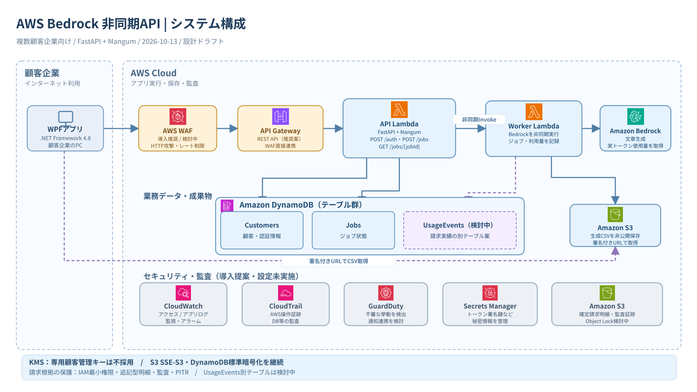

# awsMemo

WPF（.NET Framework 4.8）から AWS の Amazon Bedrock を利用してCSVを生成する非同期APIの設計メモです。

## 現在の設計方針（2026-10-13）

- API Gateway経由で **API Lambda 1つ（Python / FastAPI + Mangum）** を利用する。
- 公開エンドポイント: `POST /auth`、`POST /jobs`、`GET /jobs/{jobId}`。
- **Worker Lambda 1つ**がBedrockを非同期実行し、結果CSVをS3に保存する。
- DynamoDBで認証/ジョブを管理。Lambda実行ロールはAPI用とWorker用で分離する。
- 複数顧客企業向けに、**Bedrockのトークン使用量を保存し独自料金で請求**。請求根拠の完全性・監査・復旧を最優先する。
- WAF・CloudTrail・GuardDuty・CloudWatch・Secrets Managerの導入範囲を検討している。
- **KMSの専用カスタマー管理キーは現時点で不採用**。DynamoDB/S3の標準保存時暗号化を維持し、請求データにはIAM最小権限、冪等性・追記型明細、監査ログ、PITRなどを優先する。
- **WAF直接連携のためAPI Gateway REST APIへの変更を推奨**（まだ選定中）。
- ドキュメントは設計ドラフトです。AWS環境への構築・設定はまだ行っていません。

## AWS構成図

- [編集用 .drawio](docs/diagrams/aws-architecture.drawio) — diagrams.net（draw.io）で編集可能
- [閲覧用 SVG](docs/diagrams/aws-architecture.svg) — GitHub上でもブラウザで表示可能

**凡例:** API Lambda / Worker Lambda / Bedrockは採用方針。WAF・REST APIは推奨案、UsageEvents別テーブル化は検討中、専用KMS顧客管理キーは不採用（標準暗号化は継続）。

## 設計書

| ファイル | 内容 |
| --- | --- |
| [docs/architecture.md](docs/architecture.md) | 全体構成図、Lambda責務、FastAPI、IAMと設計判断 |
| [docs/api-spec.md](docs/api-spec.md) | APIエンドポイント、Request/Response、エラー |
| [docs/sequence.md](docs/sequence.md) | 認証〜非同期Bedrock実行〜CSV取得のフロー |
| [docs/security.md](docs/security.md) | WAF、CloudTrail、GuardDuty、KMS不採用判断、請求データの保護、監査・通知 |
| **[docs/billing-data-design-notes.md](docs/billing-data-design-notes.md)** | **DB設計前の検討メモ：UsageEvents分離、請求実績の権限制限、冪等性、監査・復旧** | 
| **[docs/adr/README.md](docs/adr/README.md)** | **採用・不採用・検討中の判断一覧、理由、代替案、経緯、見直し条件（ADR）** |

**注意:** 保守キー、署名秘密鍵、トークン、AWSアクセスキー、顧客の実データはGitHubにコミットしないこと。

## 変更の判断を記録する運用

構成やサービスを変更する際は[ADR一覧](docs/adr/README.md)で既存の判断を確認し、採用理由・比較した代替案・不採用理由・再検討条件を残す。**方針の決定とAWS環境への実装完了は区別**する。既存ADRが覆る場合は履歴を上書きせず、新しいADRで変更理由を記録する。
