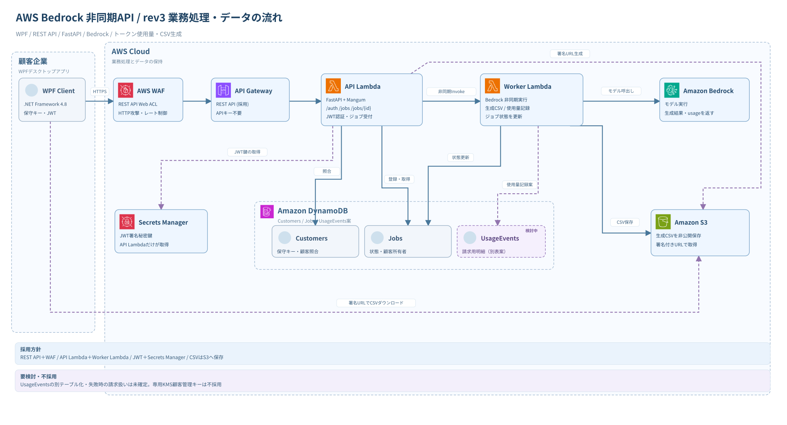
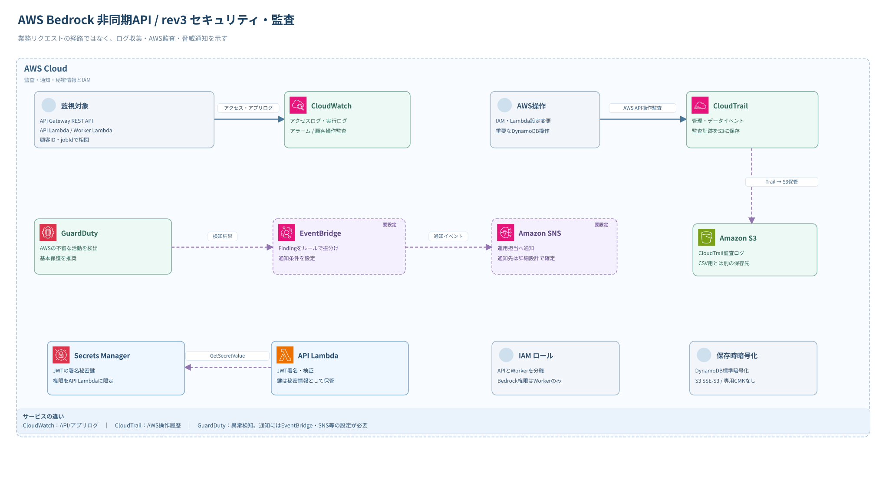

# awsMemo

WPF（.NET Framework 4.8）から AWS の Amazon Bedrock を利用してCSVを生成する非同期APIの設計メモです。

## 現在の設計方針（2026-10-13）

- API Gateway経由で **API Lambda 1つ（Python / FastAPI + Mangum）** を利用する。
- 公開エンドポイント: `POST /auth`、`POST /jobs`、`GET /jobs/{jobId}`。
- **Worker Lambda 1つ**がBedrockを非同期実行し、結果CSVをS3に保存する。
- DynamoDBで認証/ジョブを管理。Lambda実行ロールはAPI用とWorker用で分離する。
- 複数顧客企業向けに、**Bedrockのトークン使用量を保存し独自料金で請求**。請求根拠の完全性・監査・復旧を最優先する。
- **REST API＋AWS WAFを採用**し、既存の保守キー認証を維持する。API Gateway独自のAPIキーを顧客へ配布しない。自前JWTの秘密鍵管理に**Secrets Managerを採用**。CloudTrail・GuardDuty・CloudWatchの導入詳細は引き続き検討する。
- **KMSの専用カスタマー管理キーは現時点で不採用**。DynamoDB/S3の標準保存時暗号化を維持し、請求データにはIAM最小権限、冪等性・追記型明細、監査ログ、PITRなどを優先する。
- **API Gateway REST API＋WAFは採用決定済み**。
- ドキュメントは設計ドラフトです。AWS環境への構築・設定はまだ行っていません。

## AWS構成図（リビジョン別）

- **[rev3 最新：業務処理図（SVG）](docs/diagrams/aws-architecture-rev3-business.svg)** / **[セキュリティ・監査図（SVG）](docs/diagrams/aws-architecture-rev3-security.svg)** / [draw.io 2ページ編集](docs/diagrams/aws-architecture-rev3.drawio)
- [rev2 旧版（SVG）](docs/diagrams/aws-architecture-rev2.svg) / [draw.io](docs/diagrams/aws-architecture-rev2.drawio)
- [rev1 変更前の図（SVG）](docs/diagrams/aws-architecture-rev1.svg) / [draw.io](docs/diagrams/aws-architecture-rev1.drawio)
- [rev1〜rev3の比較・照合結果と補足](docs/diagrams/README.md)

**注:** rev3は`docs/architecture.md`と照合して更新した「推奨採用するサービスを含む構成案」でありAWS環境への設定完了を意味しません。専用KMS顧客管理キーは不採用、UsageEventsの物理別テーブル化は検討中です。

## デザインレビュー資料（草稿 v0.2）

- **[レビュー用Markdown](docs/reviews/aws-design-review-v0.2.md)** — 上司への説明に使う構成比較、採用／不採用理由、残存リスク、想定Q&A
- [レイアウト付きHTML](docs/reviews/aws-design-review-v0.2.html) — ダウンロードしてブラウザで閲覧する版

**レビュー前の未決定事項:** Bedrockでトークンを消費した後、CSV生成・S3保存・顧客への結果返却が失敗した場合、その消費分を顧客に請求するかは未決定。技術的な使用量の記録と請求可否の業務判断を分離して検討する。

## 設計書

| ファイル | 内容 |
| --- | --- |
| [docs/architecture.md](docs/architecture.md) | 全体構成図、Lambda責務、FastAPI、IAMと設計判断 |
| [docs/api-spec.md](docs/api-spec.md) | APIエンドポイント、Request/Response、エラー |
| [docs/sequence.md](docs/sequence.md) | 認証〜非同期Bedrock実行〜CSV取得のフロー |
| [docs/security.md](docs/security.md) | WAF、CloudTrail、GuardDuty、KMS不採用判断、請求データの保護、監査・通知 |
| **[docs/billing-data-design-notes.md](docs/billing-data-design-notes.md)** | **DB設計前の検討メモ：UsageEvents分離、請求実績の権限制限、冪等性、監査・復旧** | 
| **[docs/adr/README.md](docs/adr/README.md)** | **採用・不採用・検討中の判断一覧、理由、代替案、経緯、見直し条件（ADR）** |

**注意:** 保守キー、署名秘密鍵、トークン、AWSアクセスキー、顧客の実データはGitHubにコミットしないこと。

## 変更の判断を記録する運用

構成やサービスを変更する際は[ADR一覧](docs/adr/README.md)で既存の判断を確認し、採用理由・比較した代替案・不採用理由・再検討条件を残す。**方針の決定とAWS環境への実装完了は区別**する。既存ADRが覆る場合は履歴を上書きせず、新しいADRで変更理由を記録する。
