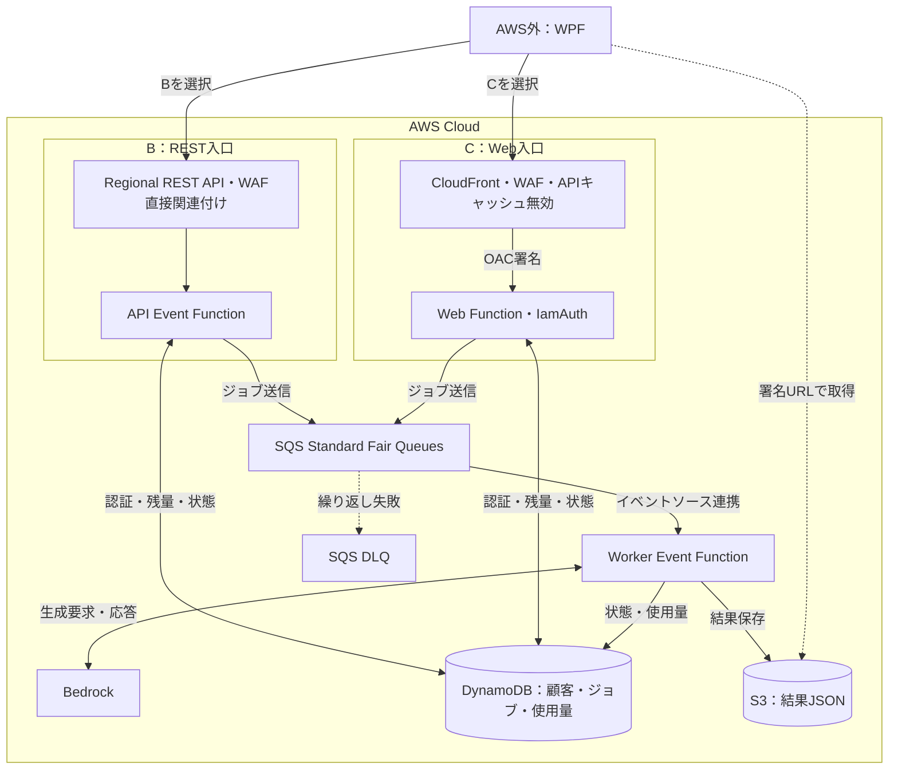
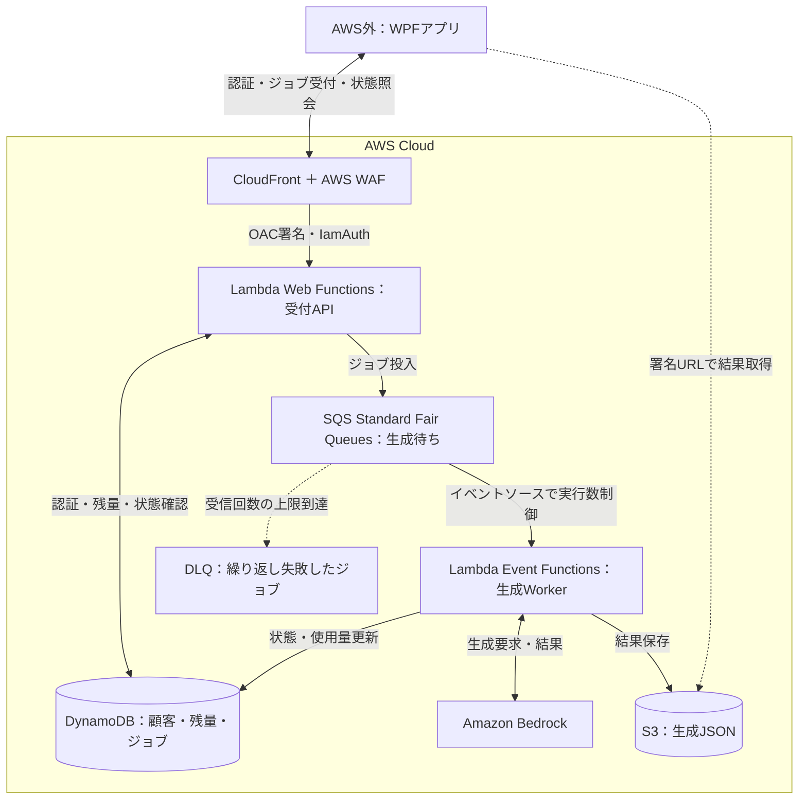
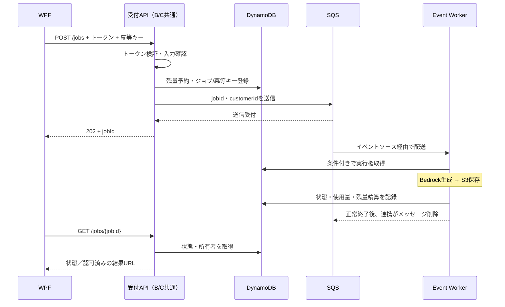

# ADR-0008: Lambda Web Functionsと通常Lambdaの比較

- **初回検討**：2026-10-15
- **再評価**：2026-10-19、2026-10-20、**2026-10-22（SQSを含む全体構成で再検討）**
- **ステータス**：Web Functionsは現時点で不採用。REST API + WAF + Event Functionsを第一候補として維持
- **SQS**：Standard Fair Queuesを導入推奨・検討中。今回の比較によって正式採用へ変更しない
- **範囲**：設計比較。AWS環境の変更・負荷試験は未実施

## 1. 結論と比較の前提

**今回の推奨は「REST API + WAF + API Event Function」を入口とし、SQS + Worker Event Functionの追加を検証する構成。** Web Functionsもサーバーレスであり、サーバーレスか否かは採否理由にならない。

入口は短時間の受付・照会を担い、長いBedrock処理はWorkerへ分離する。このため、入口だけWeb Functionsに替えても、**Workerの生成待ち時間の課金は減らない**。一方、受付API自身のDB待ちや多数のHTTP要求ではWeb Functionsの利点があり、実測対象にする。

| 前提 | 今回の扱い |
| --- | --- |
| 利用形態 | 約100社のWPFから手動でジョブ投入。月1万・10万・20万件を想定 |
| API | `POST /auth`、`POST /jobs`、`GET /jobs/{jobId}`。受付後は202とjobIdを返す |
| 生成・結果 | WorkerがBedrockを呼び、最大約1MBのJSONをS3へ保存。WPFは署名URLで取得 |
| データ | DynamoDBで顧客・ジョブ・クレジット/使用量を管理 |
| 保護 | WAF必須。トークン検証・顧客別認可・二重請求防止はアプリの責任 |
| 技術選定 | **既存Python/FastAPI資産の移植費用を採否理由にしない**。対応言語の制約は明記 |
| 用語 | 本文のRESTは**API Gateway Regional REST API**。Web FunctionsでもREST形式のAPIは作れる |
| 通常Lambda | Lambda Event Functionsの通常のオンデマンド実行を指す。Managed Instancesは比較外 |

## 2. 「入口」と「ジョブの渡し方」は独立して選ぶ

| 構成 | API入口 | Workerへの渡し方 | 評価 |
| --- | --- | --- | --- |
| A：現行設計 | REST API + WAF + Event | Lambda非同期Invoke | 部品が少ない。内部キュー・再試行はあるが、顧客間公平性の機能はない |
| **B：推奨する検証案** | **REST API + WAF + Event** | **SQS Fair Queues → Event Worker** | WAFを直接適用しつつ、滞留・再処理・顧客間の待機偏りを管理 |
| C：Webを使う対抗案 | CloudFront + WAF + Web | SQS Fair Queues → Event Worker | 非同期の信頼性をBと揃え、入口の性能・費用・運用負荷を比較できる |
| D：簡素なWeb案 | CloudFront + WAF + Web | Lambda非同期Invoke | 実装可能。SQSの必要性はAと同じ基準で別途判断 |
| E：同期生成への変更 | CloudFront + WAF + Web | Web内でBedrockを呼び、HTTP応答 | CPU待機課金・ストリーミングに利点。ただし現行のジョブ方式とは要件が変わる |

**B対Cを主比較、A対BをSQS追加の判断とする。** 「Web採用＝SQS不要」「SQS採用＝APIもEvent必須」ではない。SQSの標準イベントソース連携で実行するWorkerはEvent Functionsとする。[1][3]

### BとCの構成比較

B/Cはいずれか一方を選ぶ。受付APIはジョブ所有者の認可後に署名URLを返す。Secrets Manager・監査系は両案共通のため図から省略。

### Web Functionsを採用する場合の構成案（2026-10-22追記）

**Web Functionsも今回の要件を満たせる有力な選択肢。Node.jsでの開発とCloudFrontの追加設定を受け入れられるなら、新技術の学習価値や開発体験を理由に試す判断も合理的である。** RESTを第一候補とするのは主にWAF直接連携による運用の単純さからであり、Webに重大な不適合があるためではない。既存Python/FastAPI資産の有無・移植費用は、この判断の理由に含めない。

費用・性能が同程度かは未実測。まずWeb案を試作し、必要な保護・復旧・費用条件を満たすことを確認する。以下はSQSを含む検証候補であり、Web/SQSの正式採用を決定した図ではない。

| 部分 | 役割・設定 |
| --- | --- |
| CloudFront + WAF | 公開入口。認証・状態APIはキャッシュ無効。OACと対象配信限定の許可でオリジンを保護 |
| Web Functions | Node.jsで `/auth`・`/jobs`・`/jobs/{jobId}` を実装。トークン・所有者を検証し、ジョブ受付後に `202 + jobId` を返す |
| SQS | 待機ジョブを保持。`MessageGroupId=customerId` で企業間の待機偏りを緩和 |
| Event Worker | Bedrock生成、S3保存、使用量・状態更新。Web受付とは独立して実行数を制限 |
| DynamoDB・S3 | 状態・残量・成果物を永続化。認可後にWeb受付が結果の署名URLを返す |

**受付はWeb、生成はEventという併用構成**とする。[1][3] 鍵管理・ログ・監査系は省略。OACの認証とアプリのトークン認証は別で、ヘッダー転送等は次節の設定に従う。[2] SQS投入失敗・重複配送・残量整合性への対応は第4節を適用する。

## 3. API入口の比較：REST + Event 対 CloudFront + Web

| 観点 | REST API + Event | CloudFront + Web | 今回への影響 |
| --- | --- | --- | --- |
| サーバーレス | AWSが管理・自動スケール | 同左。アイドル時はゼロへ縮退 | 優劣の理由にしない |
| 実行方式 | イベントをhandlerで処理。通常1環境1要求 | HTTPサーバー。1環境で複数要求 | **Eventも複数環境で並列処理可能** |
| 言語 | Python・Node.js・.NETなど | 現時点はNode.js | WebはExpress/Hono等。FastAPIをそのまま載せる案ではない |
| WAF | RESTステージに直接関連付け | CloudFrontに関連付け | RESTはCloudFront設定を持たずに済む |
| 入口の保護 | ステージをWAFで保護 | OAC + IamAuth + 対象配信に限定したポリシー | Webも公式のオリジン保護を利用できる |
| トークン・顧客認可 | 現行案ではAPIアプリで実装 | 同じくAPIアプリで実装 | **Webだけに認証実装が増えるわけではない** |
| API管理 | ステージ・スロットリング等 | endpoint/revision・レート上限等 | 現行ではAPI Gateway APIキー・使用量プランは未使用 |
| 課金 | 要求数 + 割当メモリ×実行時間 | 要求数 + CPU実働 + 環境存続中のメモリ等 | WebのI/O待ちはCPU負担が小さいがメモリは課金 |
| ストリーミング | 統合方式・設定を確認して利用 | HTTPで自然に実装できる | 今回はJSON完成後に取得するため優先度は低い |
| 運用 | Gateway・Lambdaのログ/設定 | CloudFront・Webのログ、OAC、転送/キャッシュ設定 | Webは追加設定の保守を含めて評価 |
| SQS・Worker | 利用可能 | 同じSQS・Event Workerを利用可能 | 入口の置換で後段は高速化しない |

AWS仕様：[1][2][7]。上表の「今回への影響」は本システムへの設計判断。

Web案ではAPIのキャッシュTTLを0とし、JWT等を使う場合は公式手順どおり`Authorization`をキャッシュポリシーに含める。viewerの`Host`は転送しない。OACの署名とアプリ認証は別であり、CloudFront経由の正常要求・署名なし直アクセス拒否・他社jobId拒否を検証する。[2]

## 4. SQSを追加する価値と負担

SQSは**APIを受け付ける能力**ではなく、**受け付けたジョブを実行する順番・負荷・失敗後の運用**を改善する。WebのHTTP多重処理では代替できない。

| 観点 | Lambda直接非同期Invoke | SQS Standard Fair Queues |
| --- | --- | --- |
| 待機場所 | Lambdaが管理する内部非同期キュー | 明示的なSQSキュー |
| 並列実行 | Workerの同時実行枠で制御可能 | イベントソースの最大同時実行数で制御可能 |
| エラー再試行 | 関数エラーは既定で追加2回。スロットリング等は別の再試行規則 | 可視性タイムアウト後に再配信。受信回数に基づきDLQへ |
| 失敗の回収 | OnFailure Destination / DLQを設定 | SQSのDLQと再投入手順を設定 |
| 顧客間の偏り | アプリで別途設計 | `MessageGroupId=customerId`で大量投入企業の影響を緩和 |
| 監視・復旧 | 非同期イベントの経過時間・失敗・破棄を監視 | キュー滞留時間・件数・DLQを監視し再処理 |
| 重複実行 | 起こり得る | 起こり得る。Standardは順序も保証しない |
| 費用・設定 | 追加キューがなく少ない | SQS要求料金、Fair Queues追加料金、DLQ・監視・設定が増える |
| 選ぶ条件 | 集中が小さく、内部キューと失敗回収で要件を満たす | 顧客間の待ち時間・滞留・再処理を管理したい |

直接Invokeにもキューと再試行は存在するので、「SQSなしでは非同期・再試行ができない」は誤り。SQSイベントソースはWorkerを同期呼出しするが、**WPFから見たジョブ全体は非同期**である。[3][4]

Fair Queuesは企業別の専用枠、厳密な均等配分、順序保証、利用上限を提供しない。厳密な企業別上限はアプリで実装する。[5]

### SQS案の処理順とDBアクセス

通常成功経路の図。DB更新とSQS送信は原子的ではないため、次表の回復設計が必要。JWTの署名検証はローカルで完結し得るが、残量確認・ジョブ状態照会のDBアクセスはB/Cとも残る。不透明トークンなら、その検証用参照も別途必要。

| 失敗・制御の論点 | B/C共通で決めること |
| --- | --- |
| DB登録だけ成功・送信失敗 | Outbox + 配信処理、または未送信ジョブの再送・照合。受付応答を失った場合も同じ冪等キーで同じjobIdへ収束 |
| 二重配送・Worker途中停止 | 条件付きの実行権取得、期限付きリースと回収。RUNNINGのまま永久停止しない |
| 二重生成・二重請求 | 使用量イベントを一意に記録。Bedrock成功直後の停止等では推論料金の重複を完全排除できないことも扱う |
| 残量の同時消費 | 単なる読取り後の減算にせず、条件付き更新/トランザクションで予約・精算・失敗解放 |
| Bedrockクォータ | 最大同時実行数に加え、モデル別RPM/TPMと再試行バックオフを設計。**並列数だけではRPM/TPMを保証しない** |
| タイムアウト | 初期検証はバッチ1。可視性タイムアウトはAWS推奨のWorker設定タイムアウト×6以上を基準に、バッチ窓も考慮 |
| 最終失敗・再投入 | DLQアラーム、Jobsの最終状態更新、残量解放、再投入時の冪等性を揃える。DLQ移動だけではJobsは更新されない |

通常Event Workerの実行上限は15分。SQSは待機時間をHTTPから切り離すが、Workerの実行上限は延長しない。API Gateway等のHTTPタイムアウトとWorkerのタイムアウトは別に扱う。[6][8][9]

## 5. 費用・性能は「入口」と「生成」を分けて見る

| 費用・負荷 | B：REST + SQS | C：Web + SQS |
| --- | --- | --- |
| 受付・ポーリング | REST要求料金 + API Event実行料金 | CloudFront要求/転送 + Web要求/CPU/メモリ等 |
| 保護・監視 | Regional WAF、Gateway/Lambdaログ等 | CloudFront WAF、CloudFront/Webログ等 |
| キュー | SQS送信・受信・削除・空受信・再試行、Fair Queues追加分 | 同じ条件なら共通 |
| 生成 | Event Worker実行料金 + Bedrock | **同じEvent Workerなので共通** |
| 保存・照会 | DynamoDB・S3・Secrets等 | 同じ処理・保存方式なら共通 |

**120秒の生成待ちを、受付Web FunctionのCPU節約として計上しない。** SQS待機中はWorkerは実行されていないが、Worker起動後のBedrock応答待ちはEventの実行時間に含まれる。

既存の比較例（月10万ジョブ、生成120秒、10秒ポーリング、1ジョブ1認証という保守的仮定）は月140万API要求、営業時間160時間なら平均約2.43 RPS。JWT再利用で認証回数は減る一方、**SQS滞留が増えるとポーリング回数は増える**。5倍ピーク約12.15 RPSは仮定であり、実測ではない。

| 評価したい状況 | 判断の方向 |
| --- | --- |
| 短いAPI・小さい負荷・WAF必須 | RESTの運用単純さを優先 |
| 受付API自体のI/O待ち・並列要求が多い | WebのCPU/メモリ・p95を測定する価値が高い |
| Bedrock生成待ちが長いだけ | API入口の変更理由には弱い。Workerと生成方式を別途評価 |
| ポーリングの要求数が多い | 間隔・バックオフ・ジッターも比較。Webへ替えるだけではDB参照回数は減らない |
| SQSを加えるか迷う | 月額だけでなく、顧客別待機時間・復旧作業・許容滞留を評価 |

[10/20の料金資料](../比較検討/2026-10-20_REST-APIとWeb-Functions採用比較.md)のドル金額は未検証の仮定値として履歴を残す。今回、最新請求額として再利用せず、単価・無料枠・CloudFrontプラン・Fair Queues料金と実測値を揃えて再見積もりする。[10]

## 6. 同期Web案を選び直す場合

Web内でBedrockの応答を待つ案EならCPU待機課金の利点が直接効く。ただし、次の条件を別途満たす必要があり、B/Cの入口置換とは分けて評価する。

| 論点 | 非同期ジョブ案B/C | 同期Web案E |
| --- | --- | --- |
| クライアント切断 | jobIdで後から状態・結果を取得 | 完了したか不明になり得る。保存・照合・再送の設計が必要 |
| 突発的な大量要求 | SQSへ保持しWorker流量を制御 | HTTP受付制限・再試行、必要なら別途キュー |
| 表示 | 完成後にJSON取得 | 途中生成の逐次表示に向く |
| 実行の保証 | キュー・永続状態で復旧を設計 | 応答後のプロセス内バックグラウンド処理だけには依存しない |
| 採否 | 今回の前提に適合 | 逐次表示が必要になった時にADR-0002も再検討 |

SQSとWorkerを省ける可能性はあるが、保存・認可・残量整合性まで不要になるわけではない。

## 7. 採否と次の確認

| 判断 | 今回の結果 | 見直す条件 |
| --- | --- | --- |
| API入口 | **REST + WAF + Eventを維持** | Webで同じ保護・機能と許容費用・性能を満たし、開発体験・学習価値も含め追加運用を受け入れられる |
| SQS | **Standard Fair Queuesを導入推奨、正式決定は保留** | 集中負荷での顧客別待ち時間、DLQ回復、費用を確認してADR-0009で決定 |
| API/Worker分離 | 維持 | ストリーミング等で製品要件が変わる |
| 言語・既存資産 | 移植費用を理由にWebを除外しない | Python必須ならWebの現行対応言語が制約になる |

PoCではB/Cに同一の認証・データ・SQS/Worker設定を使い、通常負荷と100社同時投入を比較する。採否に必要な測定は次の4点に絞る。

1. **保護**：CloudFront迂回拒否、トークン転送、他社jobId拒否、認証/状態APIの非キャッシュ。
2. **体感**：受付・照会p95、コールドスタート、ジョブ完了時間、顧客別キュー待機時間。
3. **復旧**：送信失敗、重複配送、Worker停止、Bedrock制限、DLQ再投入で状態と残量が整合すること。
4. **総費用**：入口・キュー・Worker・保存・ログを分け、生成時間を受付へ二重計上しないこと。

「複雑な処理が少ないからEvent」「Webは常時サーバーだから不採用」ではなく、**短時間API + WAF直接連携の運用上の利点と、独立した非同期ジョブ管理への適合性**を採用理由とする。

## 関連ADR・検討履歴

- [ADR-0002：API受付とWorker分離](0002_API処理とWorker分離.md)
- [ADR-0005：REST APIとWAF採用](0005_REST-APIとWAF採用.md)
- [ADR-0009：SQS Fair Queues導入検討](0009_SQS公平キュー導入検討.md)
- [2026-10-19：非同期Bedrock基盤とAPI方式](../比較検討/2026-10-19_非同期Bedrock基盤とAPI方式の比較.md)
- [2026-10-20：REST APIとWeb Functions・料金仮定](../比較検討/2026-10-20_REST-APIとWeb-Functions採用比較.md)

## AWS公式資料

仕様確認日：2026-10-22。サービス仕様と、本ADRの推奨・未検証仮定を分けて記載した。

1. [Lambda Web Functions：実行方式・課金構造・対応言語](https://docs.aws.amazon.com/lambda/latest/dg/web-functions.html)
2. [CloudFront OACによるWeb Functionオリジン保護](https://docs.aws.amazon.com/AmazonCloudFront/latest/DeveloperGuide/private-content-restricting-access-to-lambda-web.html)
3. [LambdaとSQS：配送・削除・重複処理](https://docs.aws.amazon.com/lambda/latest/dg/with-sqs.html)
4. [Lambda非同期Invokeのエラーと再試行](https://docs.aws.amazon.com/lambda/latest/dg/invocation-async-error-handling.html)
5. [SQS Fair Queues](https://docs.aws.amazon.com/AWSSimpleQueueService/latest/SQSDeveloperGuide/sqs-fair-queues.html)
6. [SQSイベントソース設定・可視性タイムアウト](https://docs.aws.amazon.com/lambda/latest/dg/services-sqs-configure.html)
7. [REST APIステージへのWAF適用](https://docs.aws.amazon.com/apigateway/latest/developerguide/apigateway-control-access-aws-waf.html)
8. [SQSイベントソースのスケーリング](https://docs.aws.amazon.com/lambda/latest/dg/services-sqs-scaling.html)
9. [Event Functionのタイムアウト](https://docs.aws.amazon.com/lambda/latest/dg/configuration-timeout.html)
10. [SQS料金](https://aws.amazon.com/sqs/pricing/) / [Lambda料金](https://aws.amazon.com/lambda/pricing/)
