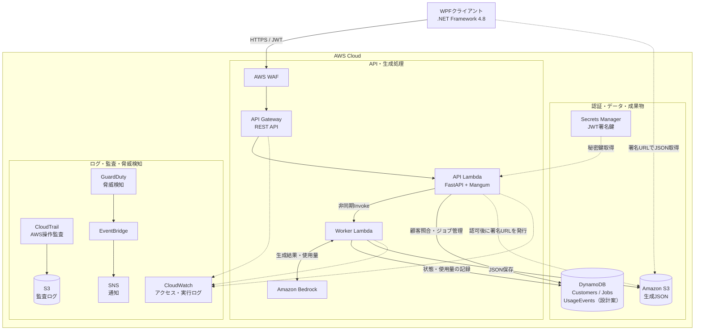

# AWS構成設計

## 全体構成図

実線は処理経路、破線は補助的な関係を表す。WAFはREST APIに関連付けるWeb ACL。監査用S3と生成JSON用S3は用途を分離する。UsageEventsの物理テーブル構成は未決定。

[業務処理図](diagrams/aws-architecture-rev4-business.svg) / [セキュリティ・監査図](diagrams/aws-architecture-rev4-security.svg) / [draw.io（2ページ）](diagrams/aws-architecture-rev4.drawio)

## コンポーネントと処理

| コンポーネント | 役割 |
| --- | --- |
| WPF | 保守キー認証、ジョブ投入、状態ポーリング、JSON取得 |
| API Gateway REST API + WAF | 公開HTTPS入口。API Gateway APIキーは使用しない |
| API Lambda | `POST /auth`、`POST /jobs`、`GET /jobs/{jobId}` |
| Worker Lambda | Bedrockの非同期実行、ジョブ状態・使用量記録、JSONのS3保存 |
| DynamoDB | `Customers`、`Jobs`、使用量イベントの記録先（物理設計は未決定） |
| S3 | 生成JSONを非公開保存。WPFは短命な署名付きURLで直接取得 |

- `POST /auth`：既存保守キーと顧客名を照合し、JWTを発行。署名鍵はSecrets Managerで管理。**WPFはJWTをメモリに保持して有効期限内は再利用し、未取得・期限切れ時に再認証する。**
- `POST /jobs`：`QUEUED`登録後、Workerを非同期起動して`202 + jobId`を返す。
- `GET /jobs/{jobId}`：JWT・ジョブ所有者を確認し、`QUEUED / RUNNING / SUCCEEDED / FAILED`と結果URLを返す。**API Lambdaは認証済みJWTも各リクエストで検証する。**
- 生成物はJSON（最大約1MBを想定、`application/json`）。使用量はBedrockの応答等からサーバー側で記録する。

処理の詳細は[シーケンス](sequence.md)、入出力は[API仕様](api-spec.md)、IAM・監査設定は[セキュリティ設計](security.md)、請求実績は[請求データ設計](billing-data-design-notes.md)に記載する。
