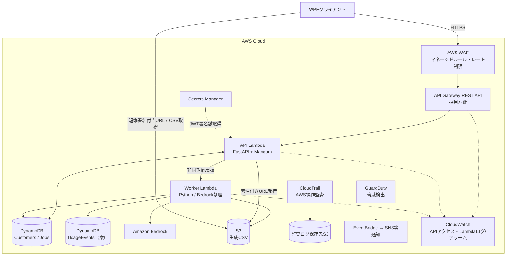

# Bedrock 非同期API 構成設計（FastAPI採用版）

> ステータス: 設計ドラフト / 2026-10-13。FastAPI採用とLambda 2関数構成は確定方針。API Gateway REST API＋AWS WAFの採用は設計確定。**専用のKMSカスタマー管理キーは不採用（標準暗号化は継続）**。設計判断の理由と経緯は [ADR](adr/README.md) に記録する。

## 構成概要

WPF（.NET Framework 4.8）から HTTPS で API Gateway を通じて、**FastAPI + Mangum を載せた API Lambda** を呼び出す。1つの API Lambda が `POST /auth`、`POST /jobs`、`GET /jobs/{jobId}` を処理する。**Worker Lambda** が非同期で Amazon Bedrock を呼び、CSVをS3に保存する。

### セキュリティ追加後の構成（REST API + WAF採用）

**最新の編集可能な構成図（rev3）**
- [draw.io構成図（業務処理・セキュリティ監査の2ページ）](diagrams/aws-architecture-rev3.drawio)
- [業務処理・データフロー（SVG）](diagrams/aws-architecture-rev3-business.svg)
- [セキュリティ・監査（SVG）](diagrams/aws-architecture-rev3-security.svg)

図では見やすさのためDynamoDBアイコンを1つとし、その内部にCustomers / Jobs / UsageEvents（案）を並べている。**UsageEventsの別テーブル採用はまだ確定していない。** 監査・ログ・通知の線は独立ページに分離した。



**注:** CloudTrail / GuardDuty の破線等は監査・保護の論理関係であり、リクエストの通信経路ではない。GuardDutyは検知サービスで、自動ブロックには別の対処設定が必要。S3のURLは認可確認後だけ発行する。

## API Gatewayの選定（採用決定）

| 案 | ネットワーク構成 | WAF | 備考 |
| --- | --- | --- | --- |
| **A: 採用** | WPF → API Gateway **REST API** → API Lambda | REST APIステージに直接紐づけ可能 | **採用確定**。シンプルだがHTTP APIより一般に高コスト |
| B | WPF → CloudFront + WAF → API Gateway **HTTP API** → API Lambda | CloudFrontに紐づける | API Gatewayへの直接迂回を防ぐ構成が別途必要 |

AWS公式比較: https://docs.aws.amazon.com/apigateway/latest/developerguide/http-api-vs-rest.html

REST APIはAPI Gateway APIキーを要求しない（`apiKeyRequired=false`）。`POST /auth` は既存保守キーと顧客名をDynamoDBで照合し、JWTを発行。後続エンドポイントではFastAPIがJWTを検証する。認証用のAPI Gateway追加キーを配布しない。

REST APIでは Lambda プロキシ統合で `ANY /{proxy+}` を API Lambda に接続（必要に応じてルート `/` も設定）。Mangum が API Gateway のイベントを FastAPI の ASGI 呼び出しへ変換する。API GatewayとFastAPIで重複するパス検証やCORS設定に注意する。

## Lambdaごとの責務

| Lambda | 役割 | エンドポイント |
| --- | --- | --- |
| API Lambda | 顧客/保守キー照合、アクセストークン発行・検証、顧客ごとのジョブ認可、ジョブ登録・状態照会、CSV署名付きURL作成 | `POST /auth`, `POST /jobs`, `GET /jobs/{jobId}` |
| Worker Lambda | ジョブ開始/完了/失敗の状態更新、Bedrock実行、CSV生成・S3保存 | 公開HTTPエンドポイントなし |

### FastAPIでのルーティング例（説明用・未実装）

```python
from fastapi import FastAPI
from mangum import Mangum

app = FastAPI(docs_url=None, redoc_url=None, openapi_url=None)  # 本番公開時の例

@app.post("/auth")
def authenticate():
    # 実装時: 入力検証・保守キー照合・短命トークン発行
    return {"detail": "実装予定"}

@app.post("/jobs", status_code=202)
def create_job():
    # 実装時: Bearer検証、Jobs保存、Worker非同期起動
    return {"detail": "実装予定"}

@app.get("/jobs/{job_id}")
def get_job(job_id: str):
    # 実装時: Bearer検証・所有者照合・状態取得
    return {"jobId": job_id, "status": "QUEUED"}

handler = Mangum(app)
```

**注意:** このサンプルには認証・認可が実装されていない。実際にはPydanticでRequestモデルを定義し、Depends等で認証、例外を共通形式で返す。FastAPI自体がBearerトークンの真正性を自動検証するわけではない。

### デプロイ

- API Lambdaは `fastapi`、`mangum`、依存の `starlette`・`pydantic` などを含むZIPまたはコンテナイメージでデプロイする。
- Lambda向けLinux/CPUアーキテクチャに合うバイナリ依存をビルドする。AWS SAM + Docker等で再現可能に構築し、依存バージョンを固定する。
- Worker LambdaはAPI用FastAPI/Mangumを必要としない。
- Lambdaハンドラーは上例なら `app.handler`（ファイル名が `app.py` の場合）。

参考: https://github.com/Kludex/mangum / https://docs.aws.amazon.com/lambda/latest/dg/python-package.html

## IAM実行ロール（最小権限）

各Lambdaの実行ロールは別々。許可対象は実ARNと必要プレフィックスのみに限定する。

| ロール | 操作例 | 用途 |
| --- | --- | --- |
| ApiLambdaExecutionRole | `dynamodb:GetItem`（必要なら`Query`） | Customers / Jobs参照 |
| ApiLambdaExecutionRole | `dynamodb:PutItem` | Jobs保存 |
| ApiLambdaExecutionRole | `lambda:InvokeFunction` | Worker Lambdaを非同期起動 |
| ApiLambdaExecutionRole | `s3:GetObject` | 結果ダウンロードURLの署名に利用 |
| ApiLambdaExecutionRole | `secretsmanager:GetSecretValue` | JWT署名秘密鍵の取得（採用） |
| WorkerLambdaExecutionRole | `bedrock:InvokeModel` | 許可したモデル/推論プロファイルだけ |
| WorkerLambdaExecutionRole | `dynamodb:UpdateItem` | Jobsの状態更新 |
| WorkerLambdaExecutionRole（請求設計案） | `dynamodb:PutItem` | UsageEventsへの条件付き新規追記（既存レコードは上書きさせない） |
| WorkerLambdaExecutionRole | `s3:PutObject` | 結果CSV書き込み |
| 両実行ロール | CloudWatch Logs書き込み | 実行ログ |

**専用KMSカスタマー管理キーは不採用。** DynamoDBの既定暗号化とS3 SSE-S3を継続する。課金実績の改ざん防止はIAM制限・条件付き追記・監査と復旧で対処する（[ADR-0004](adr/0004-no-customer-kms.md)）。API Lambdaに `bedrock:InvokeModel` は付けない。

デプロイ担当者のスイッチロール・管理ロールと、Lambdaが実行時にAssumeRoleする実行ロールは別。

## データと非同期処理

- Customers: 顧客ID/名前/保守キーの検証材料/有効フラグ。保守キーの平文保管は禁止。
- Jobs: jobId, customerId, status, createdAt, updatedAt, resultS3Key, errorCode, expiresAt。
- **請求の最重要データ**: Bedrock実トークン使用量（顧客・ジョブ・モデル・入出力別）をサーバー側で保持し、独自料金を計算する。追記型の UsageEvents テーブルを提案。物理設計は未確定 ([ADR-0003](adr/0003-storage-billing.md))。
- 請求の完全性: 二重実行/二重請求防止、変更権限の制限、監査、DynamoDB PITR、請求明細の証拠保全を検討。
- `QUEUED → RUNNING → SUCCEEDED`、異常時 `FAILED`。
- API LambdaはトークンからcustomerIdを決定し、全ジョブ照会で所有者を確認。
- 非同期Invokeは重複・再試行・失敗し得る。条件付き更新による冪等性、滞留監視、失敗通知を追加。本番の耐障害性要求によってSQS導入を検討。
- S3はパブリックアクセス遮断。成功時のみ短命の署名付きURLを返す。

## 横断セキュリティと監査

監査対象ごとにログを分ける。**CloudTrailだけではWPFユーザーのAPI操作履歴は完結しない**。

- **CloudTrail**: AWS管理イベントを証跡として継続保存。S3 GetObject等とLambda Invokeのデータイベントは必要範囲で選択。
- **API Gatewayアクセスログ/CloudWatch**: URI/ステータス/リクエストID等。機密値は記録しない。
- **アプリ監査ログ**: 顧客ID、jobId、actor（認証主体）、処理種別、結果、時刻、相関ID。保守キー・入力全文・トークンは記録しない。
- **WAF**: マネージドルール、`/auth` レートベースルール。Countで検証後にBlock。ログの秘匿化と保管期間を定義。
- **GuardDuty**: 基本保護を有効化し、必要に応じLambda ProtectionとS3 Protectionを追加。EventBridge→SNS等で通知。
- **KMS**: **専用の顧客管理キーは現時点で不採用**。S3 SSE-S3とDynamoDBの既定の保存時暗号化は継続。重要な請求データの正確性保護にはIAM・条件付き追記・監査・PITRを優先 ([ADR-0004](adr/0004-no-customer-kms.md))。
- **Secrets Manager**: JWT等の署名用秘密情報を管理。キーの取得回数・キャッシュ・ローテーションを設計。

詳細は [セキュリティ・監査設計](security.md) を参照。

## 設計上の未決事項

1. **REST API＋WAFは採用決定済み**。WAFルールや閾値、スロットリングの具体値を決める。
2. 保守キーの形・顧客照合方法・署名済みアクセストークンと失効仕様。
3. Bedrockのモデル・出力CSVの仕様・課金/クォータ。
4. ジョブ/成果物保持期間、監査ログ保存期間、求める監査証跡の粒度。
5. **専用KMS顧客管理キーは採用しないと決定済み**。顧客契約や監査要件が変わった場合のみ再評価 ([ADR-0004](adr/0004-no-customer-kms.md))。
6. WAFの閾値、正規顧客のアクセス傾向、GuardDutyの通知先。
7. 非同期実行の再試行・障害送信先・滞留監視。

関連: [API仕様](api-spec.md) / [シーケンス](sequence.md) / [セキュリティ・監査](security.md) / [設計判断記録（ADR）](adr/README.md)
