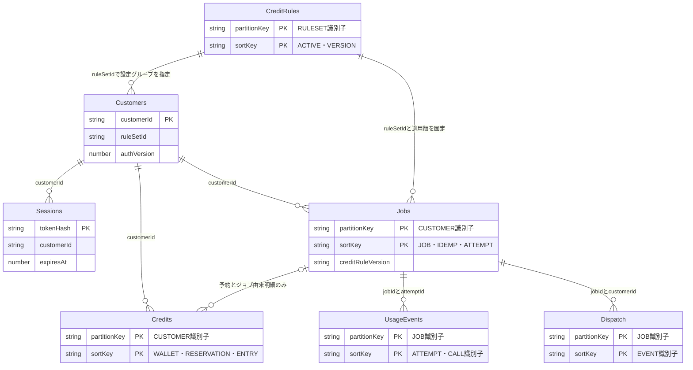
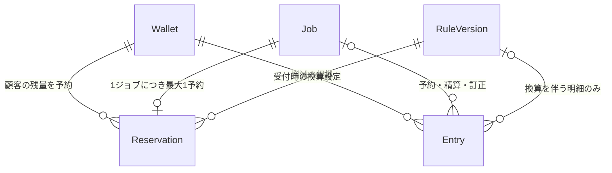

# AWS非同期JSON生成：DB設計案

更新：2026-10-28｜レビュー用。AWS未作成。

## 1. 前提・構成

API Gateway＋WAF＋Lambda Event Function、不透明トークン、別Worker、DynamoDB、S3を前提とする。クレジットはトークン量から独自計算し、換算係数はDBで変更可能とする。

| 物理テーブル | 役割 |
| --- | --- |
| Customers | 顧客・保守認証・利用停止 |
| Sessions | 不透明トークン・有効期限・失効 |
| Jobs | ジョブ・再送防止・実行試行 |
| Dispatch | Outbox配送・再配送（Outbox採用時） |
| UsageEvents | Bedrock呼出しごとの実使用量 |
| Credits | 顧客残量・ジョブ別予約・増減台帳 |
| CreditRules | 換算係数・丸め・適用版 |

**7テーブル案。SQS／Outbox、入力S3保存、クレジットの予約精算は提案段階。** 物理名は`ai-{env}-{table}`、環境ごとに分離する。

## 2. ER：テーブル間の関係

線はIDによる論理参照。DynamoDBの外部キー制約やJOINを意味せず、整合性はLambdaの条件付き更新・トランザクションで守る。件数は作成時の業務関係で、保存期限後の履歴保持は別途管理する。

CreditRules→Customersは設定グループ、CreditRules→Jobsは不変の設定版への参照。Creditsには残量・予約・明細が混在するため、ジョブとの関係は次のレコード単位で読む。

### クレジットのレコード間関係

Wallet・Reservation・Entryは**すべてCredits内の別レコード**。RuleVersionはCreditRules内の設定版。

付与・購入などのEntryにはjobIdがない場合がある。予約・精算はjobId単位で一度だけ行い、訂正は追記する。

## 3. キー・主要属性

PK＝パーティションキー、SK＝ソートキー。S＝文字列、N＝数値、M＝Map。クレジットは最小単位の整数、時刻はUTCミリ秒、TTLの`ttlAt`だけUTC秒。管理レコードには`schemaVersion / createdAt / updatedAt`、競合箇所には`version`を持つ。

| テーブル／レコード | PK | SK | 主要属性 |
| --- | --- | --- | --- |
| Customers／顧客 | `customerId` | なし | customerName、normalizedName、status、authVersion、credentialId、credentialVerifier、ruleSetId、creditUnit、maxPendingJobs、version |
| Sessions／認証 | `tokenHash` | なし | customerId、authVersion、issuedAt、expiresAt、revokedAt、ttlAt |
| Jobs／本体 | `CUSTOMER#{customerId}` | `JOB#{jobId}` | status、internalState、inputRef、requestHash、modelId、promptVersion、outputSchemaVersion、currentAttemptId、attemptCount、leaseUntil、nextActionAt、resultRef、resultHash、resultBytes、errorCode、acceptedAt、startedAt、completedAt、retentionUntil、ttlAt、version |
| Jobs／再送防止 | 同上 | `IDEMP#{hash(key)}` | jobId、requestHash、acceptedAt、replayUntil、ttlAt |
| Jobs／実行試行 | 同上 | `ATTEMPT#{jobId}#{attemptId}` | state、startedAt、finishedAt、leaseUntil、bedrockRequestId、resultRef、usageEventKeys、errorCode |
| Dispatch／配送 | `JOB#{jobId}` | `EVENT#{eventId}` | customerId、eventType、status、dispatchAttemptId、leaseUntil、nextActionAt、sendAttempts、sentAt、messageId |
| UsageEvents／呼出し | `JOB#{jobId}` | `ATTEMPT#{attemptId}#CALL#{callId}` | customerId、modelId、region、bedrockRequestId、inputTokens、outputTokens、cacheReadTokens、cacheWriteTokens、usageStatus、estimatedCostMinor、currency、awsPriceVersion、observedAt |
| Credits／残量 | `CUSTOMER#{customerId}` | `WALLET` | available、reserved、pendingJobs、unit、version |
| Credits／予約 | 同上 | `RESERVATION#{jobId}` | reservedAmount、settledAmount、state、ruleSetId、creditRuleVersion、engineVersion、configHash |
| Credits／増減明細 | 同上 | `ENTRY#{operationId}` | kind、jobId（任意）、availableDelta、reservedDelta、consumedCredits、recordedAt、actor、reason、originalEntryId |
| CreditRules／有効版 | `RULESET#{ruleSetId}` | `ACTIVE` | creditRuleVersion、configHash、version、updatedAt |
| CreditRules／設定版 | 同上 | `VERSION#{creditRuleVersion}` | engineVersion、configSchemaVersion、parameters、roundingMode、roundingStage、creditUnit、minimumCharge、configHash、createdBy、changeReason |

- Jobs本体には`ruleSetId / creditRuleVersion / engineVersion / configHash / configSnapshot`も保存する。精算明細には同じ版情報、課金したトークン内訳`chargeBasis`、使用量参照`usageEventKeys`を残す。
- `callId`はBedrock呼出し前に発行し、Jobsの試行レコードから追跡可能にする。未記録の呼出しは0消費とみなさずUNKNOWNとして照合する。
- tokenは平文保存せずSHA-256で保持する。保守キーの検証方式は既存仕様に合わせて別決定する。
- 入力・結果本文はS3、DBには不変キーまたはversionId・ハッシュ・サイズを保存する。結果は試行別キーに保存し、採用された参照だけJobsへ確定する。署名URLは照会時に発行する。

## 4. 検索経路・索引

| テーブル／索引 | GSI PK | GSI SK | 用途 |
| --- | --- | --- | --- |
| Customers／NameLookup | normalizedName | customerId | 顧客名から認証候補を取得 |
| Jobs／CustomerHistory | `CUSTOMER#{customerId}` | `{acceptedAt固定桁}#{jobId}` | 顧客別ジョブ履歴 |
| Jobs／DueJobs | `DUE#{shard}` | `{nextActionAt固定桁}#{customerId}#{jobId}` | 待機超過・リース切れ・再試行 |
| Dispatch／DueOutbox | `OUTBOX#{shard}` | `{nextActionAt固定桁}#{eventId}` | 送信漏れ・配送中断の回復 |
| UsageEvents／CustomerUsage | `CUSTOMER#{customerId}#MONTH#{YYYYMM}` | `{observedAt固定桁}#{jobId}#{attemptId}#{callId}` | 顧客月別の実使用量 |
| Credits／CustomerEntries | `CUSTOMER#{customerId}` | `{recordedAt固定桁}#{operationId}` | 顧客の増減履歴 |

索引用属性は対象レコードだけに付ける。期限検索は初期4シャード案、全シャードをページングし、処理終了時は期限索引属性を削除する。GSIは候補探索用で、本体を読み直して条件付き更新する。月の区切りは日本時間を案とする。

`GET /jobs/{jobId}`は認証済みcustomerIdとjobIdによる主キー取得。認証・認可・残量判定・有効版取得は強い整合性を使い、GSIで判断しない。NameLookup後も本体でキーと有効状態を検証する。顧客名の重複可否は未決。一意の公開customerCodeを追加する場合は、Customers内の`CODE#{code}`対応レコードを本体と同時登録して一意性を保証する。

## 5. 認証・計算設定

| 処理 | ルール |
| --- | --- |
| 認証発行 | 顧客照合後、status・authVersion・credentialIdの条件確認とSessions作成を一括実行 |
| 保護API | Sessionsの期限・失効とCustomersのACTIVE・authVersion一致を確認。初期はキャッシュなし |
| 一括失効 | Customers.authVersionを増やす。個別失効はSessions.revokedAtを更新 |
| 計算設定の変更 | 新しいVERSIONを作り、期待version条件でACTIVEを切り替える。過去版は不変 |
| 受付 | ACTIVEと設定版を読み、ジョブと予約に版を固定。設定一式はJobsへスナップショット保存 |
| 精算 | 受付時の版・設定と観測トークン量でLambdaが計算。実行中に変わったACTIVEは使わない |

係数は整数の分子・分母または厳密なDecimalで扱う。既存ロジックの係数変更はDB設定で対応し、計算方式追加はLambdaの変更で対応する。旧版の未完了ジョブを処理できるengineVersionを維持する。AWS費用の料金版`awsPriceVersion`は独自クレジットの設定版と区別する。

## 6. 原子的な更新と復旧

| タイミング | 同一トランザクションで行うこと | 主な条件 |
| --- | --- | --- |
| ジョブ受付 | IDEMP・ジョブ・予約・予約明細・Outboxを作成し、残量を予約、pendingJobsを加算 | セッション有効、顧客ACTIVE・authVersion/ruleSetId一致、ACTIVE設定版一致、キー不存在、残量十分、受付上限内 |
| 実行開始 | JobsをRUNNINGにしてcurrentAttemptId・実行権期限を設定、試行を作成 | 開始可能状態・version一致 |
| 成功確定 | 結果参照を確定、試行成功、予約精算、余剰返却、pendingJobs減算、精算明細作成 | currentAttemptId・実行権・予約状態一致、終端明細不存在 |
| 失敗確定 | ジョブと試行を終了、予約返却、pendingJobs減算、終端明細作成 | 実行中処理と競合しない、予約状態一致、終端明細不存在 |
| クレジット付与 | 残量加算＋付与明細作成 | operationId不存在 |

受付はS3入力保存後に行い、DB確定後のみ202を返す。成功確定はUsageEventsの冪等保存・試行別S3結果保存の後に行う。DynamoDB内の処理とS3・SQSは別操作として回復する。

| ケース | 対応 |
| --- | --- |
| 同じ受付キー | 同じrequestHashなら既存jobId、異なる入力なら409。予約し直さない |
| 受付と設定変更の競合 | トランザクションでACTIVE版を条件確認し、競合時は再取得・再計算 |
| SQS配送の中断 | Dispatchの期限索引から再配送。Streamsだけに依存しない |
| 重複配送・古いWorker | currentAttemptIdと実行権で更新を制限。リース切れは使用量・成果物を照合してから再実行を判断 |
| 結果保存後のDB確定失敗 | 既存使用量・成果物から精算を再開。再推論しない |
| 成功と失敗の競合 | 共通の`FINALIZE#{jobId}`明細と予約状態で終端化を一度だけにする |
| 認証・保持期限 | APIが期限判定。TTLの削除完了を待たない |
| 予約額を消費が超過 | 自動で残量をマイナスにせず調査。上限計算と費用負担を決める |

予約・使用量は別管理とする。再推論のAWS実費を顧客請求へ自動加算しない。available/reservedは0以上、reservedは未精算予約合計、pendingJobsは非終端ジョブ数と一致させる。

例：残量100→20予約でavailable=80/reserved=20→消費12で精算後available=88/reserved=0。失敗時の全額返却は提案。

## 7. アクセス・保持

| 操作 | 主な読取り | 主な書込み |
| --- | --- | --- |
| POST /auth | Customers | Sessions |
| POST /jobs | Sessions・Customers・IDEMP・CreditRules | Jobs・Credits・Dispatch |
| GET /jobs/{jobId} | Sessions・Customers・Jobs | 通常なし |
| 配送Lambda | Dispatch | Dispatch、SQS送信 |
| Worker | Jobs・予約 | Jobs・UsageEvents・Credits、S3結果 |
| 設定管理 | CreditRules | 新規設定版・ACTIVE |

状態照会でCredits・UsageEventsは読まない。IAMはAPI／Worker／配送／設定管理で分離する。オンデマンド開始を案とし、PITR・削除保護・監視を設定する。復元時は処理を停止してセッション・予約・試行・S3・台帳を照合する。

| データ | 保持案 |
| --- | --- |
| Sessions | 認証期限後にTTL削除（有効期限15分は提案） |
| Jobs・再送防止・試行 | 終端後30日以上。未完了・調査中・未精算はTTLなし |
| Dispatch | 配送済み後30日。未配送・調査中はTTLなし |
| UsageEvents・Credits台帳・CreditRules設定版 | 契約・監査期間を別途決定。初期TTLなし |
| S3入力・結果 | 再実行・再取得保証期間に合わせる |

再送防止レコードより先にジョブを消さない。保証期間後の古い受付キーを新規課金へ流用しないため、キーに作成日時を含めて期間外を拒否する案、または長期tombstoneを採る。実装方式はAPI契約で確定する。

## 8. 未決事項

| 論点 | 決めること |
| --- | --- |
| クレジット計算 | 独自式・係数・丸め・最低消費量・予約上限・有効期限 |
| 請求条件 | 失敗・再推論・ダウンロード失敗時の扱い |
| 配送・予約 | SQS／Outbox／事前予約精算の採否。Outbox省略時もJobsに配送状態と回復経路を持つ |
| 保守認証 | キーの顧客固有性・検証方式・customerCode追加可否 |
| 運用 | 保持期間・最大待機・調査期限・復旧担当 |

## 参照

[awsMemo現行設計](https://github.com/knmo000-tech/awsMemo/blob/main/docs/current/構成設計.md) ／ [DynamoDBトランザクション](https://docs.aws.amazon.com/amazondynamodb/latest/developerguide/transaction-apis.html) ／ [読取り整合性](https://docs.aws.amazon.com/amazondynamodb/latest/developerguide/HowItWorks.ReadConsistency.html) ／ [S3との分担](https://docs.aws.amazon.com/amazondynamodb/latest/developerguide/bp-use-s3-too.html) ／ [TTL](https://docs.aws.amazon.com/amazondynamodb/latest/developerguide/TTL.html)
