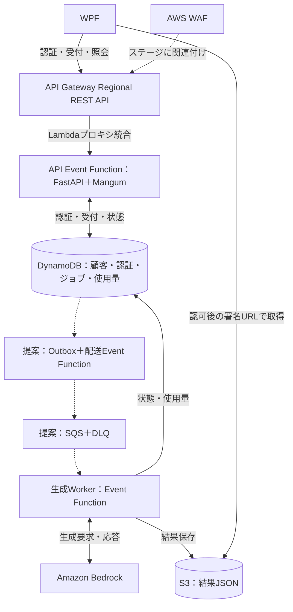

# 採用入口：API Gateway REST API＋Event Functions

更新日：2026-10-26。入口の採用は利用者が決定済み。構築・検証・本番化の完了は未確認。

[検討状況](検討状況.md) / [構成設計](構成設計.md) / [決定事項一覧](決定事項一覧.md) / [次の作業](次の作業.md)

## 採用した構成

WPFはAPI Gateway Regional REST APIに接続し、ステージに関連付けたWAFが検査する。API GatewayはAPI Event Functionを呼び、認証・受付・状態照会を処理する。Bedrock生成は別のEvent Workerへ分離する。

[業務フローSVG](../diagrams/AWS構成図_EventFunctions_業務フロー.svg) / [構成図draw.io](../diagrams/AWS構成図_EventFunctions.drawio) / [サービス間のやり取り・概要](../diagrams/AWSシーケンス図_EventFunctions_概要.md) / [概要SVG](../diagrams/AWSシーケンス図_EventFunctions_概要.svg) / [概要draw.io](../diagrams/AWSシーケンス図_EventFunctions_概要.drawio)

SQS・Outbox・入力保存・試行別成果物・残量予約精算は提案であり、入口の採用と同時に決定したものではない。図はそれらを含む設計候補。配送方式を変える場合も、永続受付後の配送漏れ・重複・失敗回復を設計する。

## 入口で設定・実装すること

| 部品 | 設定・役割 |
| --- | --- |
| API Gateway | Regional REST API、ルート、Lambdaプロキシ統合、ステージ、流量・サイズ・タイムアウト、アクセスログ |
| WAF | REGIONAL Web ACLをRESTステージへ直接関連付け。攻撃対策、/auth試行対策、全体レート制限、ログのマスキング |
| API Event Function | /auth、/jobs、/jobs/{jobId}。不透明トークンの検証、入力検証、顧客・ジョブ所有者の認可 |
| IAM | GatewayからのLambda呼出しを対象API等に限定。不要な公開Function URLを作らない |
| キャッシュ | APIキャッシュ無効。認証・状態・署名URLの応答を再利用しない |
| 独自ドメイン | 利用する場合はRegionalカスタムドメイン、同一リージョンのACM証明書、DNS |
| ログ相関 | GatewayのrequestId・extendedRequestIdをアクセスログへ。APIでも入口IDとjobIdの対応を記録し、jobId・attemptIdで後段を追跡 |

WAFは独立した中継サーバーではなく、RESTステージに関連付ける。S3への署名URLによるダウンロードはAPIのWAFを通らない別経路。

## 検証すること

- 無効・期限切れ・失効トークンと停止顧客を拒否する。他社jobIdの状態・結果URLを返さない。
- POST／GETで必要なBearer・冪等キー・入力・クエリがアプリへ到達する。
- 認証・状態・結果URLの応答をキャッシュしない。
- WAF・API流量制限の403／429とアプリのエラーをWPFが扱える。
- 永続受付、ジョブ配送、生成、状態照会、S3取得を通して確認する。
- 重複・配送停止・Worker停止・結果不明・URL期限切れからの復旧を確認する。
- 受付・照会の遅延、集中負荷、費用、ログ、通知、切戻し、復元手順を検証する。

閾値・予算・本番化判断は[次の作業](次の作業.md)で決める。入口の採用自体を再び未選定として扱わない。
