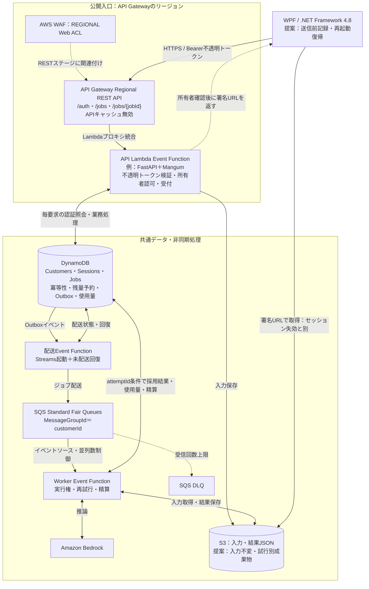
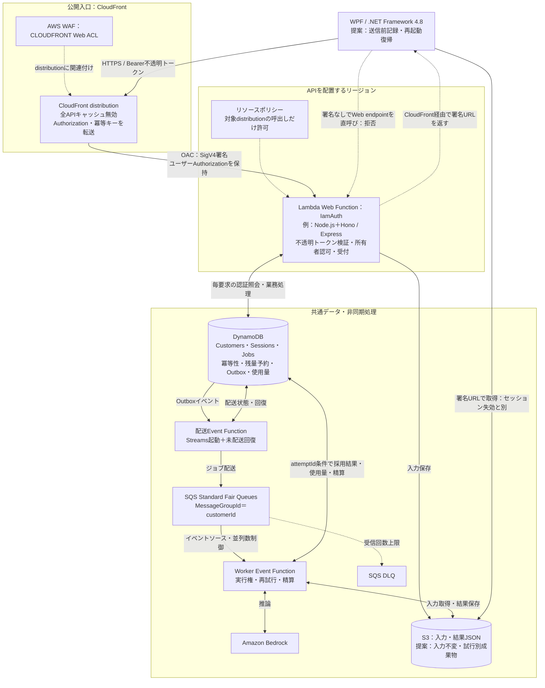

# REST API案とWeb Functions案の構成比較

[現在の検討状況](検討状況.md) / [docsの入口](../README.md)

更新日：2026-10-25 / 状態：入口方式の選定用。両案とも未確定。

## 比較の前提

約100社のWPFが認証・ジョブ投入・ポーリングを行い、生成JSONをS3から取得する。**両案とも不透明トークン、非同期ジョブ、同じSQS・Worker・DynamoDB・S3を利用する**。受付Lambda内でBedrockを同期実行する構成には変えない。

比較対象の「REST API案」はAPI Gateway Regional REST API＋Lambda Event Function。「Web案」はCloudFront＋Lambda Web Function。Web案でもREST形式のエンドポイントを実装できる。通常のLambda Function URLとWeb Functionsは別の機能で、OACの設定も混同しない。

SQS・Outbox・入力S3保存は共通の設計提案として揃える。入口方式の比較のために含めているもので、正式採用の決定ではない。既存Python資産や移植費用を採否理由にしない。

共通仕様・サービス別決定事項は[不透明トークン前提の構成設計](https://github.com/knmo000-tech/awsMemo/blob/main/docs/current/構成設計.md)を参照。

図内の送信前記録・試行別成果物はレビュー後の追加提案。承認対象と構造への影響は[次の作業2](次の作業.md)で扱う。既発行のS3署名URLはセッション失効だけでは無効にならない。即時停止が必要なら共通の配信方式を再検討する。

## A：API Gateway REST API＋Event Function

WAFは通信を中継する独立サーバーではなく、RESTステージに関連付ける。APIからWorkerを直接起動する権限は、このSQS案では不要。API GatewayからAPI Lambdaへの呼出し許可は対象APIのSourceArn等に限定し、不要なFunction URL等の公開経路を作らない。

独自ドメインを使う場合はAPI GatewayのRegionalカスタムドメイン、同一リージョンのACM証明書、DNSを用意する。CloudFrontはこの案の必須部品ではない。[AWS：Regionalカスタムドメイン](https://docs.aws.amazon.com/apigateway/latest/developerguide/how-to-custom-domains.html)

### Aで設定・実装すること

- API Gateway：ルート、Lambda統合、ステージ、スロットリング、サイズ上限、アクセスログ、カスタムドメイン。
- WAF：Regional Web ACLをRESTステージへ関連付け、/authの試行対策、全体レート制限、誤検知調整。
- Event Function：不透明トークン認証を共通処理に集約。メモリ・timeout・予約同時実行数を設定。
- 入力の業務検証・顧客別上限・所有者認可・冪等性はAPIアプリで行う。API Gatewayのリクエスト検証を使う場合も代替にはしない。
- Gateway由来の429やWAF由来の403をWPFが扱えるようにする。

## B：CloudFront＋WAF＋Web Function

**詳細な業務フロー図：** [SVG](../diagrams/AWS構成図_WebFunctions_業務フロー.svg) / [読み方](../diagrams/AWS構成図_WebFunctions_業務フロー.md)。rev4相当の粒度で、認証・受付・照会・配送・生成・結果取得を示す。SQS・Outbox等は引き続き提案。

図の直呼び矢印は拒否を検証する経路。APIの正常経路は必ずCloudFrontを通す。WPFからS3への結果取得は両案共通の別経路であり、WAFを通らない。短命な署名URLとS3権限で制限する。

Web案ではAPI Gatewayを必須にしない。**受付はWeb Function、配送・生成はEvent Functions**として併用する。[AWS：Web Functions](https://docs.aws.amazon.com/lambda/latest/dg/web-functions.html)

### Bで設定・実装すること

1. Web endpointは`IamAuth`。最初は単一リージョンのRegional endpointで比較する。複数リージョン化はデータ整合性と合わせて別に判断する。
2. CloudFrontのオリジンにWeb endpointを設定し、OACを付ける。Regional endpointの署名プロトコルは`sigv4`。
3. OACの署名動作はWeb Functions用の`always-amz-auth`（Always sign, preserve viewer authorization）。CloudFrontの署名とWPFのBearerトークンを共存させる。Function URL向けの`always`と混同しない。
4. Web Functionのリソースポリシーで`cloudfront.amazonaws.com`に対象endpointの呼出しを許可し、`aws:SourceArn`を対象distributionに限定する。迂回可能な別の許可を追加しない。
5. 全API behaviorのキャッシュポリシーに`Authorization`を含め、Min／Default／Max TTLをすべて0にする。`/auth`とジョブ状態・署名URLの応答もキャッシュさせない。アプリ応答にも`Cache-Control: no-store`を付ける。
6. viewerの`Host`をオリジンへ転送しない。origin request policyは`AllViewerExceptHostHeader`等、公式手順に合う設定にする。`Idempotency-Key`、必要なクエリ、Content-Type等の到達も試験する。
7. 必要なHTTPメソッドをCloudFrontで許可し、アプリで定義外ルート・メソッドを拒否する。Web endpointのRPS上限・最大環境数も決める。
8. CloudFront用WAF、distributionログ、Web実行ログ、デプロイ・リビジョンの切替を運用する。

上記OAC・認証ヘッダー・Hostの要件は[AWS：Web Functionオリジンのアクセス制限](https://docs.aws.amazon.com/AmazonCloudFront/latest/DeveloperGuide/private-content-restricting-access-to-lambda-web.html)に従う。IAM認証はCloudFront経由かを確認するもので、顧客認証はWebアプリの不透明トークン検証で別途行う。

独自ドメインを使う場合はCloudFront alternate domain name、us-east-1のACM証明書、DNSを用意する。APIを置くリージョンと証明書のリージョンは異なる場合がある。[AWS：CloudFrontのHTTPS要件](https://docs.aws.amazon.com/AmazonCloudFront/latest/DeveloperGuide/cnames-and-https-requirements.html)

## どこが変わり、どこを同じにするか

| 観点 | A：REST API＋Event | B：CloudFront＋Web | 判断への影響 |
| --- | --- | --- | --- |
| 公開入口 | Regional REST API | CloudFront distribution | 入口の運用対象が変わる |
| WAF | RESTステージにRegional ACL | distributionにCloudFront ACL | どちらでもWAFを必須にできる |
| 入口の迂回対策 | RESTにWAFを適用、Lambdaの公開経路を限定 | OAC＋IamAuth＋対象distribution限定 | Bは転送・署名・ポリシーを一式で検証 |
| 受付の実装 | handler、例：FastAPI＋Mangum | HTTP server、例：Node.js＋Hono | 開発言語と開発体験を選ぶ |
| 同時処理 | 複数実行環境で並列化 | 1環境内でも複数HTTP要求を処理 | 両方で同時受付可能。実測で比較 |
| 不透明トークン | APIアプリがSessions等を照会 | Webアプリが同じ照会 | DB認証コストは原則共通 |
| 顧客別認可・上限 | APIアプリ | Webアプリ | GatewayやWAFだけに任せない |
| APIの流量制御 | Gatewayスロットリング＋Lambda制御 | WAF＋Web endpointの制御＋アプリ | 同じ閾値・429動作を用意して比較 |
| キャッシュ | APIキャッシュ無効 | 全TTL=0＋認証ヘッダー転送 | Bは設定の整合を追加確認 |
| デプロイ | Event FunctionとAPIステージ等 | Web revision／endpointとdistribution等 | 障害時の切戻しまで評価 |
| 非同期配送・復旧 | Outbox→SQS→Worker | 同左 | 入口の採否と独立 |
| Bedrock生成性能 | 共通Workerが実行 | 同左 | 入口をWebに替えても直接は高速化しない |
| 結果配信 | 所有者確認後、S3署名URL | 同左 | CloudFrontで結果を配る方式への変更は不要 |
| 主な入口費用 | REST要求＋Event Lambda実行＋WAF | CloudFront＋Webの要求・CPU・メモリ等＋WAF | 同じポーリング量と実測使用量で見積もる |
| 障害解析 | Gateway／WAF／APIログ | CloudFront／WAF／Webログ | 相関IDで一つの要求を追えるか確認 |

Web Functionsの対応ランタイム・同時処理・課金構造は[公式概要](https://docs.aws.amazon.com/lambda/latest/dg/web-functions.html)を参照。現時点の概要はNode.js対応。上表の評価は本システムへの設計上の当てはめであり、性能・金額は未実測。

## 構成から見た現時点の評価

**両案ともこの非同期生成システムを構成できる。** 図の後段は同一であり、認証・整合性・請求・再試行の主要な難しさは共通する。

入口の設定対象と迂回防止の確認箇所を少なくすることを優先するならAが適する。WAFをRESTステージへ直接適用でき、CloudFrontのOAC・転送・キャッシュ設定が不要になる。

Node.jsの通常のHTTPサーバーとして実装する開発体験や、I/O待ちの多い受付・ポーリングを同一環境で多重処理する特性を重視するならBを選ぶ理由がある。ただし今回のDB照会量で費用や応答時間が有利になるかは実測する。CloudFrontを追加しても、キャッシュを無効にするAPIのDB照会は減らない。

現時点では**Aを設定の簡潔さから暫定推奨し、Bを同じ条件で検証する**。Bが保護・運用・費用の条件を満たし、開発体験や計測結果に選ぶ価値があればBの採用は合理的。既存Python資産はこの評価に含めない。

API Gateway＋Web FunctionのHTTPプロキシ併用案は、別の接続・迂回防止設計が必要になるため今回の主比較には含めない。不要と確定したわけではなく、Gatewayの特定機能とWebの開発体験を両方必須にする場合に再評価する。

## 採否を決めるための検証表

[3つの作業](次の作業.md)の検証として実施する。まず認証・ヘッダー・キャッシュ・迂回防止の最小APIで比較し、共通Workerの品質・復旧検証を進める。両入口の本格実装を採用前の必須作業にはしない。

同じリージョン、モデル、JSON仕様、認証・失効ルール、同じデータ、同じ後段で比較する。言語ごとの差も測定結果に含まれるため、「入口サービス単体の差」と断定しない。

| 検証 | 両案の合格条件／測定内容 |
| --- | --- |
| 認証・失効 | 無効／期限切れ／失効／停止顧客を拒否。/authはレート制限 |
| 他社アクセス | 他社jobIdから状態・署名URLを取得できない |
| Webの迂回 | OAC署名なしの直呼び・別distribution経由を拒否 |
| ヘッダー | BearerとIdempotency-Keyがアプリに正しく届く。GET・POSTを両方確認 |
| キャッシュ | 顧客を交互に呼び、応答・URLが再利用されない。失効直後の新しい照会を拒否 |
| 正常処理 | 202→状態照会→S3取得。URL期限切れは再発行で回復 |
| 障害復旧 | 同じキーの再送、Outbox再配送、Worker重複でも二重請求なし |
| 負荷 | 通常・100社集中・1社集中。受付と照会のp50／p95／p99、エラー、429、コールドスタートを測定 |
| DBへの影響 | 同じAPI件数に対する読取り・書込み・スロットリング・コネクションを確認 |
| 運用 | IaCで再現でき、ログで追跡でき、デプロイ失敗から切り戻せる |
| 費用 | 同じジョブ数・ポーリング回数で入口費用と共通費用を分けて計算 |

許容p95・エラー率・月額予算・運用負担は試験前に決める。安全性の合格条件は両案共通とし、その後に費用・開発体験・運用の優先順位で採用を決める。

## Web案で追加して決める項目

[決定事項一覧](決定事項一覧.md)のWEB01〜WEB08を参照。

## 参照

- [AWS：Web Functions概要](https://docs.aws.amazon.com/lambda/latest/dg/web-functions.html)
- [AWS：Web FunctionのOAC保護](https://docs.aws.amazon.com/AmazonCloudFront/latest/DeveloperGuide/private-content-restricting-access-to-lambda-web.html)
- [AWS：REST APIとWAF](https://docs.aws.amazon.com/apigateway/latest/developerguide/apigateway-control-access-aws-waf.html)
- [既存ADR-0008](https://github.com/knmo000-tech/awsMemo/blob/main/docs/adr/0008_Web-Functions比較.md)：従来の比較と検討履歴
- [既存ADR-0009](https://github.com/knmo000-tech/awsMemo/blob/main/docs/adr/0009_SQS公平キュー導入検討.md)：SQSの採用検討
