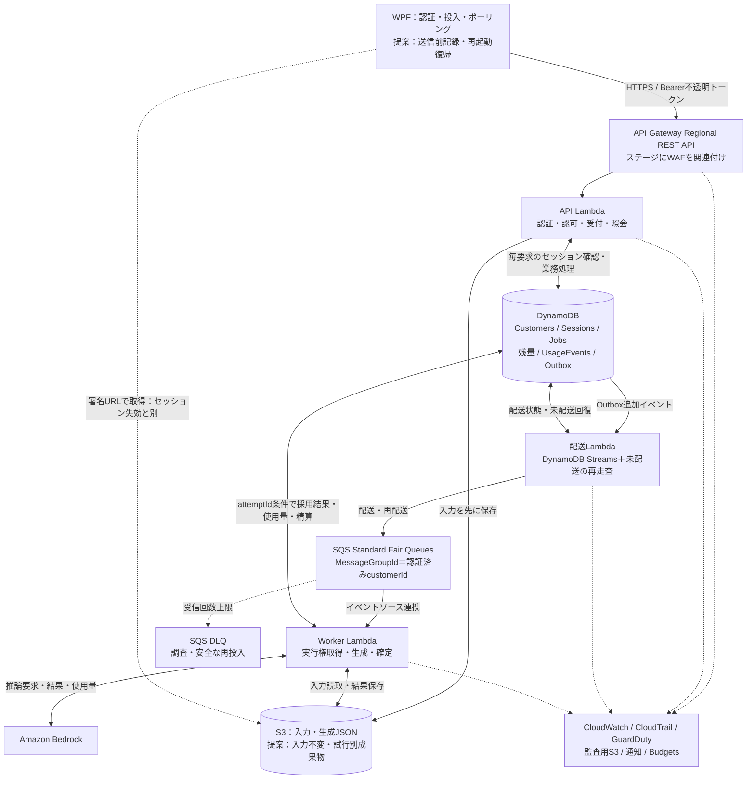
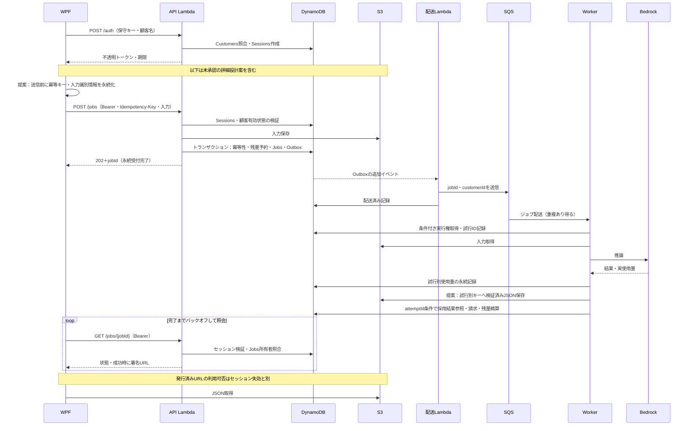

# AWS構成設計・サービス別決定事項

[現在の検討状況](検討状況.md) / [DB設計案](DB設計.md) / [docsの入口](../README.md)

更新日：2026-10-28 / 状態：Event Functions採用。後段の詳細設計は提案・未決を含む

## 1. この資料の位置付け

約100社のWPFアプリから生成要求を受け、Amazon BedrockでJSONを生成し、使用量を記録するシステムを具体化する。

参照したリポジトリのmain：`0d2b4f4bad4ae0243c86b303003a202e023deaf9`。

- 今回の指定：認証方式は**不透明トークン**を前提とする。
- 既存資料の方針：APIとWorkerを分離し、ジョブ方式・DynamoDB・S3の結果配信を利用する。
- 採用入口：**Regional REST API＋WAF＋API Event Function**。APIと生成Workerを分離する。
- 後段の推奨案：SQS Standard Fair Queues＋Outbox＋配送Event Function＋生成Worker。採否は別に判断する。
- 入口の採用は2026-10-26に利用者が決定。SQS・Outbox等の推奨を、同時に採用済みとは扱わない。
- AWS環境の構築・変更・実測は今回実施していない。数値案は検証開始値であり、性能・費用・SLAの保証値ではない。

旧設計・旧図は履歴として維持する。現行の説明・図は本資料とEvent入口構成を更新し、判断変更時にADRへ記録する。構造変更と業務判断の承認対象は[次の作業](次の作業.md)にまとめる。

## 2. 基準にする全体構成

採用した入口の設定・検証条件は[Event入口構成](Event入口構成.md)を参照。以下は採用入口と、提案中の非同期配送を合わせた図。

Outboxと配送Lambdaは**今回追加した推奨設計**。ジョブ登録後のキュー送信漏れを回復するために設ける。単純な「APIがDB登録→SQS送信」方式にするなら、同等の未配送回復処理が必要となる。

図のDynamoDB内の名称は論理領域であり、物理テーブル数は未決定。入力のS3保存も今回の提案で、保存の可否・期間はデータ要件に合わせて確定する。

## 3. 不透明トークンの具体的な扱い

### 発行

1. WPFが`POST /auth`へ保守キー＋顧客名を送る。顧客名は秘密情報として扱わず、主たる認証材料は保守キーとする。
2. APIがCustomersで照合し、契約・顧客の有効状態を確認する。保守キーが全顧客共通なのか顧客固有なのか、既存方式を最初に確認する。
3. 暗号学的乱数で32バイトのトークンを生成し、base64url等で文字列化する案とする。
4. Sessionsへ`SHA-256(token)`をキーとして保存し、平文トークンは応答時にだけ返す。高エントロピーのランダムトークン用の方式であり、人が決めた保守キーの保存方式とは分ける。
5. WPFは原則メモリに保持し、有効期限内は再利用する。初期案は絶対有効期限15分、リフレッシュトークンなし。利便性・負荷・漏えい対策を確認して決める。

### 検証

`POST /jobs`、`GET /jobs/{jobId}`等の保護対象ルートで共通認証処理を必ず通す。

1. `Authorization: Bearer ...`の形式・長さを検証する。
2. トークンをハッシュ化し、Sessionsを主キーで強い整合性のGetItemにより読む案とする。
3. 存在、`expiresAt > now`、`revokedAt`なし、顧客との紐付きを確認する。
4. 顧客の一括停止も反映するなら、Customersを強い整合性で読み、有効状態と`authVersion`を照合する。Sessionsに発行時のバージョンを持たせる。
5. ここで確定した`customerId`を後続処理に渡す。本文中の顧客IDは認可の根拠にしない。
6. 状態照会ではJobsの所有者を別途確認する。

**初期案は認証結果をキャッシュしない。** そのため、各保護APIでSessions読取りが発生する。顧客一括停止の上記案ならCustomers読取りも追加され、状態照会ではさらにJobs読取りが必要。トークンDBへのアクセスと業務DBへのアクセスは別に数える。

**DynamoDB TTLは削除の後処理であり、有効期限の判定に使わない。** 期限後もしばらくレコードが残るため、必ずAPIが`expiresAt`を比較する。[AWS TTL](https://docs.aws.amazon.com/amazondynamodb/latest/developerguide/TTL.html)

失効更新が完了した後の新しい照会には強い整合性で反映させる。一方、失効直前に検証を通過した実行中要求まで取り消せるわけではない。顧客停止時に待機・実行中ジョブも止めるかは別の業務仕様とする。

API Lambdaの共通依存処理／ミドルウェアに認証をまとめる案を推奨。Lambda Authorizerは代替案。導入する場合もキャッシュによる失効遅延と、所有者認可をどこで行うかを設計する。

### 失効・秘密管理

- 個別失効：Sessionsの`revokedAt`を更新する管理操作を用意する。
- 顧客一括失効：Customersの`authVersion`更新／無効化を利用する案とする。
- WPFに共有AWSアクセスキーやサーバー秘密鍵を埋め込まない。
- JWT署名鍵はこの方式には不要。Secrets Managerは必要なサーバー秘密情報がある場合に利用し、JWT用という理由だけで残さない。
- ログに保守キー、トークン、認証ヘッダー、署名付きURLを出さない。WAF・アクセスログ側のマスキングも確認する。
- 顧客ごとの共有保守キーでは、社員個人の追跡や個人単位の失効には限界がある。個人識別が必要なら利用者認証を追加検討する。

セッション識別子の乱数・期限・保管の原則は[OWASP Session Management](https://cheatsheetseries.owasp.org/cheatsheets/Session_Management_Cheat_Sheet.html)を参照。上記の32バイト・15分は本システム向けの提案値。

## 4. 受付から完了までの処理

### 受付の保証と冪等性

- `202`はジョブと配送意図を永続化したことを表す。SQS投入・生成成功を意味しない。
- `(customerId, Idempotency-Key)`と入力ハッシュを保存。同じキー・同じ入力は同じjobId、同じキー・異なる入力は`409`とする案。
- API応答が失われてもWPFは同じキーで再送する。毎回キーを作り直さない。
- Outbox配送は少なくとも1回を前提にする。送信成功後に配送済み記録が失敗すると再送されるため、Workerで重複を防ぐ。
- Streams処理が長時間停止した場合に備え、未配送Outboxを期限・再試行回数付きで検索し再送する回復処理を設ける。そのためのキー／GSIを設計する。
- 入力S3保存後にDB登録が失敗する場合は孤立オブジェクトが残る。再送時の入力同一性と保存キーを管理し、採用済み入力を消さない清掃手順を設ける。

### Worker・失敗回復

- 状態例：`QUEUED → RUNNING → SUCCEEDED / FAILED`。再試行待ちはJobsの`nextRetryAt`等で表す案とし、API公開状態の追加要否を決める。
- 実行権は条件付き更新＋`attemptId`＋リース期限で取得する。確定時も現行attemptIdを条件にし、古いWorkerによる上書きを防ぐ。
- Bedrockの一時エラーと入力不正等の恒久エラーを分ける。SDK内とキュー側の再試行を掛け合わせて暴走させない。
- 既に成功したジョブの再配送では推論しない。JSON保存後に停止した場合は既存成果物・使用量記録を確認して確定処理を再開する。
- 推論成功直後にWorkerが停止すると、使用量記録や結果が残らない場合がある。**二重請求防止と二重推論防止は別問題**。結果不明の試行を自動で再推論するか、調査対象にするかを明示する。
- DLQに入っただけではJobsはFAILEDにならない。DLQ処理／照合処理で状態・残量予約を整合させ、運用者が再投入できるようにする。
- SQSは重複処理を前提に設計する。[AWS LambdaとSQS](https://docs.aws.amazon.com/lambda/latest/dg/with-sqs.html)

### 残量・請求

- 利用可否を「残量を読む→後で減算」だけで判定しない。同時受付による使い越しを防ぐ条件付き更新／トランザクションが必要。
- 提案は受付時の予約と完了時の精算。最大予約量を算定するため、入力上限・最大出力・モデル・顧客単価を先に決める。
- AWSで発生した試行ごとの実費／使用量と、顧客に請求する明細を区別する。再推論でAWS費用が2回発生しても、自動的に2回請求しない。
- `UsageEvents`は推論試行IDで一意にする。顧客請求はjobId等の業務キーで二重確定を防ぐ。
- 失敗時の返金／予約解放、実使用量が予約を超えた場合、月次締め・訂正は業務ルールとして確定する。
- 「生成成功だがダウンロード失敗」はURL再発行で回復し、再推論しない。請求の成立条件は別途決定する。

### レビューで補足した設計案

以下は詳細化の提案。データ構造・API・業務ルールの採用は[次の作業](次の作業.md)で判断する。図内の送信前記録・試行別成果物も未承認の提案を表す。

- **保守キー交換**：旧キーからの新規セッション発行と既存セッション失効を別々に定義する。顧客固有性・配布・端末保管・個人識別の範囲は承認待ち。
- **停止と署名URL**：既発行のS3署名URLはセッション失効だけでは無効にならず、URL期限・署名資格情報・S3権限等に従う。300秒は提案値。停止後の残存アクセスを許容できない場合は、配信方式変更を作業2で検討する。[AWS署名URL仕様](https://docs.aws.amazon.com/AmazonS3/latest/userguide/using-presigned-url.html)
- **WPFの復帰**：202受信前の終了に備え、送信前に冪等キー・入力ハッシュ・操作状態を永続化する案。再起動後も同じキーで受付を回復する。入力本文の端末保存可否、保持期限超過時の動作、照会API追加は未決。古い操作を自動で新規投入しない案を検討する。
- **入力・成果物の不変性**：入力は再送で上書きされない参照にする。成果物はcustomerId/jobId/attemptId等の試行別キーに保存し、Jobsで採用結果を参照する案。DBのattemptId条件だけではS3上書きを防げない。参照更新を条件付きで行い、採用済み成果物を清掃で消さない。
- **結果不明**：結果不明・調査待ち・再試行待ちを内部で識別する。自動再試行の上限・累計費用・予約解放・担当・解決期限は未決。公開状態を増やすか内部項目で表すかも判断する。
- **品質**：構文・Schema適合と、必須項目の正しさ・欠落・捏造・値の整合性を別評価する。モデル・プロンプト・Schema版をジョブへ固定する案とし、WPFの対応版を確認する。成功基準と修復費用は承認待ち。
- **受付上限**：顧客別未完了数・全体滞留・受付停止と復帰・最大待機を定める。Fair Queuesだけでは顧客別上限にならない。予約解放は実行中Workerと競合しない条件付き処理にする。数値と契約上の扱いは未決。

### 停止地点別の復旧表

設計・試験準備用の提案。各行の担当・復旧期限・通知先は作業2で割り当てる。業務判断や構造変更の採用を自動確定しない。

| 停止地点／事象 | 復旧案と守る条件 | 承認・具体化が必要なこと |
| --- | --- | --- |
| 202受信前のWPF終了 | 永続化した同じキーで同じjobIdへ復帰。予約を増やさない | 端末保存、保持期限超過、照会契約 |
| 入力S3保存後・DB確定前 | 同一入力を識別し再受付。孤立入力は参照確認後に清掃 | 保存・清掃期間 |
| DB確定後・SQS投入前 | 未配送Outboxを再走査し配送 | Outbox採否、復旧期限 |
| SQS投入後・配送済み記録前 | 再配送を許し実行権で重複を抑止 | 配送回数・通知 |
| 推論開始後・結果記録前 | 結果不明を識別。再推論か調査かを規則で分岐 | 費用、上限、予約、解決期限 |
| 使用量記録後・成果物保存前 | 使用量を再計上しない。結果喪失時は再生成を別判断 | 再生成・修復の費用負担 |
| 成果物保存後・成功確定前 | 試行別結果・使用量を検証し現行attemptId条件で残処理を確定 | 結果参照・永続的な試行記録の構造 |
| リース切れ・古いWorker完了 | Jobsと採用成果物を上書きしない。試行費用は別追跡 | リース・timeout・清掃 |
| DLQ／最大待機超過 | Jobs・実行権・予約を照合し安全に終了または再投入 | 待機上限、解放条件、担当 |
| 成功後のURL期限切れ・保存失敗 | 所有者確認後にURL再発行。再推論しない | 再取得期間、請求条件 |
| 顧客停止 | 新規API拒否。既発行URLと待機／実行中ジョブは別扱い | 残存アクセス、続行、精算 |
| バックアップ復元 | 配送を止めS3・試行・請求と照合後に再開 | RPO／RTO、手順・担当 |

## 5. 論理データとアクセス

テーブル・ER図・キー・索引・更新条件は[DB設計案](DB設計.md)を参照。クレジットはトークン量から独自計算し、換算係数・丸め等をCreditRulesで管理する。適用版はジョブ受付時に固定する。

| 領域 | 主な情報 | 必要なアクセス／注意 |
| --- | --- | --- |
| Customers | customerId、保守キー検証材料、有効状態、authVersion、契約 | 認証・顧客停止判定。名称検索用の索引とキー照合方法を分ける |
| Sessions | tokenHash、customerId、issuedAt、expiresAt、revokedAt、authVersion | tokenHash主キーの強い整合性読取り。TTLは清掃用 |
| Jobs | jobId、customerId、入力参照、状態、attemptId、leaseUntil、結果キー | ID照会・所有者確認・滞留／異常検出 |
| Idempotency | customerId＋キー、入力ハッシュ、jobId、有効期限 | 受付トランザクションで一意性保証。再送可能期間まで保持 |
| 残量・予約 | 利用可能量、予約量、jobId、精算状態 | 同時受付・精算・返却を条件付きで実施 |
| Outbox | eventId、jobId、customerId、配送状態、再試行予定 | Jobsと同一トランザクションで作成。未配送検索が必要 |
| UsageEvents | attemptId、jobId、顧客、モデル、入出力／キャッシュ使用量 | 条件付き追記。AWS費用の根拠・未知の試行の調査 |
| CreditRules | 換算係数、丸め設定、engineVersion、適用版 | 不変の設定版とACTIVEを管理。受付時の版で精算 |
| 請求明細 | jobId、単価版、顧客請求量・金額、確定／訂正 | 一意な確定処理。元明細の保全と訂正履歴 |

物理テーブル分離は、IAMの分離・トランザクション・検索要件・運用を見て決める。Sessionsと請求実績は性質と保持期間が違うため、分離を優先して検討する。

## 6. サービス別に決める項目

[決定事項一覧](決定事項一覧.md)を正本として管理する。現行構成の61項目について、優先度と現在の提案・未決定事項を確認できる。

## 7. 次の作業は3つ

1. 業務ルールと合格条件を決める。
2. 状態遷移・復旧・構造変更案を具体化する。
3. 最小構成で品質・復旧・運用を検証する。

[次の作業](次の作業.md)で成果物・完了条件・承認対象を管理する。61項目は漏れ防止の詳細チェックリストとして参照する。

## 8. 本番前に確認するシナリオ

- トークンなし／期限切れ／個別失効／顧客停止で拒否。TTL未削除でも期限切れを拒否する。
- 他社jobIdで結果を取得できず、他社S3キーを指定してURLを発行できない。
- 同じ冪等キーの並列投入・通信切断後再送で、予約とジョブを重複作成しない。
- 残量が1件分の状態で同時に2件受付しても、契約で認めない使い越しが起きない。
- DB登録後の配送停止、SQS送信後の記録失敗を回復できる。
- 重複配送・リース期限切れ・古いWorkerの遅延完了でも、請求を二重確定しない。
- Bedrock成功直後／使用量記録後／S3保存後の停止を、それぞれ区別して復旧できる。
- DLQ到達がJobsと残量予約に反映され、安全な再投入ができる。
- 複数社同時利用・1社大量投入で待機時間とモデルクォータを測る。
- URL期限切れやダウンロード再試行で再推論が走らない。
- ログ・エラー応答に秘密情報や入力全文が出ない。
- バックアップから復元し、過去ジョブの再実行・二重請求を防げる。

- 202受信前にWPFを終了し、再起動後も同じジョブ・予約へ復帰できる。
- 古いWorkerが遅れてS3へ保存しても、採用成果物の内容・参照が変わらない。
- 旧保守キーによる再認証拒否と、既発行URLのアクセスを別々に試験する。
- Schema適合でも業務内容が誤る入力を品質評価に含める。
- 滞留上限・受付停止と復帰・実行中ジョブと予約解放の競合を確認する。

## 9. 費用見積もりに必要な入力

見積もりはジョブ件数だけでなく、平均ポーリング回数、再認証回数、推論再試行率、モデル別トークン量、ログ量、保存量から作る。

例：N件のジョブ、1件あたりp回の状態照会なら、保護APIは概ね`N×(1+p)`回。初期の認証案ではSessions・Customersを各1回読むため、認証の読取りは概ね`2×N×(1+p)`回となる。これに/auth、Jobs照会、受付・精算トランザクション、Outbox等が加わる。これは呼出し回数の概算であり、課金読取り単位や金額そのものではない。

同時実行数の制限だけではRPM／TPMの厳密な制限にならない。モデルのクォータと実測を踏まえてバックオフ・流量制御を追加する。費用通知も支出の強制停止ではないため、必要ならアプリ上限を別途実装する。

## 10. 根拠と履歴資料

以下は検討の根拠となった履歴。旧資料は当時の内容として保存し、記載の反映事項は現行資料と採用時のADRで扱う。

- [既存の構成設計](https://github.com/knmo000-tech/awsMemo/blob/main/docs/archive/旧設計/構成設計.md)：当時のJWT＋直接Invokeを示す履歴。現行構成は本資料。
- [API仕様](https://github.com/knmo000-tech/awsMemo/blob/main/docs/archive/旧設計/API仕様.md)：Bearer不透明トークン、失効、冪等キー、409等を反映。
- [処理シーケンス](https://github.com/knmo000-tech/awsMemo/blob/main/docs/archive/旧設計/処理シーケンス.md)：Sessions照会、配送、予約・精算を反映。
- [セキュリティ・監査設計](https://github.com/knmo000-tech/awsMemo/blob/main/docs/archive/旧設計/セキュリティ・監査設計.md)：JWT鍵の記述を整理し、不透明トークンの保存・期限・失効・IAMへ更新。
- [請求データ設計メモ](https://github.com/knmo000-tech/awsMemo/blob/main/docs/archive/旧設計/請求データ設計メモ.md)：実費・試行・顧客請求・予約精算の区別を追加。
- [ADR-0011](../adr/0011_Event-Functions採用.md)：2026-10-26の入口採用決定。
- [ADR-0009](https://github.com/knmo000-tech/awsMemo/blob/main/docs/adr/0009_SQS公平キュー導入検討.md)：SQSは導入推奨・検討中。採用する際にステータスと回復方式を確定。
- [JWTと不透明トークンの比較](https://github.com/knmo000-tech/awsMemo/blob/main/docs/比較検討/2026-10-21_JWTと不透明トークンの認証方式比較.md)：履歴として維持し、今回の不透明トークン前提の設計へのリンクを追加。

2026-10-26更新：入口をEvent Functions採用へ更新。SQS・Outbox・業務ルール・本番化判断は引き続き別に扱う。
