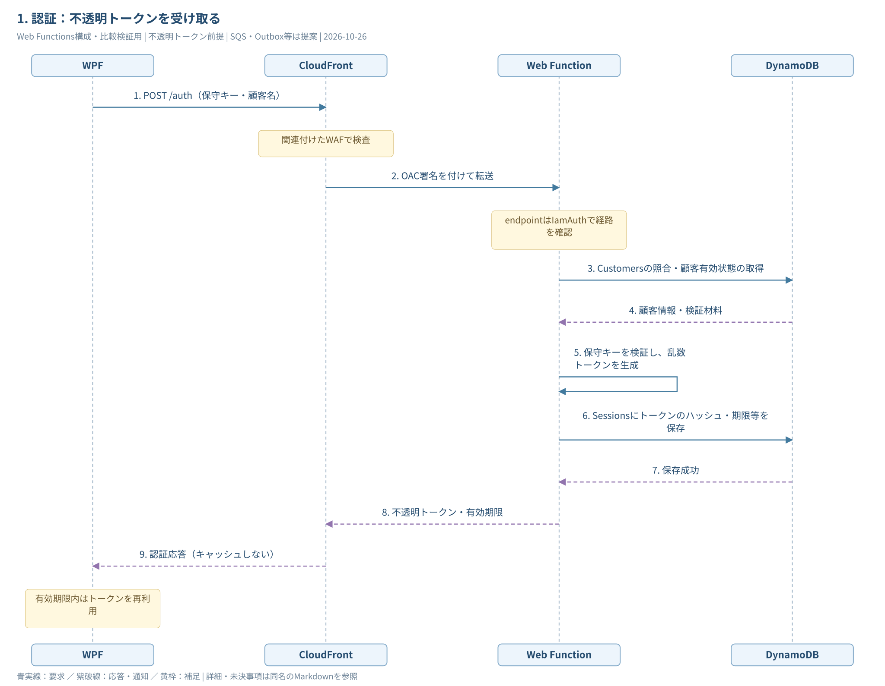
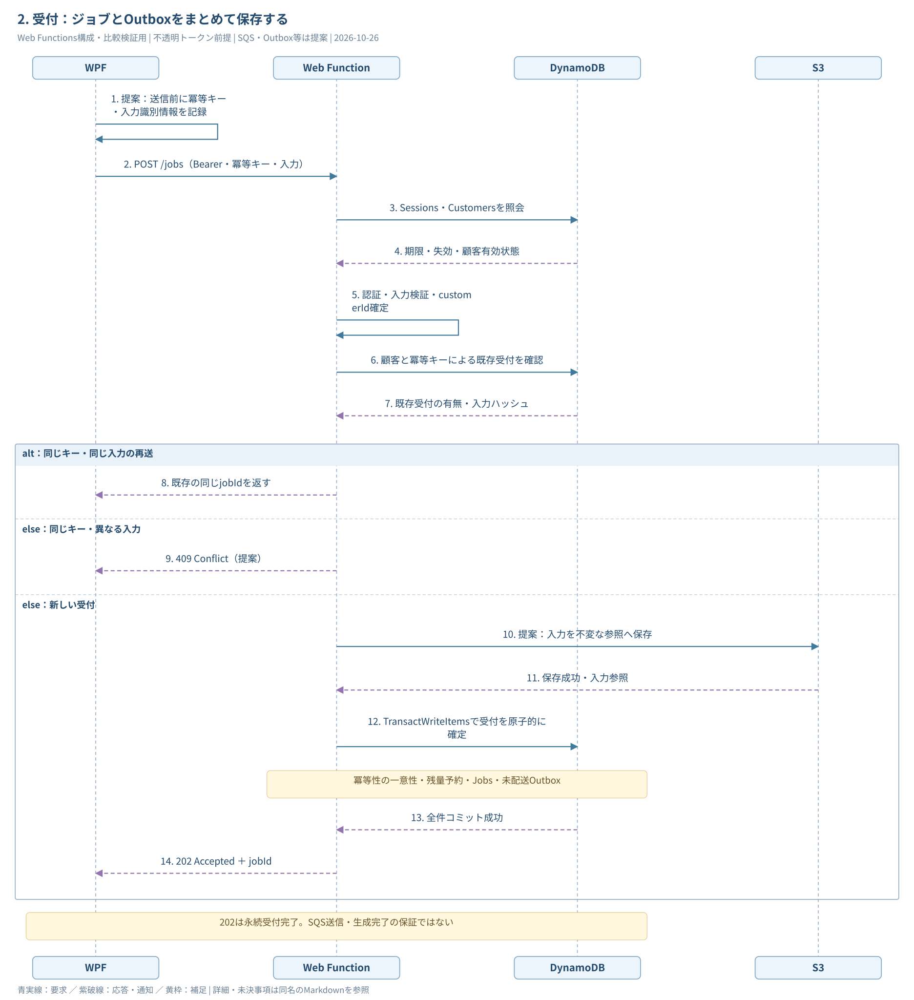
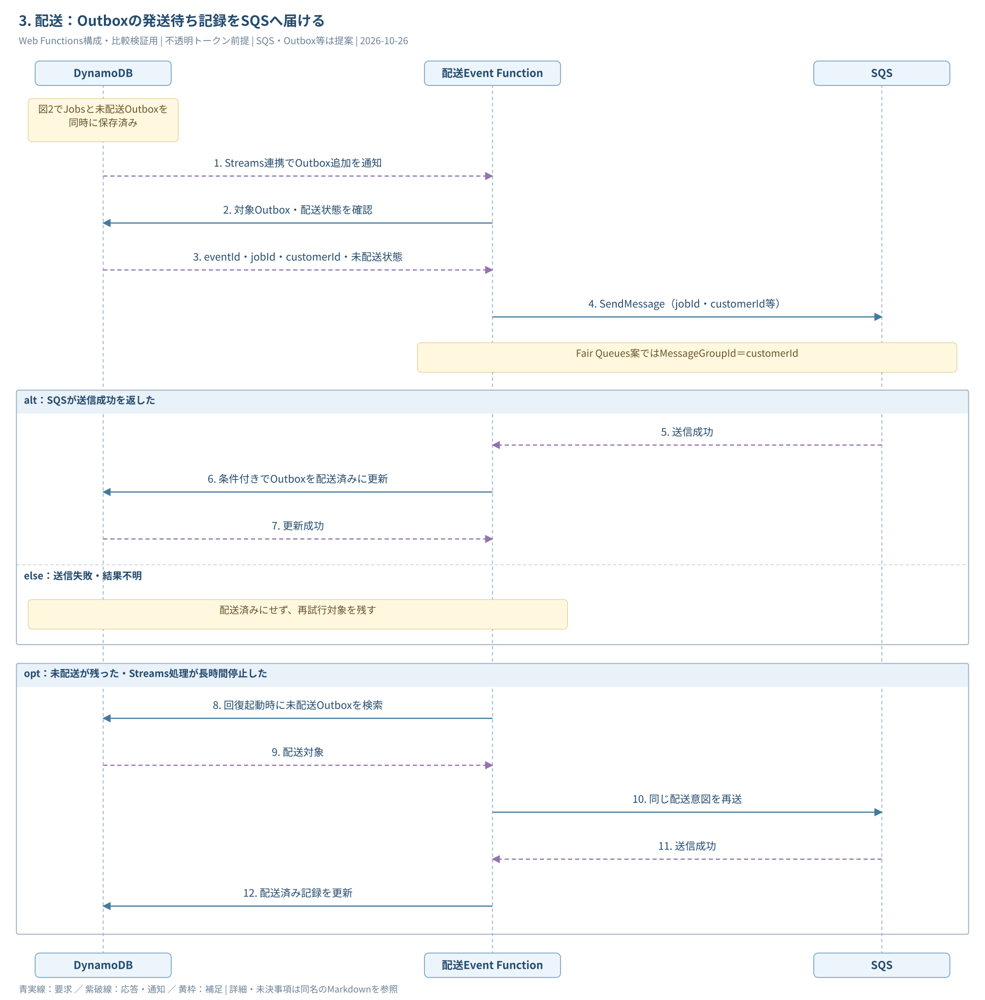
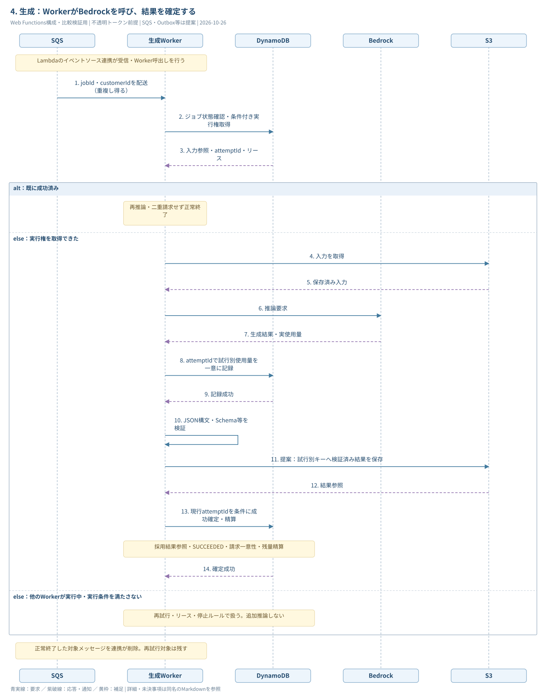
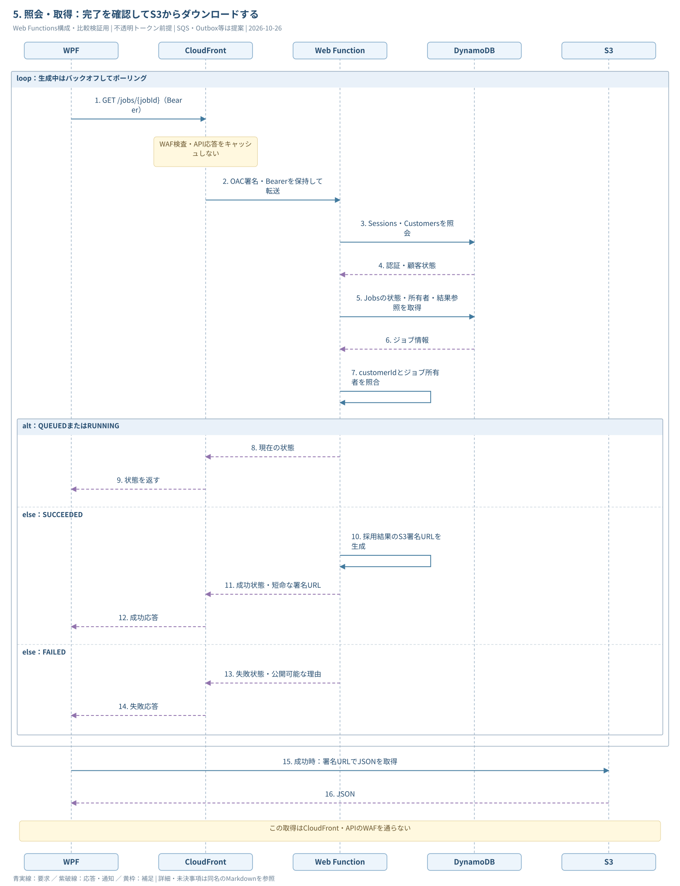
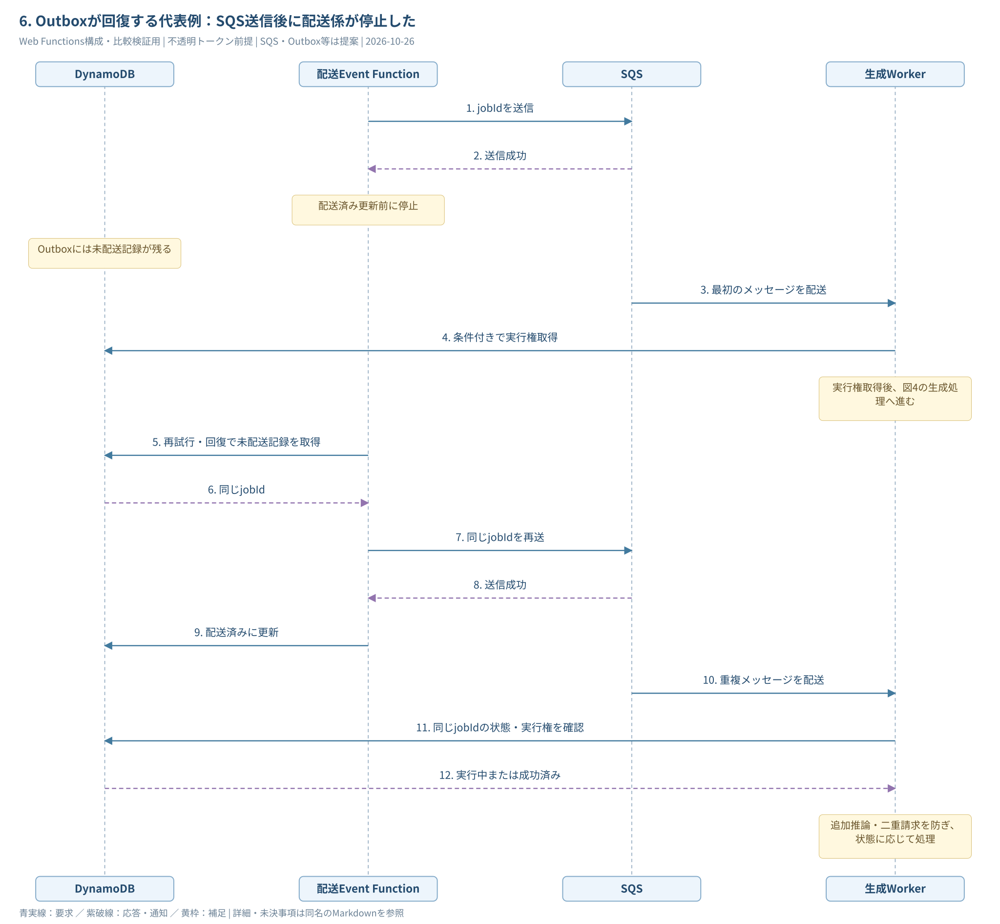

# Web Functions案：処理シーケンス

**最初に大枠を掴む場合：** [サービス間のやり取り・概要版](AWSシーケンス図_WebFunctions_概要.md)（[SVG](AWSシーケンス図_WebFunctions_概要.svg) / [draw.io](AWSシーケンス図_WebFunctions_概要.drawio)）。このページは細かな仕様を含む詳細版。

作成日：2026-10-26。既存の[業務フロー構成図](AWS構成図_WebFunctions_業務フロー.svg)に対応する。**比較・検証用で、Web入口・SQS・Outbox等の採用確定や実装完了を意味しない。**

[draw.ioで編集（全6ページ）](AWSシーケンス図_WebFunctions.drawio) / [全6図をまとめたSVG](AWSシーケンス図_WebFunctions.svg) / [構成図の読み方](AWS構成図_WebFunctions_業務フロー.md) / [入口方式比較](../current/入口方式比較.md) / [構成設計](../current/構成設計.md) / [図の一覧](README.md)

横幅を抑えるため、認証・受付・配送・生成・取得を分けて示す。各図は同じシステムの続きで、別の構成案ではない。図2〜4には、入力保存・Outbox・予約精算・試行別成果物等の既存の提案を含む。

| 担当 | 役割 |
| --- | --- |
| Web Function | 顧客から認証・ジョブ受付・状態照会を受ける |
| DynamoDBのOutbox | 永続化した「SQSへの発送待ち記録」。独立したAWSサービスではない |
| 配送Event Function | OutboxをもとにSQSへ送り、配送状態を管理・回復する |
| 生成WorkerのEvent Function | SQS経由で依頼を受け、Bedrock生成と結果の確定を行う |

## 1. 認証：不透明トークンを受け取る

[認証のSVGを開く](AWSシーケンス図_WebFunctions_01_認証.svg)



<details>
<summary>編集用Mermaidソース</summary>

```text
sequenceDiagram
    autonumber
    participant C as WPF
    participant F as CloudFront
    participant A as Web Function
    participant D as DynamoDB
    C->>F: POST /auth（保守キー・顧客名）
    Note over F: 関連付けたWAFで検査
    F->>A: OAC署名を付けて転送
    Note over A: endpointはIamAuthで経路を確認
    A->>D: Customersの照合・顧客有効状態の取得
    D-->>A: 顧客情報・検証材料
    A->>A: 保守キーを検証し、乱数トークンを生成
    A->>D: Sessionsにトークンのハッシュ・期限等を保存
    D-->>A: 保存成功
    A-->>F: 不透明トークン・有効期限
    F-->>C: 認証応答（キャッシュしない）
    Note over C: 有効期限内はトークンを再利用
```

</details>

正常時の図。保守キー不正・停止顧客は認証を拒否する。OACの経路認証と顧客の認証は別。トークンの保存・期限・失効仕様は構成設計の提案に従う。

## 2. 受付：ジョブとOutboxをまとめて保存する

図を読みやすくするため、この節だけCloudFrontを省略する。WPFとWeb間の要求・応答は、すべて図1と同じCloudFront・WAF・OAC経由。入力S3保存とOutbox・予約処理は提案。

[受付のSVGを開く](AWSシーケンス図_WebFunctions_02_受付.svg)



<details>
<summary>編集用Mermaidソース</summary>

```text
sequenceDiagram
    autonumber
    participant C as WPF
    participant A as Web Function
    participant D as DynamoDB
    participant S as S3
    C->>C: 提案：送信前に冪等キー・入力識別情報を記録
    C->>A: POST /jobs（Bearer・冪等キー・入力）
    A->>D: Sessions・Customersを照会
    D-->>A: 期限・失効・顧客有効状態
    A->>A: 認証・入力検証・customerId確定
    A->>D: 顧客と冪等キーによる既存受付を確認
    D-->>A: 既存受付の有無・入力ハッシュ
    alt 同じキー・同じ入力の再送
        A-->>C: 既存の同じjobIdを返す
    else 同じキー・異なる入力
        A-->>C: 409 Conflict（提案）
    else 新しい受付
        A->>S: 提案：入力を不変な参照へ保存
        S-->>A: 保存成功・入力参照
        A->>D: TransactWriteItemsで受付を原子的に確定
        Note over A,D: 冪等性の一意性・残量予約・Jobs・未配送Outbox
        D-->>A: 全件コミット成功
        A-->>C: 202 Accepted ＋ jobId
    end
    Note over C,D: 202は永続受付完了。SQS送信・生成完了の保証ではない
```

</details>

事前の冪等性照会だけでは並列再送を防げない。新規登録時にも条件付き書込みを行い、競合時は既存レコードを読み直して同じjobIdへ収束させる。残量不足等でトランザクションが失敗した場合は202を返さない。入力保存後に受付が失敗すると孤立オブジェクトが残るため清掃を設計する。

## 3. 配送：Outboxの発送待ち記録をSQSへ届ける

[Outbox配送のSVGを開く](AWSシーケンス図_WebFunctions_03_Outbox配送.svg)



<details>
<summary>編集用Mermaidソース</summary>

```text
sequenceDiagram
    autonumber
    participant D as DynamoDB
    participant R as 配送Event Function
    participant Q as SQS
    Note over D: 図2でJobsと未配送Outboxを同時に保存済み
    D-->>R: Streams連携でOutbox追加を通知
    R->>D: 対象Outbox・配送状態を確認
    D-->>R: eventId・jobId・customerId・未配送状態
    R->>Q: SendMessage（jobId・customerId等）
    Note over R,Q: Fair Queues案ではMessageGroupId＝customerId
    alt SQSが送信成功を返した
        Q-->>R: 送信成功
        R->>D: 条件付きでOutboxを配送済みに更新
        D-->>R: 更新成功
    else 送信失敗・結果不明
        Note over R,D: 配送済みにせず、再試行対象を残す
    end
    opt 未配送が残った・Streams処理が長時間停止した
        R->>D: 回復起動時に未配送Outboxを検索
        D-->>R: 配送対象
        R->>Q: 同じ配送意図を再送
        Q-->>R: 送信成功
        R->>D: 配送済み記録を更新
    end
```

</details>

**Outboxは「発送予定」、SQSは「Workerが実行するのを待つ場所」。配送済みは生成済みを意味しない。** Streams連携に加え、回復処理の起動方式・検索キー・再試行上限は詳細設計で決める。図では回復処理を配送担当にまとめており、別の起動機構や専用処理の採否は確定していない。

図2の202応答と、図3の配送開始の前後関係は固定ではない。DynamoDB確定後は独立して進み、WPFが202を受信する前に配送が始まることもある。

## 4. 生成：WorkerがBedrockを呼び、結果を確定する

[生成のSVGを開く](AWSシーケンス図_WebFunctions_04_生成.svg)



<details>
<summary>編集用Mermaidソース</summary>

```text
sequenceDiagram
    autonumber
    participant Q as SQS
    participant W as 生成Worker
    participant D as DynamoDB
    participant B as Bedrock
    participant S as S3
    Note over Q,W: Lambdaのイベントソース連携が受信・Worker呼出しを行う
    Q->>W: jobId・customerIdを配送（重複し得る）
    W->>D: ジョブ状態確認・条件付き実行権取得
    D-->>W: 入力参照・attemptId・リース
    alt 既に成功済み
        Note over W: 再推論・二重請求せず正常終了
    else 実行権を取得できた
        W->>S: 入力を取得
        S-->>W: 保存済み入力
        W->>B: 推論要求
        B-->>W: 生成結果・実使用量
        W->>D: attemptIdで試行別使用量を一意に記録
        D-->>W: 記録成功
        W->>W: JSON構文・Schema等を検証
        W->>S: 提案：試行別キーへ検証済み結果を保存
        S-->>W: 結果参照
        W->>D: 現行attemptIdを条件に成功確定・精算
        Note over W,D: 採用結果参照・SUCCEEDED・請求一意性・残量精算
        D-->>W: 確定成功
    else 他のWorkerが実行中・実行条件を満たさない
        Note over W,D: 再試行・リース・停止ルールで扱う。追加推論しない
    end
    Note over Q,W: 正常終了した対象メッセージを連携が削除。再試行対象は残す
```

</details>

この図は成功経路中心。推論の結果不明・検証失敗・古いattemptIdの確定拒否・請求訂正は[構成設計の復旧表](../current/構成設計.md)で扱う。実行中の重複を無条件に完了扱いせず、リース期限後の回復を含めて決める。部分バッチ応答を使う場合も、削除対象と再試行対象を分ける。

## 5. 照会・取得：完了を確認してS3からダウンロードする

[照会と取得のSVGを開く](AWSシーケンス図_WebFunctions_05_照会と取得.svg)



<details>
<summary>編集用Mermaidソース</summary>

```text
sequenceDiagram
    autonumber
    participant C as WPF
    participant F as CloudFront
    participant A as Web Function
    participant D as DynamoDB
    participant S as S3
    loop 生成中はバックオフしてポーリング
        C->>F: GET /jobs/{jobId}（Bearer）
        Note over F: WAF検査・API応答をキャッシュしない
        F->>A: OAC署名・Bearerを保持して転送
        A->>D: Sessions・Customersを照会
        D-->>A: 認証・顧客状態
        A->>D: Jobsの状態・所有者・結果参照を取得
        D-->>A: ジョブ情報
        A->>A: customerIdとジョブ所有者を照合
        alt QUEUEDまたはRUNNING
            A-->>F: 現在の状態
            F-->>C: 状態を返す
        else SUCCEEDED
            A->>A: 採用結果のS3署名URLを生成
            A-->>F: 成功状態・短命な署名URL
            F-->>C: 成功応答
        else FAILED
            A-->>F: 失敗状態・公開可能な理由
            F-->>C: 失敗応答
        end
    end
    C->>S: 成功時：署名URLでJSONを取得
    S-->>C: JSON
    Note over C,S: この取得はCloudFront・APIのWAFを通らない
```

</details>

成功・失敗を受けたらポーリングを終了する。無効トークンは認証エラーとして扱い、未認証・所有者不一致にはジョブ情報やURLを返さない。署名URLはWebが署名計算して作るため、URL発行だけのためにS3へHTTP要求は送らない。URL期限切れは、再認証・所有者確認を経て再発行し、再推論しない。既発行URLはセッション失効だけでは無効にならない。

## 6. Outboxが回復する代表例：SQS送信後に配送係が停止した

[配送回復のSVGを開く](AWSシーケンス図_WebFunctions_06_配送回復.svg)



<details>
<summary>編集用Mermaidソース</summary>

```text
sequenceDiagram
    autonumber
    participant D as DynamoDB
    participant R as 配送Event Function
    participant Q as SQS
    participant W as 生成Worker
    R->>Q: jobIdを送信
    Q-->>R: 送信成功
    Note over R: 配送済み更新前に停止
    Note over D: Outboxには未配送記録が残る
    Q->>W: 最初のメッセージを配送
    W->>D: 条件付きで実行権取得
    Note over W: 実行権取得後、図4の生成処理へ進む
    R->>D: 再試行・回復で未配送記録を取得
    D-->>R: 同じjobId
    R->>Q: 同じjobIdを再送
    Q-->>R: 送信成功
    R->>D: 配送済みに更新
    Q->>W: 重複メッセージを配送
    W->>D: 同じjobIdの状態・実行権を確認
    D-->>W: 実行中または成功済み
    Note over W: 追加推論・二重請求を防ぎ、状態に応じて処理
```

</details>

Outboxは「1回だけ送る」仕組みではなく、**配送意図を失わず、必要なら再送する**仕組み。重複への対策はWorker側にも必要になる。DB確定後・SQS送信前の停止も、未配送Outboxから回復する。

SQSの受信回数上限でDLQへ移っても、それだけでJobsがFAILEDになったり、残量予約が解放されたりはしない。別途照合・復旧手順で整合させる。二重請求の防止と、推論成功直後の停止による二重推論リスクも分けて設計する。

## 図を通して追うID

| ID | 対象・引き継ぎ先 |
| --- | --- |
| X-Amz-Cf-Id | HTTP要求1回。CloudFront・WAF・Webログを突合。ポーリングごとに変わる |
| Idempotency-Key | WPFの同じ受付操作。再送時にも同じ値を使う |
| jobId | 1件の生成ジョブ。Jobs・Outbox・SQS・Worker・結果参照・請求をつなぐ |
| eventId | Outboxの配送意図。未配送検索・配送状態管理に使う |
| attemptId | Workerの1回の生成試行。使用量・実行権・成果物・確定条件をつなぐ |

受付時に入口IDとjobIdの対応を残す。保守キー、平文トークン、入力本文、署名URLはログに出さない。細部の採用・期限・上限・失敗時の請求条件はcurrentの未決事項として維持する。
