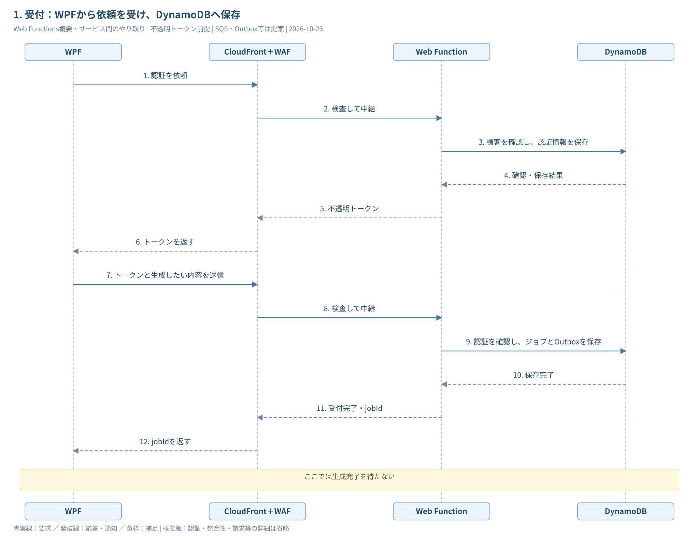
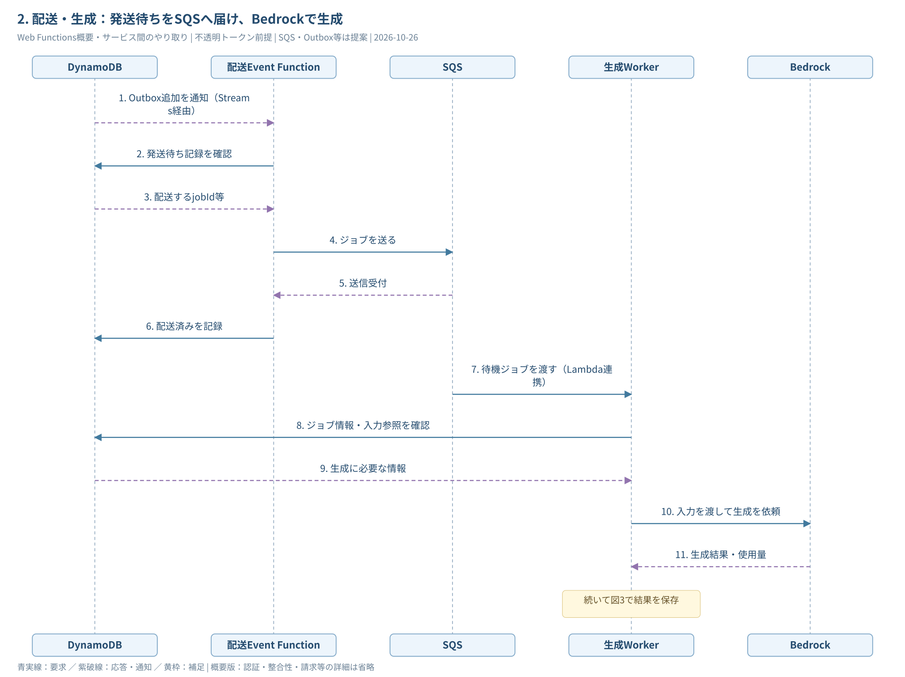
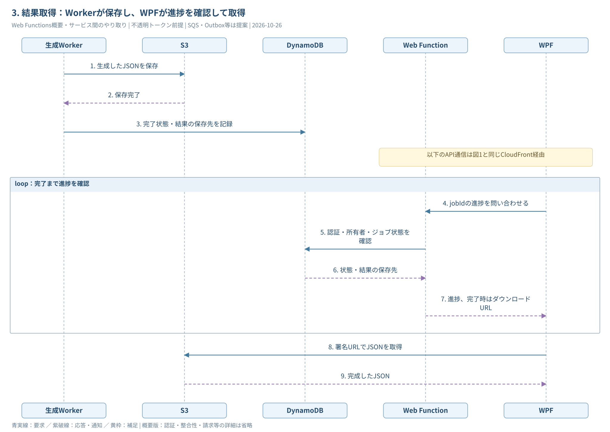

# Web Functions案：サービス間のやり取り・概要

**最初に大枠を掴むための図。** 認証の検証方法、冪等性、実行権、再試行、残量・請求などの細かな仕様を省き、サービス間で何を渡すかに絞った。

[全体SVG](AWSシーケンス図_WebFunctions_概要.svg) / [draw.io（3ページ）](AWSシーケンス図_WebFunctions_概要.drawio) / [詳細シーケンス](AWSシーケンス図_WebFunctions.md) / [構成図](AWS構成図_WebFunctions_業務フロー.svg)

図1→図2→図3で1件の依頼が進む。入口のWeb Functionsと、Outbox・SQSを使う配送は比較・検討中の案。図を追加しても採用確定にはしない。

| サービス | 大まかな役割 |
| --- | --- |
| CloudFront＋WAF | WPFからの通信を検査してWebへ中継する |
| Web Function | 認証、依頼の受付、進捗・結果の案内をする |
| DynamoDB | 顧客・認証情報、ジョブの状態、発送待ち記録を保存する |
| 配送Event Function | 発送待ち記録を読み、SQSへジョブを届ける |
| SQS | 生成待ちのジョブを保持し、Workerへ渡す |
| 生成Worker | Bedrockに生成を依頼し、結果と状態を保存する |
| Bedrock | 入力をもとにJSONを生成する |
| S3 | 完成したJSONを保存し、WPFのダウンロードに応答する |

## 1. 受付：WPFから依頼を受け、DynamoDBへ保存



<details>
<summary>編集用Mermaidソース</summary>

```text
sequenceDiagram
    participant C as WPF
    participant F as CloudFront＋WAF
    participant A as Web Function
    participant D as DynamoDB
    C->>F: 認証を依頼
    F->>A: 検査して中継
    A->>D: 顧客を確認し、認証情報を保存
    D-->>A: 確認・保存結果
    A-->>F: 不透明トークン
    F-->>C: トークンを返す
    C->>F: トークンと生成したい内容を送信
    F->>A: 検査して中継
    A->>D: 認証を確認し、ジョブとOutboxを保存
    D-->>A: 保存完了
    A-->>F: 受付完了・jobId
    F-->>C: jobIdを返す
    Note over C,D: ここでは生成完了を待たない
```

</details>

**OutboxはDynamoDBに置く「SQSへの発送待ち記録」。** WPFには受付完了を返し、生成は後から進む。認証は毎ジョブで発行し直すのではなく、有効なトークンを再利用する。

## 2. 配送・生成：発送待ちをSQSへ届け、Bedrockで生成



<details>
<summary>編集用Mermaidソース</summary>

```text
sequenceDiagram
    participant D as DynamoDB
    participant R as 配送Event Function
    participant Q as SQS
    participant W as 生成Worker
    participant B as Bedrock
    D-->>R: Outbox追加を通知（Streams経由）
    R->>D: 発送待ち記録を確認
    D-->>R: 配送するjobId等
    R->>Q: ジョブを送る
    Q-->>R: 送信受付
    R->>D: 配送済みを記録
    Q->>W: 待機ジョブを渡す（Lambda連携）
    W->>D: ジョブ情報・入力参照を確認
    D-->>W: 生成に必要な情報
    W->>B: 入力を渡して生成を依頼
    B-->>W: 生成結果・使用量
    Note over W: 続いて図3で結果を保存
```

</details>

**配送係はSQSへ届けるまで。生成するのはWorkerとBedrock。** 入力の保存・取得、キューの再送・削除などは省略。生成はWeb FunctionのHTTP応答とは独立して進むため、図1の受付応答と配送開始の厳密な前後関係は固定ではない。

## 3. 結果取得：Workerが保存し、WPFが進捗を確認して取得



<details>
<summary>編集用Mermaidソース</summary>

```text
sequenceDiagram
    participant W as 生成Worker
    participant S as S3
    participant D as DynamoDB
    participant A as Web Function
    participant C as WPF
    W->>S: 生成したJSONを保存
    S-->>W: 保存完了
    W->>D: 完了状態・結果の保存先を記録
    Note over A,C: 以下のAPI通信は図1と同じCloudFront経由
    loop 完了まで進捗を確認
        C->>A: jobIdの進捗を問い合わせる
        A->>D: 認証・所有者・ジョブ状態を確認
        D-->>A: 状態・結果の保存先
        A-->>C: 進捗、完了時はダウンロードURL
    end
    C->>S: 署名URLでJSONを取得
    S-->>C: 完成したJSON
```

</details>

**完了通知をサーバーからプッシュする方式ではなく、WPFから問い合わせる方式。** 問い合わせ自体は生成中から始まり、Workerの処理と並行する。図は保存から取得までの関係を示しており、保存完了後に初めてポーリングを始めるという意味ではない。

結果の署名URLはWeb Functionが作り、JSON本体はWPFがS3から直接取得する。APIのCloudFront・WAFを通るのは認証・受付・状態照会で、S3への直接ダウンロードは別経路になる。

## 詳細を知りたくなったら

[詳細シーケンス](AWSシーケンス図_WebFunctions.md)で重複配送や障害回復を確認する。概要図では、失敗・再試行・請求・残量処理を省略しており、それらが不要という意味ではない。
