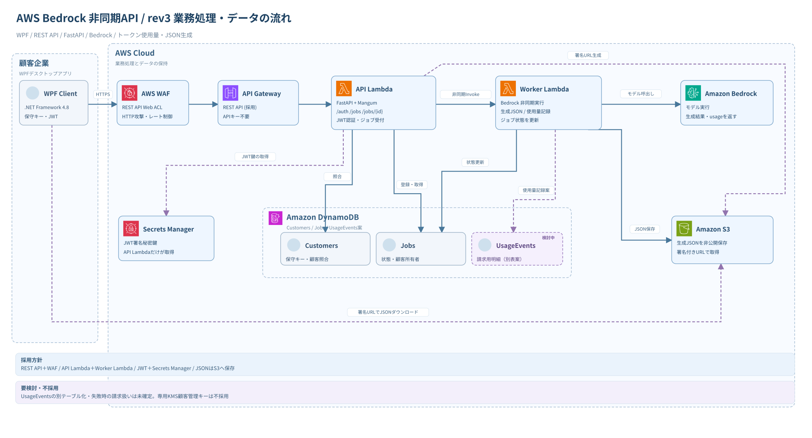

# AWS構成図 — リビジョン管理

| 版 | 編集用 | 画像プレビュー | 内容 |
| --- | --- | --- | --- |
| **rev1** | [draw.io](aws-architecture-rev1.drawio) | [SVG](aws-architecture-rev1.svg) | 変更前の構成を凍結保存。DynamoDBは1つのサービス枠 |
| **rev2** | [draw.io](aws-architecture-rev2.drawio) | [SVG](aws-architecture-rev2.svg) | 前版。JSON保存・監査ログ連携を追加した段階（レイアウト調整前） |
| **rev3（旧版・CSV形式）** | **[draw.io（2ページ）](aws-architecture-rev3.drawio)** | **[業務処理SVG](aws-architecture-rev3-business.svg)** / **[セキュリティSVG](aws-architecture-rev3-security.svg)** | architecture.mdに照合し、業務・監査の線を分けて再配置 |
| 旧互換パス | [draw.io](aws-architecture.drawio) | [SVG](aws-architecture.svg) | rev1相当の旧リンク（既存の参照用） |

| **rev4（最新・JSON形式）** | **[draw.io（2ページ）](aws-architecture-rev4.drawio)** | **[業務処理SVG](aws-architecture-rev4-business.svg)** / **[セキュリティSVG](aws-architecture-rev4-security.svg)** | **rev3を維持したまま生成物の形式だけCSVからJSONへ変更** |

### rev4：業務処理・データの流れ

### rev4：セキュリティ・監査

**編集:** 2ページを1ファイルにまとめた [aws-architecture-rev4.drawio](aws-architecture-rev4.drawio) を diagrams.net で開く。rev1・rev2・rev4は変更せず保存している。

### architecture.mdとの対応確認（2026-10-15）

- 採用確定: REST API＋WAF、API Lambda（FastAPI＋Mangum）、Worker Lambdaの非同期実行、既存保守キーのDynamoDB照合とJWT、Secrets Manager。
- データと結果: DynamoDB内にCustomers / Jobsを表示し、UsageEventsの物理別テーブル化は**検討中**。WorkerからBedrock呼び出し、S3へのJSON保存をそれぞれ表示。API Lambdaによる署名URL生成と、WPFからS3へのJSON取得は別線。
- セキュリティ・監査: CloudWatchでAPI/Lambdaログ、CloudTrailでAWS操作監査・監査専用S3保存、GuardDuty→EventBridge→SNSの通知案を別ページに表示。実際の監視や通知設定は未実施。
- IAMと暗号化: API/Workerの実行ロール分離、専用KMSカスタマー管理キー不採用（標準暗号化は利用）を表示。
- rev4では線と文字が重なりにくいよう配置を変更。**SVGの接続ラベルとサービス枠の座標衝突を検査し0件**。draw.io側も同じ配置・ラベルに調整した。ただしビューアやフォントによる見え方は差が出る可能性がある。

図中のAWS WAFはREST APIステージに関連付けるWeb ACLを論理的に前段に示しており、独立したHTTP中継サービスを意味しない。

## rev4に反映した採用・導入推奨サービス

- **AWS WAF + API Gateway REST API**: インターネット公開APIの保護とアクセス制限。HTTP APIへのWAF直接接続はできないためREST APIを推奨。
- **CloudWatch**: API Gatewayアクセスログ、API Lambda/Worker Lambdaの実行・アプリ監査ログ、メトリクス・アラーム。
- **CloudTrail**: AWS管理イベントと請求用DynamoDB操作の必要なデータイベントを記録し、監査用S3に保存。
- **GuardDuty**: 不審な活動の検知。検出結果の通知はEventBridge/SNS等で**別途構築が必要**。S3 Protection/Lambda Protectionなど有料オプションは利用量・要件次第で個別判断。
- **Secrets Manager**: 認証トークン署名に使う秘密情報の保管・管理。利用する鍵方式によって要再評価。
- **S3**: Worker Lambdaで生成したJSONを非公開保管し、API Lambdaが顧客の所有者照合後に署名付きURLを発行。請求監査証跡は別の保存先として管理。

これらは**設計上の推奨採用構成**であり、AWSにデプロイ済み・IAM設定済みではありません。

## 引き続き検討中・今回は採用しないもの

- **DynamoDB UsageEventsの物理別テーブル化**: 課金根拠を分離する案は維持するが、物理設計は未確定。
- **S3 Object Lock**: 請求明細/監査ログの改ざん耐性と保持期間の要件が決まるまで検討中。
- **専用AWS KMSカスタマー管理キー**: **現時点で不採用**。標準的な保存時暗号化（DynamoDB、S3 SSE-S3）は継続。
- **CloudFront＋HTTP API方式**: REST API＋WAFの代替案として記録、rev2には採用しない。

## 接続線について

- 実線: アプリの業務通信（WPF→API→Worker→Bedrock / Worker→JSONのS3保存など）
- 破線: ログ収集・監査・秘密情報の読み出し・請求テーブル検討などの補助的な関係
- GuardDutyは監視情報を分析するサービスであり、すべての業務リクエストがGuardDutyを経由する意味ではありません。
- CloudTrailはAWS操作の証跡、CloudWatch/アプリログはAPI顧客操作と障害追跡に利用します。

## AWSアイコン素材

AWS公式アイコン: https://aws.amazon.com/architecture/icons/  
図の生成時に参照した公開カタログ: https://github.com/phergoualch/aws-icons

判断の経緯は [ADR一覧](../adr/README.md) を参照。図のrev4は現在の設計の見取り図、rev1・rev2・rev3は比較用の版として扱い、正式な採用判断はADRで記録する。
