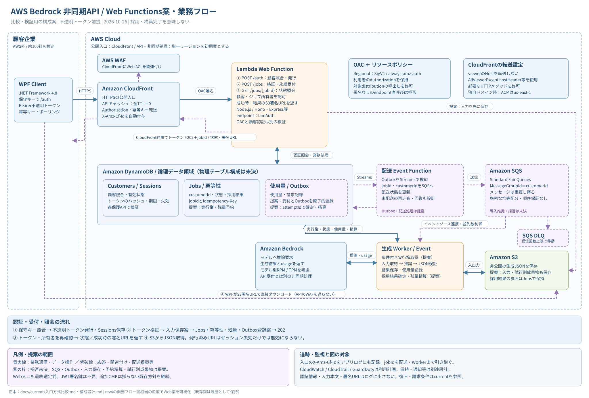

# 構成図

## 現在の比較用構成図

[REST API案・Web Functions案の全体構成図](../current/入口方式比較.md)を参照。不透明トークンを前提に、同じ非同期処理・データ管理で比較する。両案とも最終採用前。

### Web Functions案：業務処理・データの流れ

[構成図のdraw.io](AWS構成図_WebFunctions.drawio) / [シーケンス図のdraw.io（6ページ）](AWSシーケンス図_WebFunctions.drawio) / [SVGを開く](AWS構成図_WebFunctions_業務フロー.svg) / [シーケンス図・説明](AWSシーケンス図_WebFunctions.md) / [シーケンスSVG全体](AWSシーケンス図_WebFunctions.svg) / [読み方・設定・処理順](AWS構成図_WebFunctions_業務フロー.md)

rev4の業務フロー図相当の粒度で、現在の不透明トークン前提を反映。CloudFront＋WAF＋OAC、Web受付、DynamoDB、配送・生成、Bedrock、S3取得を示す。SQS・Outbox等は未承認の提案として明示し、Web案の採用確定を意味しない。

## 過去の図（履歴）

このフォルダの初版〜rev4のSVG・draw.ioは旧設計。最新の不透明トークン・SQS・Outbox案を描いたものではない。最新図として使わない。

| 版 | 編集元 | 表示用 |
| --- | --- | --- |
| 初版 | [draw.io](AWS構成図_初版.drawio) | [SVG](AWS構成図_初版.svg) |
| rev1 | [draw.io](AWS構成図_rev1.drawio) | [SVG](AWS構成図_rev1.svg) |
| rev2 | [draw.io](AWS構成図_rev2.drawio) | [SVG](AWS構成図_rev2.svg) |
| rev3 | [draw.io](AWS構成図_rev3.drawio) | [業務](AWS構成図_rev3_業務フロー.svg) / [監査](AWS構成図_rev3_セキュリティ監査.svg) |
| rev4 | [draw.io](AWS構成図_rev4.drawio) | [業務](AWS構成図_rev4_業務フロー.svg) / [監査](AWS構成図_rev4_セキュリティ監査.svg) |

[docsの入口](../README.md) / [履歴の案内](../archive/README.md)
