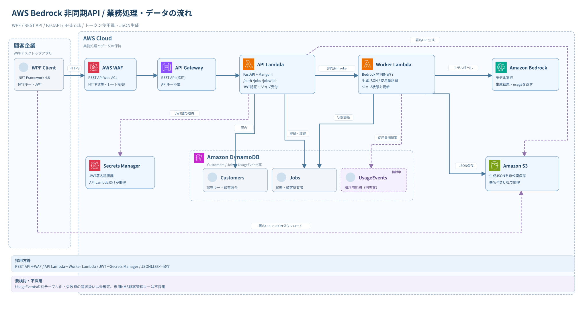
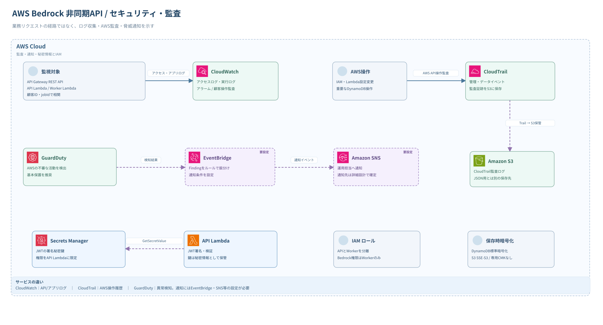

# AWS構成図

| 版 | 編集用 | プレビュー |
| --- | --- | --- |
| **rev4（JSON）** | [draw.io（2ページ）](AWS構成図_rev4.drawio) | [業務処理](AWS構成図_rev4_業務フロー.svg) / [セキュリティ・監査](AWS構成図_rev4_セキュリティ監査.svg) |
| rev3（CSV） | [draw.io](AWS構成図_rev3.drawio) | [業務処理](AWS構成図_rev3_業務フロー.svg) / [セキュリティ・監査](AWS構成図_rev3_セキュリティ監査.svg) |
| rev2 | [draw.io](AWS構成図_rev2.drawio) | [SVG](AWS構成図_rev2.svg) |
| rev1 | [draw.io](AWS構成図_rev1.drawio) | [SVG](AWS構成図_rev1.svg) |

## 業務処理

## セキュリティ・監査

**図の読み方**：実線は処理経路、破線は補助的な連携・検討対象。DynamoDBの`UsageEvents`は物理分割未決定。WAFはREST APIステージに関連付けるWeb ACLを前段として表現。

AWSサービスアイコン：[AWS Architecture Icons](https://aws.amazon.com/architecture/icons/)（[SVG素材カタログ](https://github.com/phergoualch/aws-icons)）。

## 2026-10-19の更新

**rev4はSQSを介さない直接非同期Invoke方式の履歴図。** SQS Standard Fair Queuesは今回「追加を推奨する検討候補」であり、rev4のSVG/draw.ioには未反映。提案構成の最新概念図は[構成設計（Mermaid）](../構成設計.md)と[API方式・SQS比較試算](../比較検討/2026-10-19_非同期Bedrock基盤とAPI方式の比較.md)を参照。

## 2026-10-25：不透明トークン・入口方式の比較図

[REST API案とWeb Functions案の全体構成図](../比較検討/2026-10-25_REST-APIとWeb-Functionsの構成比較.md)に両案のMermaid図を掲載。SQS・Outbox・Worker・データ管理を揃え、入口の違いを比較する。既存SVG／draw.ioは履歴として維持する。
