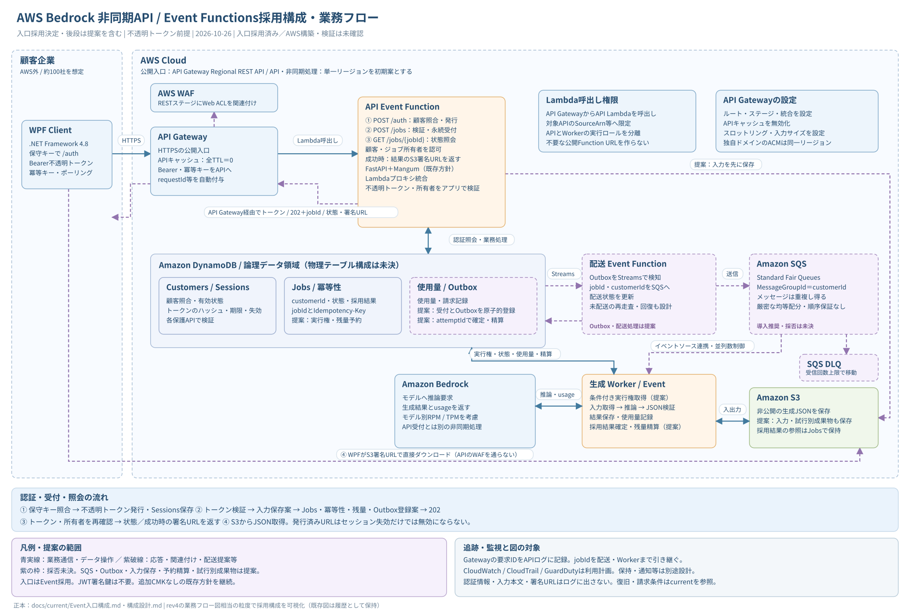

# 構成図

## 現行：Event Functions採用構成

入口は**API Gateway Regional REST API＋WAF＋API Event Function**を採用（2026-10-26）。SQS・Outbox等は引き続き提案。

- [採用構成・設定・検証条件](../current/Event入口構成.md)
- 構成図：[SVG](AWS構成図_EventFunctions_業務フロー.svg) / [draw.io](AWS構成図_EventFunctions.drawio)
- 概要シーケンス：[説明](AWSシーケンス図_EventFunctions_概要.md) / [SVG](AWSシーケンス図_EventFunctions_概要.svg) / [draw.io・3ページ](AWSシーケンス図_EventFunctions_概要.drawio)

## 検討履歴：Web Functions案

**現行構成ではない。** 検討した比較・構成図・SVG・draw.io・編集元を既存パスで保存する。[比較の履歴](../比較検討/2026-10-25_REST-APIとWeb-Functionsの構成比較.md)

### 当時の業務フロー・シーケンス

**大枠から読む：** [サービス間のやり取り・概要](AWSシーケンス図_WebFunctions_概要.md) / [概要SVG](AWSシーケンス図_WebFunctions_概要.svg) / [概要draw.io（3ページ）](AWSシーケンス図_WebFunctions_概要.drawio)

[構成図のdraw.io](AWS構成図_WebFunctions.drawio) / [シーケンス図のdraw.io（6ページ）](AWSシーケンス図_WebFunctions.drawio) / [SVGを開く](AWS構成図_WebFunctions_業務フロー.svg) / [シーケンス図・説明](AWSシーケンス図_WebFunctions.md) / [シーケンスSVG全体](AWSシーケンス図_WebFunctions.svg) / [読み方・設定・処理順](AWS構成図_WebFunctions_業務フロー.md)

rev4の業務フロー図相当の粒度で、検討当時の不透明トークン前提を反映。CloudFront＋WAF＋OAC、Web受付、DynamoDB、配送・生成、Bedrock、S3取得を示す。SQS・Outbox等は未承認の提案として明示し、現行の採用構成ではない。

## 過去の図（履歴）

このフォルダの初版〜rev4のSVG・draw.ioは旧設計。最新の不透明トークン・SQS・Outbox案を描いたものではない。最新図として使わない。

| 版 | 編集元 | 表示用 |
| --- | --- | --- |
| 初版 | [draw.io](AWS構成図_初版.drawio) | [SVG](AWS構成図_初版.svg) |
| rev1 | [draw.io](AWS構成図_rev1.drawio) | [SVG](AWS構成図_rev1.svg) |
| rev2 | [draw.io](AWS構成図_rev2.drawio) | [SVG](AWS構成図_rev2.svg) |
| rev3 | [draw.io](AWS構成図_rev3.drawio) | [業務](AWS構成図_rev3_業務フロー.svg) / [監査](AWS構成図_rev3_セキュリティ監査.svg) |
| rev4 | [draw.io](AWS構成図_rev4.drawio) | [業務](AWS構成図_rev4_業務フロー.svg) / [監査](AWS構成図_rev4_セキュリティ監査.svg) |

[docsの入口](../README.md) / [履歴の案内](../archive/README.md)
