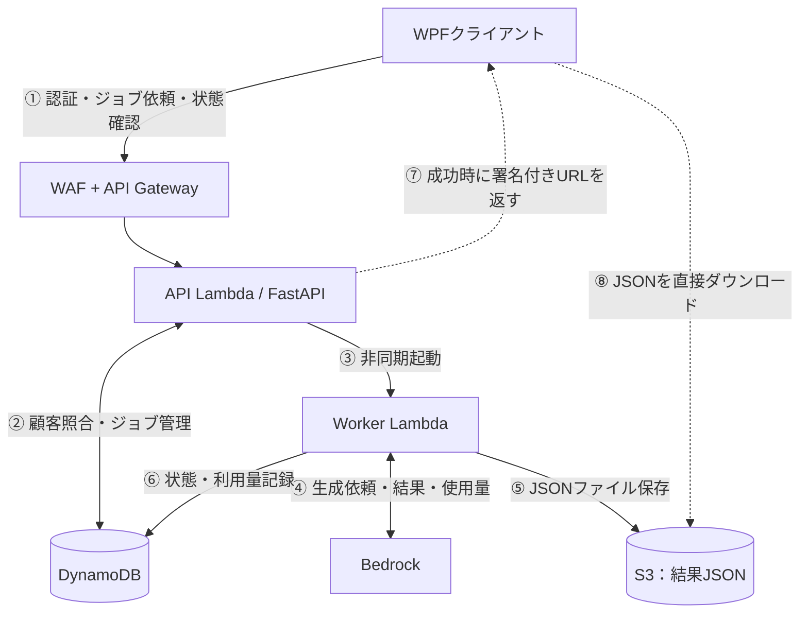

# AWS構成を自分の言葉で説明するための理解ノート

> **作成当時の学習・レビュー資料。** 最新の設計・採否は[現在の検討状況](../current/検討状況.md)を参照。

> 読み方：最初は「全体像 → 1回の処理 → DBとS3」を読めば十分。その後、各サービスの役割と想定質問を確認する。

今回のシステムは、**複数の顧客企業が利用するWPFデスクトップアプリからAmazon BedrockでJSONを生成するサービス**。API受付とAI実行を分離し、顧客認証・ジョブ管理・利用量に基づく請求・監査まで考慮する。

GitHubの図と併せて読む：[全体アーキテクチャ](../archive/旧設計/構成設計.md) ／ [業務構成図](../diagrams/AWS構成図_rev4_業務フロー.svg) ／ [セキュリティ・監査図](../diagrams/AWS構成図_rev4_セキュリティ監査.svg)

## 1. 最初に押さえる「登場人物の役割」

| 役割 | サービス | 何をしている？ |
| --- | --- | --- |
| 顧客の画面 | **WPF** | ログイン、生成依頼、進行状況の確認、JSON取得 |
| 門番 | **AWS WAF** | 明らかに怪しいHTTPリクエストや過剰アクセスを制限 |
| 受付窓口 | **API Gateway REST API** | インターネットからのHTTPSリクエストをAPI Lambdaへ渡す |
| 受付係 | **API Lambda（FastAPI）** | 認証、ジョブ受付、状況照会、ダウンロード許可 |
| 作業担当 | **Worker Lambda** | Bedrockを呼び出し、JSON保存・ジョブ状態更新・使用量記録 |
| AIエンジン | **Amazon Bedrock** | モデルを実行して生成結果と取得可能な利用量情報を返す |
| 管理台帳 | **DynamoDB** | 顧客情報、ジョブの状態、請求用の使用量データ |
| ファイル保管庫 | **Amazon S3** | 生成したJSONファイル本体を保存し、顧客へ配信 |
| 金庫 | **Secrets Manager** | JWT署名に使う秘密鍵を管理 |
| 監視・監査 | **CloudWatch / CloudTrail / GuardDuty** | 障害・利用操作・AWS操作・不審な活動を把握 |

**この構成の肝：** HTTPリクエストへの応答はAPI Lambdaで素早く返し、時間のかかるAI生成をWorker Lambdaに任せる。その間の状態はDynamoDB、完成した成果物はS3に置く。

## 2. 1回の処理を頭の中で追う



### ステップA：認証（POST /auth）

1. WPFが、顧客名と既存の**保守キー**をHTTPSで送る。
2. WAFがリクエストを検査し、API GatewayがAPI Lambdaへ転送。
3. API LambdaのFastAPIがDynamoDBの`Customers`を照合。
4. 合致したら、JWTを発行してWPFに返す。JWTの署名鍵はSecrets Managerから取得する。

**覚えること：** 保守キーは最初の身元確認材料。JWTは、その後のAPI呼び出しで使う期限付きの認証トークン。API Gatewayの「APIキー」という別機能は使わない。

### 補足：JWTは毎回発行するの？

**いいえ。有効期限内のJWTはWPF側で保持し、次回の生成AI利用でも再利用する。** Lambda側がJWTを保持して返し直す仕組みではない。`POST /auth`はJWTの新規取得・再認証のためのAPI。

例えばJWTの有効期間を**1時間と仮定**すると、次の動きになる。

| 時刻 | 利用者の操作 | WPFがすること |
| --- | --- | --- |
| 10:00 | 1回目の生成AI利用 | `POST /auth`でJWT取得（11:00まで有効）。取得したJWTで`POST /jobs` |
| 10:05 | 1回目が完了 | JSON取得。**JWTはWPFのメモリに保持** |
| 10:30 | 2回目の生成AI利用 | **`POST /auth`は呼ばず**、同じJWTで直接`POST /jobs` |
| 11:00以降 | さらに利用 | JWTが期限切れなら、`POST /auth`で新しいJWTを取得してから利用 |

WPFは`Authorization: Bearer <JWT>`を`POST /jobs`や`GET /jobs/{jobId}`に付ける。**API LambdaはリクエストごとにJWTの署名と期限を検証するが、通常は保守キーを毎回照合しない。**

WPFの実装ではJWTと期限をメモリで管理し、期限の少し前に再認証する。`401`を受けた場合の再認証も扱う。ただし**失敗したジョブ投入の無条件な再送は、二重登録・二重課金に注意**する。WPFを再起動してメモリ上のJWTが消えた場合も再認証する。

**設計上の注意：** 上記の1時間は説明用の仮定。API仕様の`expiresIn: 900`は15分の例で、正式なJWT有効期限は未決定。また、JWTが有効期間内でも顧客停止を即時反映したい場合は別の失効確認が必要になる。

### ステップB：生成依頼（POST /jobs）

1. WPFがJWTと生成したいテキストを送る。
2. API LambdaがJWTを検証し、DynamoDBの`Jobs`に`QUEUED`を記録。
3. API LambdaがWorker Lambdaを**非同期で起動**。
4. WPFには生成完了を待たず、`202 Accepted`と`jobId`を返す。

**覚えること：** 202は「処理の受付」であり「AI生成の成功」ではない。

### ステップC：AI処理（Worker）

1. Workerは`RUNNING`を記録し、Bedrockにモデル実行を依頼。
2. Bedrockの応答から生成内容と、モデル/APIで取得できる入力・出力トークン使用量を得る。
3. WorkerはJSONを検証・整形し、S3に`application/json`で保存。
4. 併せて利用量をサーバー側で記録し、ジョブの状態を`SUCCEEDED`または`FAILED`に更新。

**覚えること：** トークン使用量は顧客のPCに申告させない。正確な請求のため、AWS側で得た情報を保存する。

### ステップD：完了確認とダウンロード（GET /jobs/{jobId}）

1. WPFは定期的にジョブを照会する（**ポーリング**）。
2. API LambdaがJWT・ジョブの顧客所有者・状態を確認する。
3. 成功済みなら、S3の**署名付きURL**を短時間だけ有効にして返す。
4. WPFはそのURLへHTTPS GETし、**API Lambdaを通さずS3からJSONを取得**する。

**覚えること：** Lambdaを通さないのは*ファイル本体の転送だけ*。ダウンロードしてよいかの判定はAPI Lambdaが実施する。

---

## 3. 深掘り：DynamoDBとS3は何が違う？

この質問には、次のように説明できる。

> 「DynamoDBは処理の管理台帳、S3は生成ファイルの保管庫です。ジョブIDで状況を素早く調べたいデータはDynamoDBに置き、約1MBになるJSON本体はS3に保存します。DynamoDBには、そのJSONがS3のどこにあるかを記録します。」

### DynamoDBとは

AWSが運用する**NoSQLデータベース**。テーブル内のアイテム（レコード）をキーで素早く検索・更新するのが得意。OS・DBサーバーを自分たちで管理する必要がない。今回の「ジョブIDを指定して状態を取得」に合う。

- `Customers`：顧客ID、会社名、保守キーの検証材料、有効/無効など。
- `Jobs`：jobId、customerId、`QUEUED/RUNNING/SUCCEEDED/FAILED`、S3オブジェクトキー、エラーコードなど。
- `UsageEvents`（**保存方式は検討中**）：モデル・顧客・jobIdごとの実トークン使用量と課金計算の証拠。

**注意：DynamoDBの1アイテムは最大400KB。** 今回の生成JSONは最大約1MBの想定なので、結果の全体を1アイテムに入れることはできない。

### S3とは

AWSの**オブジェクトストレージ**。バケット（保管場所）の中へ、キー（ファイルの識別名）を指定してJSON・画像・ログなどのオブジェクトを保存する。ファイル保存・再取得・ダウンロード配信に向く。

例えば、次のイメージ。

```text
S3 バケット: ai-results-private
オブジェクトキー: customers/customer-001/jobs/job-123/result.json
ファイル内容: { "summary": "...", "items": [...] }
Content-Type: application/json
```

DynamoDBの`Jobs`に入るのは次のようなデータ（概念例）。

```json
{
  "jobId": "job-123",
  "customerId": "customer-001",
  "status": "SUCCEEDED",
  "resultS3Key": "customers/customer-001/jobs/job-123/result.json"
}
```

**結果本体のJSONはS3**、**その所在と状態はDynamoDB**。バケット名・キー名は設計例であり、まだ確定した命名ではない。

### 「S3を使わずに全部DBにできないの？」

小さいJSONなら別設計も可能。ただし今回は約1MBの可能性があり、DynamoDBの400KB上限を超える。また、ジョブ管理とファイル配信は特性が違う。S3に分けることで、大きめの生成物の保存・保持期限の設定・直接ダウンロードが扱いやすい。

### 「S3が非公開なのにWPFがダウンロードできるの？」

S3の**署名付きURL**を使う。API LambdaはJWTと所有者を確認したあと、自身のIAM権限で期限付きのURLを生成する。S3はその署名を検証して、一時的に特定オブジェクトの取得を許可する。

署名付きURLは有効期限中、URLを知っている人が使える**一時的な鍵のようなもの**。秘密情報として扱い、ログに残さない。発行済みURLはJWT失効と自動連動しない点にも注意。

---

## 4. Lambdaは結局どんなサービス？ なぜ2個？

### AWS Lambdaとは

**必要なときだけプログラムを実行するサービス（サーバーレスの計算処理）**。EC2のように自分たちで常駐サーバーを起動・パッチ適用する必要がない。関数ごとにコード・実行ロール・タイムアウト等を設定する。

### API Lambda：受付に専念

Pythonの**FastAPI**というWebフレームワークで3つのAPIを実装する。

- `POST /auth`：顧客認証とJWT発行。
- `POST /jobs`：ジョブ登録とWorkerの非同期起動。
- `GET /jobs/{jobId}`：ジョブ照会と署名付きURLの発行。

**Mangum**はAPI GatewayからLambdaへ渡されるイベントを、FastAPIが理解するASGIリクエストへ変換するアダプター。**FastAPIはAWSサービス名ではなく、Pythonのライブラリ**。MangumもAWSサービスではなくライブラリ。

### Worker Lambda：重い処理に専念

Bedrock呼び出し、JSON検証、S3への書き込み、DynamoDBの状態・使用量記録を担当。外部から直接呼び出す公開HTTPエンドポイントは設けない。

**なぜ分ける？** Bedrockの処理完了までHTTP接続を維持しなくて済み、API側とWorker側でタイムアウト・権限・障害対応を分けられるから。特にAPI LambdaにBedrock実行権限を付けなくてよい。

### 非同期とポーリングの違い

- **非同期実行**：API LambdaはWorkerの完了を待たずに受付結果を返すこと。
- **ポーリング**：WPFが「終わった？」と一定間隔でAPIへ確認すること。

両者は対応している。処理が非同期だからこそ、別の方法で完了を確かめる必要がある。今回はポーリング＋DynamoDBの状態管理を採用している。

### 「1MBなら同期処理にできるのでは？」

**ファイルサイズと生成所要時間は別の問題。** JSONが1MBでも生成に数十秒以上かかる場合がある。同期化にはAPIタイムアウト・失敗時の再試行・通信断などの設計変更が伴うため、今回は非同期構成を維持する。

---

## 5. API GatewayとWAFは何が違う？

### Amazon API Gateway

外部向けHTTPS APIの**入口・転送窓口**。URL、HTTPメソッド、Lambdaとの統合、スロットリング、アクセスログなどを扱う。今回のRegional **REST API**では、`ANY /{proxy+}` でAPI Lambdaへまとめて転送し、**実際の`/auth`や`/jobs`のルーティングはFastAPI側**で行える。

**API Gatewayの「APIキー」と既存の「保守キー」は別物。** API Gateway独自のAPIキーは使わず、顧客が持っている保守キーをアプリ側で検証する。

### AWS WAF

Web Application Firewall。APIに届くHTTPリクエストを検査し、攻撃パターンや過剰なリクエストを制限する。**REST APIステージにWeb ACLを関連付ける**。構成図では入口の手前に描くが、独立した中継サーバーを起動するイメージではない。

**WAFは認証の代わりにはならない。** WAFが許可したリクエストでも、FastAPIはJWTやジョブの所有者を確認する。

### 2つをどう説明する？

「WAFが入口で不審なアクセスを選別し、API GatewayがHTTPリクエストをLambdaへ渡します。APIの業務的な認証・認可はFastAPIが行います。」

---

## 6. BedrockはChatGPTやLambdaと何が違う？

**Amazon Bedrock**は、AWSから基盤モデルをAPIで利用するためのマネージドサービス。自分たちでGPUサーバーやモデルの配備を運用せず、許可したモデルに入力を送って推論結果を得る。

- Lambda：**業務プログラムを実行する側**。入力を組み立て、Bedrockを呼び、結果を保存する。
- Bedrock：**モデルを実行する側**。入力からテキストなどを生成する。
- S3：**生成結果を保管する側**。Bedrockの代わりにAIを動かすものではない。

生成したテキストが常に正しいJSONとは限らない。Worker側でパース・スキーマ検証・エラー処理を行う設計が必要。出力形式はJSON、生成物の最大サイズは約1MBの想定。

**請求に重要な点：** Bedrockの利用料金と、顧客に自社料金で請求する金額は同じとは限らない。入力・出力トークン等の実績をサーバー側で記録して、自社の料金計算に使う。

---

## 7. Secrets Manager・JWT・IAMはどこが違う？

混同しがちだが、扱う「相手」が違う。

| 用語 | 何か | 今回の役割 |
| --- | --- | --- |
| 保守キー | 既存顧客を確認するための材料 | 最初の`/auth`で照合 |
| JWT | 署名付きの期限付きトークン | WPFから`/jobs`等を使うときの認証情報 |
| Secrets Manager | 秘密情報を管理するAWSサービス | JWTの署名鍵を安全に保管 |
| IAM | AWSリソースを操作できる主体と権限を決める仕組み | API Lambdaは顧客DB/ジョブ参照、WorkerはBedrock/S3書込等に限定 |

**JWTの認証は「顧客が誰か」**、**IAMは「そのLambdaがAWS上で何をできるか」**。JWTがあるだけではS3やBedrockを操作できない。逆にLambdaにIAM権限があっても、顧客のジョブ所有者チェックを省略してはいけない。

例：API Lambdaは署名URL生成に必要なS3取得権限を持つが、Worker LambdaはS3へJSONを書き込む権限を持つ。役割によって権限を分ける。

---

## 8. CloudWatch、CloudTrail、GuardDutyは似ているけど別物

| サービス | どんなもの？ | 今回知りたいことの例 |
| --- | --- | --- |
| **CloudWatch** | ログ・メトリクス・アラーム | `POST /jobs`が何件失敗した？ Workerがタイムアウトした？ |
| **CloudTrail** | AWS API操作の監査記録 | 誰のAWS権限で設定を変更した？ S3やDynamoDBにどのようなAPI操作があった？ |
| **GuardDuty** | AWS環境での不審な活動の検知 | 認証情報の悪用や異常なアクセスの兆候がある？ |
| **EventBridge** | イベントを条件で振り分けるサービス | GuardDutyの検知結果を通知処理へ渡す |
| **Amazon SNS** | 通知を配信するサービス | 異常検知をメール等で運用担当者へ送る |
| **AWS Budgets** | AWS費用の予算管理・通知 | Bedrockや関連AWS料金が想定を超えそうか？ |

### CloudWatch vs CloudTrail

CloudWatchは主に**アプリがどう動いたか**。CloudTrailは主に**AWS上でどんなAPI操作が行われたか**。両方必要な場面がある。

例えば、顧客Aが`job-123`の生成を依頼した事実は、アプリ側でcustomerId/jobId等を記録しないと十分に追えない。CloudTrailだけで「顧客Aの操作履歴」が自動的に完成するわけではない。

CloudTrailの管理イベントと、S3オブジェクトアクセス・一部DynamoDB操作等の**データイベント**は区別して、必要な範囲を設定する。

### GuardDutyは遮断装置？

違う。基本的には**検知**。自動通知や遮断を行いたければEventBridge、SNSなどとの連携や別の対処を設計する。WAFもGuardDutyも「顧客ごとのJWT認証の代用品」ではない。

なおCloudWatch、CloudTrail、GuardDutyの**導入詳細や通知先は現在も設計対象**であり、AWS環境に設定済みという意味ではない。

---

## 9. KMSを採用しない、というのは「暗号化しない」の意味？

**違う。** 今回採用しないのは**専用のKMSカスタマー管理キーを自分たちで持つ設計**。DynamoDBの標準暗号化、S3のSSE-S3、HTTPS/TLSなどの保護は使う。

- 暗号化：許可されていない第三者による内容の読み取りを困難にする。
- 請求データの完全性：正しい権限を持つ処理が誤って上書きしたり、二重計上したりすることを防ぐ。

KMSを追加しても、正規のDynamoDB書き込み権限を持つプログラムがレコードを書き換える問題は自動では防げない。だから**IAMの最小権限、条件付き書き込み、監査、バックアップと請求明細の保全**を優先する。

---

## 10. 請求まわりで本当に難しいところ

今回のシステムは顧客企業ごとにトークン使用量から料金を計算するため、**JSONが生成できたか**と**トークンを何個使ったか**を分けて考える必要がある。

### 例：Bedrockは成功したが、その後にWorkerが落ちた

1. Bedrockの推論自体は完了し、トークンが消費された。
2. しかしWorkerがS3保存前、または使用量記録前に終了した。
3. アプリ上は`FAILED`や不明な状態になり得る。
4. 再試行するとBedrockを再度呼び、**AWS側では追加トークン消費が発生する可能性**がある。

したがって、`jobId`と個々のモデル実行の識別子、使用量イベントIDの対応付け、条件付き更新・二重計上防止・失敗時の突合が重要になる。

**まだ決めていない業務ルール：** 「トークンを消費したがJSONが手元に届かなかった場合、顧客に請求するか？」。これは技術構成だけで決まらないため、設計レビューで確認する。

### SQSは必要ない？

SQSは**メッセージをためて確実に順番に近い形で処理へ渡すためのキューサービス**。再試行・滞留監視・障害時の分離に役立つ。今の構成ではAPI Lambda→Worker Lambdaの非同期Invokeを採用し、SQSは未採用。請求の正確性・障害耐性が厳しくなれば、優先的に見直す候補。

---

## 11. 上司に聞かれそうな質問と、説明の骨子

| 質問 | 返答のポイント |
| --- | --- |
| なぜLambdaが2つ？ | API受付とAI生成で処理時間・責務・IAM権限が違うから。受付はすぐ202を返せる |
| なぜ非同期？ | Bedrock処理をHTTP接続の時間制限から分離するため。WPFはポーリングで完了確認 |
| なぜ結果JSONをDynamoDBへ保存しない？ | DynamoDBは1アイテム400KB。最大約1MBを想定するJSON本体はS3。DBには状態とS3キーを保存 |
| なぜS3へクライアントが直接アクセス？ | API Lambdaで認可して短命URLを発行。ファイル転送はS3に任せ、Lambdaの実行時間・サイズ制約を避ける |
| WAFとJWTは両方必要？ | WAFはHTTP攻撃の検査、JWTは利用者認証。目的が違う |
| 10:30に生成AIを再利用するときも認証し直す？ | 10:00に取得したJWTが有効ならWPFが再利用。`/auth`は不要。API Lambdaは毎リクエストJWTを検証 |
| CloudWatchとCloudTrailの違いは？ | 前者は稼働状況・アプリ操作ログ、後者はAWS API操作の監査証跡 |
| GuardDutyがあればWAFは不要？ | 不要にならない。GuardDutyは主に脅威検知、WAFは入口でのHTTP検査 |
| KMSを追加しないのは危険では？ | 専用顧客管理キーを使わないだけ。標準暗号化は継続。請求実績の整合性には条件付き書き込み・監査が直接効く |
| 顧客ごとの利用料金はどう算出？ | Workerで得たBedrockの実トークン使用量を顧客・ジョブ別に記録し、独自単価を適用。料金計算の詳細は設計中 |
| Lambda Web Functionsへ変えない？ | 現時点ではNode.js中心でPython/FastAPIの移植が必要。REST API＋WAFの既存方針を維持 |
| この構成は実装済み？ | いいえ。現在は設計方針であり、AWSへのデプロイ済みとは区別する |

---

## 12. 口頭で話す練習（長さ別）

### 20秒で説明

「WPFからAWSのREST APIへ依頼し、API Lambdaで認証と受付を行います。時間のかかるBedrock実行はWorker Lambdaに任せます。ジョブの状態はDynamoDB、生成したJSONはS3に保存し、クライアントはポーリング後に署名付きURLで取得します。」

### 1分で説明

「利用企業ごとに既存の保守キーで認証し、API LambdaがJWTを発行します。生成依頼が来たらジョブをDynamoDBへ登録し、Worker Lambdaを非同期起動するので、クライアントは結果を待たずジョブIDを受け取れます。WorkerはBedrockからJSONを生成してS3へ保存し、トークン使用量もサーバー側で記録します。クライアントは状態をポーリングし、完了したらAPI Lambdaが所有者を確認したうえでS3の短命署名URLを返します。入口はWAFで保護し、CloudWatchなどで運用を監視します。」

### 特に覚えておく3つの区別

1. **DynamoDBは管理台帳、S3は生成物の保管場所。**
2. **JWTは顧客の認証、IAMはAWSサービス間の権限。**
3. **CloudWatchは動作・障害、CloudTrailはAWS操作の監査、GuardDutyは脅威検知。**

---

## 13. セルフチェック（答えを隠して考える）

**Q1. API LambdaはBedrockを直接呼び出す？**  
**答え：** 呼び出さない。API LambdaはWorkerを非同期で起動し、WorkerがBedrockを呼ぶ。

**Q2. WPFはDynamoDBに直接接続する？**  
**答え：** しない。WPFはAPI Gatewayを通じてAPI Lambdaに問い合わせる。

**Q3. 顧客Aが顧客BのjobIdを知ったらJSONを取得できる？**  
**答え：** 取得させてはいけない。API LambdaがJWTのcustomerIdとジョブ所有者を照合してからURLを発行する。

**Q4. JSON保存にS3を使うのは、APIからのレスポンスが1MBを超えるから？**  
**答え：** 主な理由は生成物の保存・配信と、DynamoDBの1アイテム400KB制限。非同期処理の完了時に成果物を保持する場所も必要。

**Q5. トークンが消費され、保存に失敗した場合の請求可否は決まっている？**  
**答え：** 未決定。実使用量は記録し、顧客へ請求するかという業務ルールと分離して検討する。

**Q6. すべてのセキュリティサービスはもうAWS上に作成した？**  
**答え：** いいえ。現在の資料は設計方針。設定値や運用詳細もこれから決める。

**Q7. 同じWPFで30分後に再度AIを使う場合、JWTは誰が再利用する？**  
**答え：** WPFがメモリに保持したJWTを再利用する。有効期限内は`POST /auth`不要。API Lambdaは毎リクエストJWTを検証する。
## 2026-10-19補足：ゼロベース比較とSQSの導入検討

本ノート本文の「直接非同期Invoke」「SQS未採用」は元の採用案の説明。複数企業が並列で利用する条件で比較した結果、**Regional REST API + WAF直接連携 + 通常Lambda**を第一候補と再確認した。SQS Standard Fair Queuesの追加は導入推奨・**採用未確定**。

- 100社・20営業日・8時間、1社1日5/50/100ジョブで月1万/10万/20万ジョブ。
- SQS Standardに`MessageGroupId=customerId`を設定して企業間の待機偏りを緩和するが、企業ごとの利用上限や保証された実行枠ではない。
- Web Functionsの多重同時HTTP処理や課金体系は魅力だが、WAFにはCloudFront + オリジン保護が必要。非同期設計・S3・DynamoDB・ポーリングは変わらない。
- API受付料金・RPS・Workerの必要並列数は[2026-10-19比較試算](../比較検討/2026-10-19_非同期Bedrock基盤とAPI方式の比較.md)参照。費用も性能も実測ではない。
- rev4図はSQS追加前の履歴図。構成設計に追加候補のMermaid図を掲載。

