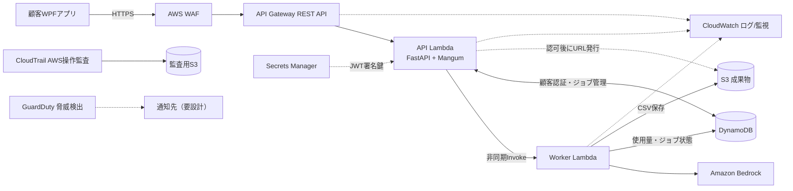

# AWS Bedrock連携システム 設計レビュー説明資料

**デザインレビュー用ドラフト v0.2｜2026-10-14｜対象：WPF × AWS × Bedrock**  
**位置づけ：構成と判断根拠のレビュー資料。AWSへの実装・デプロイ完了を示すものではない。設計判断はレビュー後にADRへ反映する。**

## 0. このレビューで合意したいこと

本システムは、複数の顧客企業がインターネット経由でWPFアプリを利用し、AWS Bedrockへ文章を渡してCSVを非同期生成するサービスである。既存の「保守キー＋顧客名」で認証し、新たなAPI Gateway APIキーは配布しない。**顧客別の実トークン使用量に独自の料金計算を行うため、利用明細の正確性と追跡可能性が最重要**である。

レビューで説明する主張は次の3点。

1. **入口の保護と既存顧客の利用継続を両立**：REST API＋WAFを使いつつ、既存保守キー認証・JWTを継続する。
2. **業務処理とAI処理を分離**：API Lambda（FastAPI＋Mangum）と非同期Worker Lambdaを分け、IAM権限と障害範囲を狭くする。
3. **暗号化よりも請求データの完全性を重点的に守る**：DynamoDB/S3の標準暗号化に加え、認可・冪等性・監査・PITR・使用量の突合を重視する。

**大きな保留事項：** **Bedrockでトークンを消費したにもかかわらず、CSVの生成・S3保存・顧客への結果返却が失敗した場合に、その使用量を顧客へ請求するかは未決定（要検討）**。失敗原因ごとの請求／非請求／返金・調整ルールは業務判断としてレビューで確認する。商用請求の根拠になるため、直接非同期Invokeだけで耐障害性が十分かは**レビューで重点確認**する。利用量・障害時の請求ルールが決まるまで、SQS等のキュー追加の要否を確定しない。

## 1. 全体構成（レビュー用の簡略図）

**図の読み方**：通常の通信と監査・鍵取得の関係を分ける。GuardDutyやCloudTrailはAPIリクエストの経由先ではない。DynamoDBは同一サービス枠内にCustomers・Jobs・使用量明細候補（UsageEvents）を描くが、**物理テーブル分割はまだ決めていない**。S3は生成CSV用と監査証跡用を分離する方針。

**現状の採否**：REST API、WAF、FastAPI、2 Lambda、JWT、Secrets Manager、DynamoDB/S3、専用KMS顧客管理キーの不採用は設計方針として確定。CloudWatch、CloudTrail、GuardDuty基本保護、監査用S3、PITRは導入推奨（詳細設定・費用・運用方法をレビューで承認対象）。UsageEventsの別テーブル、SQS、S3 Object Lock、GuardDuty追加保護は検討中。

## 2. 選定の根拠と代替案：ひと目で比較

| 論点 | 今回の構成・方針 | 採用の根拠 | 選ばなかった/保留の代替案と理由 | 代償・再検討条件 |
| --- | --- | --- | --- | --- |
| API入口 | **API Gateway REST API + WAF** | WAFをREST APIステージに直接関連付けられ、公開APIに入口の保護層を置ける [S1][S2] | HTTP API単体はWAF直接統合なし。HTTP API + CloudFront + WAFは迂回対策等が増える | REST APIの単価やWAFの誤検知・維持費。高トラフィックで再評価 |
| 認証 | **既存保守キー＋顧客名 → DynamoDB照合 → 短命JWT** | 既存顧客に新しい認証情報の配布が不要。`POST /auth`で認証、以後Bearerを検証 | API Gateway APIキーを追加配布する案は顧客運用が増え、APIキーは利用者認証の代用ではない。Cognitoは将来の候補 | WPF内の共有秘密は抽出リスク。失効・更新・試行制限が必須 |
| JWT秘密情報 | **Secrets Manager** | 鍵をソースやGitHubに埋め込まない。IAMで参照を絞り、キャッシュ・ローテーションが設計できる [S7] | 環境変数への平文直置き・ソース埋め込みを避ける。マネージド認証へ移行すれば再評価 | 署名アルゴリズム、旧鍵の検証期間と失効は未設計 |
| API実装 | **API Lambda 1個 / FastAPI + Mangum** | 3ルートを一括管理しPydanticによる型検証とOpenAPIに対応 | 生Lambdaハンドラーは依存が軽いがルート・検証が自前。3ルート別LambdaはIAM分離が細かいが初期運用負荷増 | ZIP/コンテナに依存を梱包。422等の例外整合を要調整 |
| AI実行 | **Worker Lambda 1個** | 長時間AI処理をHTTP応答から切り離し、Bedrock権限をWorkerのみに限定 | API Lambdaが同期でBedrockを実行する案は待機とタイムアウトのリスク | 非同期Invokeは重複・失敗し得る。商用運用前に回復設計必須 [S3] |
| 非同期基盤 | **当初はLambda非同期Invoke** | 関数間の連携が簡単で追加サービスが少ない | SQSやStep Functionsは信頼性・可視化に利点があるが設計と運用が増える | **採否未決**：請求の正確性要求次第でSQSを強く推奨 |
| ジョブ状態 | **DynamoDB Jobs** | `jobId`で状態照会でき、顧客IDと結び付けてアクセスを検証できる | Lambdaメモリやローカルファイル保存は永続性なし。RDSは結合・複雑集計が必要なら再評価 | 状態遷移・TTL・GSI・アクセスパターンはDB設計で決定 |
| 成果物 | **S3（非公開）＋短命署名付きURL** | CSV本体をDBに持たず、認可済み顧客にだけダウンロードを委譲 | CSVをDynamoDBに格納、あるいはLambdaレスポンスに直載せする方式はサイズ・保管・再取得に不向き | URLは一時的な認証情報。漏えい対策・期限・保存期間が必要 |
| 課金実績 | **サーバー側Bedrock使用量を記録** | WPF申告値では改ざん可能。Bedrock Converse等は使用量情報を返す [S4] | Jobsの累積値を上書きするだけの案は再計算・差分確認に弱い | モデル・入出力・キャッシュ別トークン、単価版、再試行を管理 |
| データ完全性 | **最小IAM＋条件付き追記＋監査＋PITR** | 改ざん・重複請求・誤削除に直接対処できる [S5][S6] | `PutItem`のみ付与して安心するのは誤り。条件式なしでは上書き可能 | 利用明細の独立テーブル化は後で判断、復旧訓練が必要 |
| 暗号化 | **標準暗号化を利用、専用KMS CMKは不採用** | DynamoDB/S3は標準で保存時暗号化。CMKだけでは許可済み更新の改ざんを防げない [S8] | CMKは独自鍵制御に利点があるが、今回は費用・鍵管理・可用性負荷が先行 | 顧客契約で独自鍵管理が求められれば再検討 |
| 監査・検知 | **CloudWatch / CloudTrail / GuardDutyを導入推奨** | 顧客操作・AWS管理操作・脅威検知は別目的。互いに置換不能 [S9][S10] | CloudTrailだけ、あるいはGuardDutyだけですべて済ませる案は不十分 | 監査対象、保持期間、通知先、データイベント費用を要決定 |

## 3. 認証・認可をなぜ二段階にするか

**フロー**：① WPFが既存保守キーと顧客名を `POST /auth` へ送信 → ② FastAPIがDynamoDB Customersで認証 → ③ 成功時に短命JWTを発行 → ④ `POST /jobs` / `GET /jobs/{jobId}` でJWT署名・`exp`・`iss`・`aud`等を検証 → ⑤ JWTから求めた`customerId`でジョブ所有権を必ず確認する。

**REST APIでも追加のAPI Gateway APIキーは不要**。REST APIのメソッドに `apiKeyRequired=false` を設定し、認証処理はAPI Lambdaが担う。API Gatewayの `authorization=NONE` は**Gateway側の認証を省略するだけ**で、API自体を公開無認証で使わせる趣旨ではない。REST APIにはHTTP APIのネイティブJWTオーソライザーがないので、当初はFastAPIでJWTを検証する。必要になればLambda authorizerに切り出せる [S1]。

**注意点**：顧客名は秘密情報ではない。保守キーが顧客端末に置かれる以上、解析や流出の可能性はあるため、十分な鍵強度、ログへの非出力、顧客単位の失効・ローテーション、認証失敗の制限、TLS、端末側での安全な保管が必要。JWTを使っても保守キー漏えい自体は解決しない。短命JWTの有効期間と更新方法は未確定。

**上司に伝える一言**：「既存の導入済みキーを活用して配布負荷を増やさず、後続操作は短期トークンに切り替える。認証だけでなく、各ジョブの顧客IDを必ず照合して他社データへのアクセスを防ぎます。」

## 4. Lambdaを2つにする理由と非同期の弱点

| 比較項目 | 今回：API Lambda + Worker Lambda | 全API・Bedrockを1関数 | APIルートごとに別Lambda |
| --- | --- | --- | --- |
| IAM | APIにBedrock権限を与えない | 権限が大きくなりがち | 最も細かく分けやすい |
| 実行時間 | HTTP受付とAI処理を分離 | HTTP待機・タイムアウトを受けやすい | 別Workerが必要 |
| デプロイ | APIとWorkerで別管理 | 単純だが変更の影響が広い | 関数数・ロール数が増える |
| 結論 | **現段階のバランスがよい** | 不採用 | 規模増大時に再評価 |

**最大の技術リスクは直接の非同期Invoke**。Lambdaの非同期実行では、正常終了でも同じイベントが再配送される可能性があり、再試行・イベント期限超過・処理破棄への対応が必要 [S3]。

想定シナリオ：WorkerがBedrockを成功させ、トークン利用量を記録する前に停止した場合、**AWS側にコストが発生したのに自社の請求記録が欠落**する。逆に再実行するとBedrockも再度呼ばれ二重消費になる可能性がある。対策として、`jobId`/モデル呼び出しIDによる冪等制御、条件付き状態更新、失敗送信先、滞留検知、利用量の突合を必要とする。

**SQS追加の判断基準（レビュー論点）**：重要なのが「確実な受付と再処理可能性」なら、`API Lambda → SQS → Worker Lambda` を商用投入前に検討する。SQSは追加のキュー管理とコストがあるが、再試行・滞留・DLQを扱いやすい。**SQSだけでも処理の一回限り実行や二重課金防止は保証しない**。なお入力文章がSQSメッセージ制限を超える設計なら、入力をS3に退避して参照キーだけをキューに入れる方式が必要になる。

## 5. データ保持と独自請求の妥当性

**DynamoDBの論理領域案**

| データ | 内容 | 統制方針 |
| --- | --- | --- |
| Customers | 顧客ID、名前、保守キー検証情報、有効状態 | 認証用読み取りを限定。保守キー平文保存を避ける |
| Jobs | 顧客ID、ジョブID、状態、成果物S3キー、エラー | 状態の条件付き更新・TTL・顧客所有権確認 |
| UsageEvents（設計候補） | 実行ID、モデル、入力/出力/キャッシュトークン、単価版、時刻 | 原則追記。API Lambdaには書き込み権限を持たせない |
| InvoiceSnapshots（設計候補） | 請求確定値・内訳・単価版・訂正履歴 | 確定版を保管し訂正は差分記録。Object Lockは後で判断 |

**重要：別テーブルという物理構造は決定していない。** 検討理由は、Jobsは進捗更新が必要な一方でUsageEventsは請求原本として追記中心にしたいから。1テーブル/複数テーブル構成は照会方法やIAM・費用を比較してDB詳細設計で決める。

**課金モデルで残すもの**：Bedrockレスポンスの`usage`から取れたトークン数、モデル・リージョン・課金対象の呼び出しID、キャッシュ等の区分、料金計算版と当時単価、計算時刻、顧客ID、実行成否、訂正履歴。Converse APIは入力・出力・キャッシュのusageを返す [S4]。ただし**エラー・タイムアウト時に必ずusageを取得できるとは限らない**ため、AWSの利用料金データ（CUR等）と後から突合する運用が必要。利用料金データとジョブイベントは粒度や反映時刻が一致しないこともある [S11]。

**PITR**：DynamoDBのポイントインタイムリカバリは指定期間（最大35日）で新しいテーブルへ復元できる [S6]。復旧と長期監査は別であり、保持年限の長い請求原本は別途保全する。

## 6. セキュリティ・監査を採用する理由

| レイヤー | 導入サービス | やりたいこと | 限界・不採用にした考え方 |
| --- | --- | --- | --- |
| Web入口 | WAF + API Gateway | `/auth` の総当たり対策補助、レート制限、API受付ログ | WAFは認証の代替にならない。正規キーの大量利用はアプリ側の顧客クォータが必要 [S2] |
| アプリ監視 | CloudWatch + 構造化ログ | 認証結果、`customerId`・`jobId`で障害追跡、異常なトークン消費の検知 | プロンプト、保守キー、Bearer、署名付きURL等はログに残さない |
| AWS操作監査 | CloudTrail（Trail + 監査用S3） | IAM/設定変更の長期履歴。請求用DBのデータイベントを対象指定 | 90日間のEvent historyだけでは長期保存にならず、DBの変更前後の値も記録しない [S9] |
| 脅威検知 | GuardDuty基本保護 | 認証情報悪用・不審なAWS操作を検知 | 自動遮断装置ではない。検知後の通知・対応を別途用意 [S10] |
| 重要データ保全 | DynamoDB PITR / S3監査保管 | 誤操作から復旧し、請求説明資料を保全 | PITRは永久履歴ではない。Object Lockは要件次第 |
| 保存時暗号化 | DynamoDB標準 / S3 SSE-S3 | 保存データの機密性保護 | 専用KMS CMKでも正規権限による請求実績の改ざんは止められない [S8] |
| JWT秘密鍵 | Secrets Manager | 最小権限・秘密鍵ローテーションの土台 | 自動で安全なJWT失効運用まで完成するわけではない [S7] |

**不採用または保留**：専用KMS顧客管理キー（独自鍵要件なし）、S3 Object Lock（保管年限・運用未確定）、GuardDuty追加保護（対象・価格精査待ち）、全面的なBedrock入出力ログ保存（顧客プロンプトの機微情報リスク）。GuardDuty基本保護については有効化を推奨する。

## 7. IAM：実際に権限をどう分けるのか

| 主体（実行ロール例） | 与える操作の例 | 与えない操作の例 | 判断根拠 |
| --- | --- | --- | --- |
| API Lambda | Customers/Jobs読取、Jobs登録、Worker Invoke、S3成果物読取用の署名、Secrets Managerの署名鍵取得、ログ | **`bedrock:InvokeModel`なし**、課金実績の自由な更新なし | 公開API侵害時にAI利用と請求元の改変を広げない |
| Worker Lambda | Bedrock Invoke、Jobs状態更新、S3成果物書込、必要な使用量イベント追記、ログ | Customersの秘密検証情報読取なし、Secrets Manager署名鍵取得なし | 実行処理に必要なものだけを許す |
| 管理・デプロイ担当ロール | Lambdaデプロイ・ロールパス等、作業職責の範囲 | 無制限の常用管理者権限 | 実行ロールと人間の管理操作を分ける |

**IAMレビュー時に確認すること**：Resourceを`*`にしない、必要なARN/テーブル/プレフィックスを絞る、`iam:PassRole`の対象限定、CloudWatch Logs権限、Secrets Managerの対象ARN、必要なDynamoDBインデックスARN。`PutItem`だけでは既存キーを上書きできるため、アプリの条件付き書き込みと監査の組み合わせが必要 [S5]。

## 8. 非機能・運用・費用の説明

**信頼性**：ジョブ状態を少なくとも`QUEUED → RUNNING → SUCCEEDED / FAILED`とし、非同期起動失敗時は補償処理。APIの429/5xx、Worker失敗/タイムアウト、滞留件数、課金実績の未記録、GuardDuty findingを監視する。複数テーブル更新を伴う場合は整合性方式も決める。

**コスト**：固定的に発生し得るのはWAFルール/Web ACL、Secrets Managerのシークレット、ログ保管など。従量部分はREST APIのリクエスト、Lambda実行、Bedrockのモデル・トークン区分、DynamoDB、S3、CloudTrailのデータイベント、GuardDuty分析対象など。**金額見積りは顧客数・1日リクエスト数・トークン数が未定なので現時点で出さない。** 顧客単位の利用上限とAWS Budgets/Cost Anomaly Detectionによる請求異常通知も検討する。

**障害からの復旧**：DynamoDB PITRは復元先が新テーブルとなるため、復元後の参照切替・データ突合・再実行の手順が必要。S3成果物は保持期間と削除ルールを決める。トークン実績の独立保全はPITRと別に検討する。

**顧客分離**：JWTの`customerId`とJobs所有者を一致させ、他社IDは404として扱う。S3キーも顧客単位で命名・権限分離し、署名付きURLは短命で発行する。

## 9. 上司に聞かれそうな質問と回答

**Q1. APIが3つなら、FastAPIは過剰では？**  
A. 小規模なら標準ハンドラーでも可能。ただし認証・スキーマ検証・将来のOpenAPI管理を一元化でき、API増加時の変更を考慮して採用する。依存をZIP等で同梱する負担は受け入れる。

**Q2. REST APIのほうが高いのでは？**  
A. 通常のAPI実行料金はHTTP APIより高くなり得るが、WAFの直接連携による入口構成の単純さを選ぶ。リクエスト数が多くなればCloudFront＋HTTP API構成も再比較する。

**Q3. 既存保守キーで十分安全？**  
A. 利便性重視の互換策であり、単独で「十分」とは断定しない。強度・漏えい時失効・総当たり対策・短命JWT・顧客ごとの認可を組み合わせる。必要なら認証基盤更改を検討する。

**Q4. Lambdaが1つのほうが簡単では？**  
A. Bedrock実行を別にすると、API処理から長時間処理とBedrockの権限を切り離せる。運用対象は2関数になり多少増えるが許容する。

**Q5. 非同期Invokeでジョブが消えない？**  
A. その可能性を前提に設計する。再試行、失敗送信先、滞留監視と冪等性が必要。商用で請求漏れが許容しにくいならSQS追加をレビューで判断する。

**Q6. GuardDutyとCloudTrailは重複する？**  
A. CloudTrailは「AWS操作を証跡として保存」、GuardDutyは「不審な挙動を分析・検知」。顧客操作は別途アプリ監査ログに残す。3つは用途が異なる。

**Q7. 最重要データなのになぜKMSを入れない？**  
A. 保存時の標準暗号化は有効。今回最優先は使用量の改ざん・二重計上・記録漏れの防止であり、CMKは正当な書き込み権限の悪用を防止しない。独自鍵管理要件が出たら再検討。

**Q8. DBのテーブルを3つに分けるのは決定済み？**  
A. いいえ。Customers・Jobs・UsageEventsは論理領域。物理テーブル数やGSIは照会パターン・請求監査の必要性から後で決める。

**Q9. AWSの請求と顧客請求の額がずれたら？**  
A. 使用量を呼び出し単位で記録し、単価版と訂正履歴を保持して突合する。失敗時にusageが得られないケースやAWSデータの集計粒度・遅延差を考慮する。

**Q10. データ流出時の最大の弱点は？**  
A. 顧客端末内の保守キー、各APIの顧客所有者照合、誤ったS3署名URL発行、過大IAM権限を重点的にレビューする。

## 10. レビューでの決定事項・宿題

| 優先度 | 確認・決定したいこと | 決定しない場合の影響 |
| --- | --- | --- |
| **高** | ジョブのピーク件数、最大入力サイズ、最大Bedrock処理時間、許容遅延 | 直接Invokeで足りるかSQSが必要か判断できない |
| **高** | **Bedrockでトークン消費後、CSV生成・結果返却に失敗した場合の請求可否（未決定）**、利用量記録失敗・二度呼び出し時の課金ポリシー | 二重請求・記録漏れへの対応が曖昧 |
| **高** | 保守キーの強度、顧客単位失効・再発行、盗難時の手順 | 外部向け認証の安全性を説明しきれない |
| **高** | 顧客別クォータ（トークン数・件数・費用）と停止措置 | 正規キーの悪用による高額請求を抑制できない |
| 中 | JWT署名方式、有効期間、更新・鍵切替の設計 | 署名鍵更新時に正常顧客が利用不能となる恐れ |
| 中 | CloudTrailデータイベントの範囲、保持年限、GuardDuty通知先 | 監査の抜け・無駄な費用が生じる |
| 中 | CSVと請求確定明細の保存年限、PITRの復旧手順 | 顧客問い合わせ時の再現・復旧が困難 |
| 中 | AWSリージョン、使用モデル、料金内訳・見積前提 | 性能・コスト・データ所在の評価ができない |

**提案するレビュー結論：** 「API入口・認証・Lambda分離・保存サービス・セキュリティ層の**基本アーキテクチャは妥当**。一方、**請求精度に直結する非同期配送の保証、使用量の突合、鍵失効、顧客別クォータ**は商用リリース前の必須設計課題として条件付き承認」とする。

## 11. 参照した資料と設計根拠

**社内レビュー対象の現行ドラフト（GitHub）**：[awsMemo README](https://github.com/knmo000-tech/awsMemo) ／ [構成図 rev2](https://github.com/knmo000-tech/awsMemo/blob/main/docs/diagrams/aws-architecture-rev2.svg) ／ [ADR一覧](https://github.com/knmo000-tech/awsMemo/blob/main/docs/adr/README.md)。今回の資料は上記を読み取り、レビュー用に整理した草稿。レビュー後の承認済み設計や確定ADRとは区別する。

- [S1] [AWS公式：REST APIとHTTP APIの比較](https://docs.aws.amazon.com/apigateway/latest/developerguide/http-api-vs-rest.html)
- [S2] [AWS公式：API Gateway REST APIをWAFで保護](https://docs.aws.amazon.com/apigateway/latest/developerguide/apigateway-control-access-aws-waf.html)
- [S3] [AWS公式：Lambda非同期実行のエラーと再試行](https://docs.aws.amazon.com/lambda/latest/dg/invocation-async-error-handling.html)
- [S4] [AWS公式：Bedrock Converseのレスポンスとusage](https://docs.aws.amazon.com/bedrock/latest/userguide/conversation-inference.html)
- [S5] [AWS公式：DynamoDB PutItem／条件付き書き込み](https://docs.aws.amazon.com/amazondynamodb/latest/APIReference/API_PutItem.html)
- [S6] [AWS公式：DynamoDB PITR](https://docs.aws.amazon.com/amazondynamodb/latest/developerguide/Point-in-time-recovery.html)
- [S7] [AWS公式：Secrets Managerのベストプラクティス](https://docs.aws.amazon.com/secretsmanager/latest/userguide/best-practices.html)
- [S8] [AWS公式：S3デフォルト暗号化（SSE-S3）](https://docs.aws.amazon.com/AmazonS3/latest/userguide/default-bucket-encryption.html)
- [S9] [AWS公式：CloudTrailのイベント履歴](https://docs.aws.amazon.com/awscloudtrail/latest/userguide/view-cloudtrail-events.html)
- [S10] [AWS公式：GuardDutyの概要と基礎データ](https://docs.aws.amazon.com/guardduty/latest/ug/guardduty_settingup.html)
- [S11] [AWS公式：Bedrock Cost and Usage Reportの利用量内訳](https://docs.aws.amazon.com/bedrock/latest/userguide/cost-mgmt-understanding-cur-data.html)

---

*作成メモ：レビュー後、採否が確定した内容だけをADRに反映する。保留論点は「決定したこと」に書き換えない。*