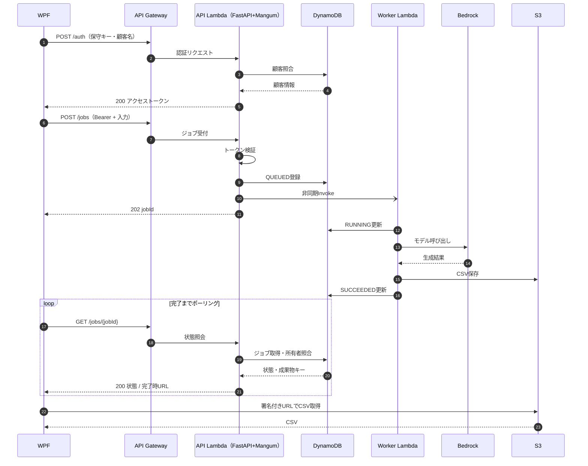

# 処理シーケンス（ドラフト）

> **更新方針（2026-10-13）**: API LambdaにFastAPI + Mangumを採用。REST API + WAFは推奨案であり、API Gateway方式は検討中。図は処理の論理フローで、WAFの検査やCloudTrail/GuardDutyの検知はリクエスト業務フローとは分けて管理する。

失敗時にはWorkerが `FAILED` とエラーコードをJobsに記録する想定。非同期Invokeの重複配送や再試行、Lambda中断、ジョブ滞留、S3保存後の状態更新失敗を想定した冪等処理・監視が必要です。

関連: [構成設計](architecture.md) / [API仕様](api-spec.md)

## セキュリティと監査上の補足

- WAFが有効なREST API構成なら、外部HTTPリクエストはAPI GatewayでWAFルールの評価を受け、許可されたものだけがLambdaへ進む。
- FastAPIは各ルートで入力の型検証と認証・ジョブ所有者照合を実行。MangumがREST API LambdaプロキシイベントをASGIに橋渡しする。
- API GatewayのアクセスログにはHTTPステータス・パス・requestId等、アプリ監査ログにはcustomerId・jobId・成功/失敗等を出力。保守キーやトークンは残さない。
- CloudTrailはAWSリソースの管理操作を記録し、GuardDutyは不審なAWSアカウント等の挙動を検出する。**顧客単位のAPI利用操作はアプリ監査ログで記録する**。
- CSV取得用URLを発行する前にジョブの所有者確認をする。URL自体は機密情報としてログ出力しない。

詳細: [セキュリティ・監査](security.md) / [構成設計](architecture.md)
