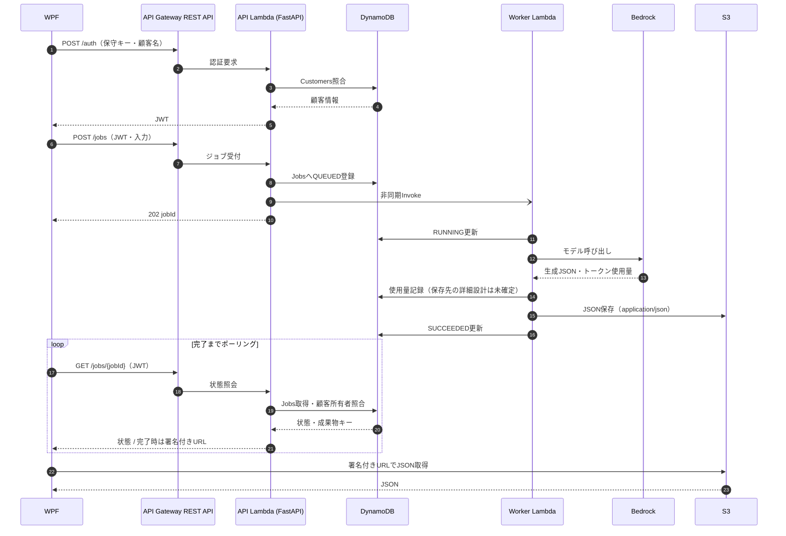

# 処理シーケンス

**`POST /auth`は初回・JWT期限切れなどの再認証時のみ実行。** WPFは有効なJWTを保持し、ジョブ投入・ポーリングで再利用する。API Lambdaは各リクエストでJWTを検証する。

異常時は`FAILED`とエラーコードを記録。非同期再試行・重複起動・S3保存後の状態更新失敗に備え、冪等性と復旧処理を設計する。

## 2026-10-19：SQS導入時の差分（未確定）

上のシーケンス図は従来の直接非同期Invoke方式。SQS採用時は `API Lambda → SQS → Worker Lambda` に置き換える。

- APIがDynamoDBへ`QUEUED`登録し、SQSへメッセージを送信。片側のみ成功した際の回復処理を設ける。
- `MessageGroupId`はJWTなどからサーバー側で確認した`customerId`を使用し、WPFからの値を信用しない。
- Workerは重複配送でも安全に動作させ、条件付き状態遷移と一意な使用量イベントで二重請求を防ぐ。ただし二重推論そのものは失敗状況により完全排除できない可能性がある。
- 詳細：[ADR-0009](adr/0009_SQS公平キュー導入検討.md)。
