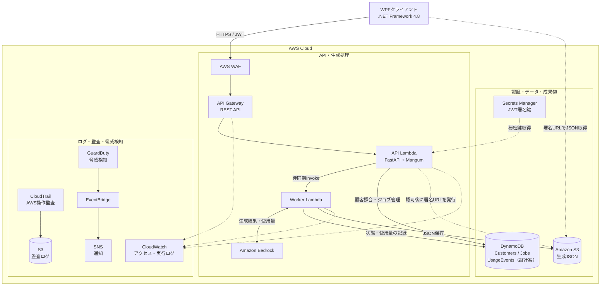
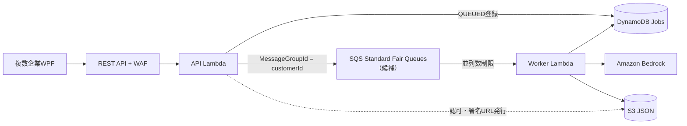

# AWS構成設計

> **2026-10-25更新：現在の認証前提は不透明トークン。入口方式は比較・選定中です。**
> [最新の構成設計・決定事項](AWS構成設計_不透明トークン前提_2026-10-25.md) / [REST API案・Web Functions案の全体構成図と比較](比較検討/2026-10-25_REST-APIとWeb-Functionsの構成比較.md)。
> 以下のJWT・直接Invokeや従来の採否記述は検討履歴です。最新資料ではSQS・Outboxを共通の提案として比較し、入口・SQSの正式採用は未確定です。

## 全体構成図

**上の図はSQS追加前の採用案。SQS追加は検討中で、後述の候補図を参照。**

実線は処理経路、破線は補助的な関係を表す。WAFはREST APIに関連付けるWeb ACL。監査用S3と生成JSON用S3は用途を分離する。UsageEventsの物理テーブル構成は未決定。

[業務処理図](diagrams/AWS構成図_rev4_業務フロー.svg) / [セキュリティ・監査図](diagrams/AWS構成図_rev4_セキュリティ監査.svg) / [draw.io（2ページ）](diagrams/AWS構成図_rev4.drawio)

## コンポーネントと処理

| コンポーネント | 役割 |
| --- | --- |
| WPF | 保守キー認証、ジョブ投入、状態ポーリング、JSON取得 |
| API Gateway REST API + WAF | 公開HTTPS入口。API Gateway APIキーは使用しない |
| API Lambda | `POST /auth`、`POST /jobs`、`GET /jobs/{jobId}` |
| Worker Lambda | Bedrockの非同期実行、ジョブ状態・使用量記録、JSONのS3保存 |
| DynamoDB | `Customers`、`Jobs`、使用量イベントの記録先（物理設計は未決定） |
| S3 | 生成JSONを非公開保存。WPFは短命な署名付きURLで直接取得 |

- `POST /auth`：既存保守キーと顧客名を照合し、JWTを発行。署名鍵はSecrets Managerで管理。**WPFはJWTをメモリに保持して有効期限内は再利用し、未取得・期限切れ時に再認証する。**
- `POST /jobs`：`QUEUED`登録後、Workerを非同期起動して`202 + jobId`を返す。
- `GET /jobs/{jobId}`：JWT・ジョブ所有者を確認し、`QUEUED / RUNNING / SUCCEEDED / FAILED`と結果URLを返す。**API Lambdaは認証済みJWTも各リクエストで検証する。**
- 生成物はJSON（最大約1MBを想定、`application/json`）。使用量はBedrockの応答等からサーバー側で記録する。

処理の詳細は[シーケンス](処理シーケンス.md)、入出力は[API仕様](API仕様.md)、IAM・監査設定は[セキュリティ設計](セキュリティ・監査設計.md)、請求実績は[請求データ設計](請求データ設計メモ.md)に記載する。

## 2026-10-19 追記：並列受付・SQS公平キューの候補

AWSクォータ範囲内でAPI Gateway + Lambdaは複数企業の同時受付に対応できる。しかし、APIの受付とBedrockの同時生成の流量制御は別問題。ジョブ集中時にWorker Lambdaの最大同時実行数を制御し、企業間の待機偏りを軽減する目的で**SQS Standard Fair Queuesを追加推奨する（採用は未決定）**。

- WorkerはSQSのイベントソースにより起動。バッチサイズ1を検証基準とし、Bedrockのモデル別RPM/TPMクォータや処理時間に基づき最大同時実行数を決定。
- SQS Standard Queueの`MessageGroupId=customerId`でFair Queuesの企業間公平性を利用する。FIFOの順序保証・企業別同時数の保証ではない。
- DynamoDBのQUEUED登録とSQS送信は原子的ではない。登録成功・送信失敗の回復手順、Outboxパターン等を設計する。
- 重複配信、二重生成・二重課金防止、可視性タイムアウト、DLQ、滞留アラームを詳細設計で確定する。
- 非同期出力の永続保存先としてS3は維持。Web Functions採用の有無とは独立。
- API入口は**REST API + WAF直接連携 + Event Functions（通常Lambda）**が第一候補。

[比較・試算](比較検討/2026-10-19_非同期Bedrock基盤とAPI方式の比較.md) / [SQS検討ADR](adr/0009_SQS公平キュー導入検討.md)。rev4のSVG/draw.ioはSQS追加前の履歴図であり、上の検討案とは一致しない。
