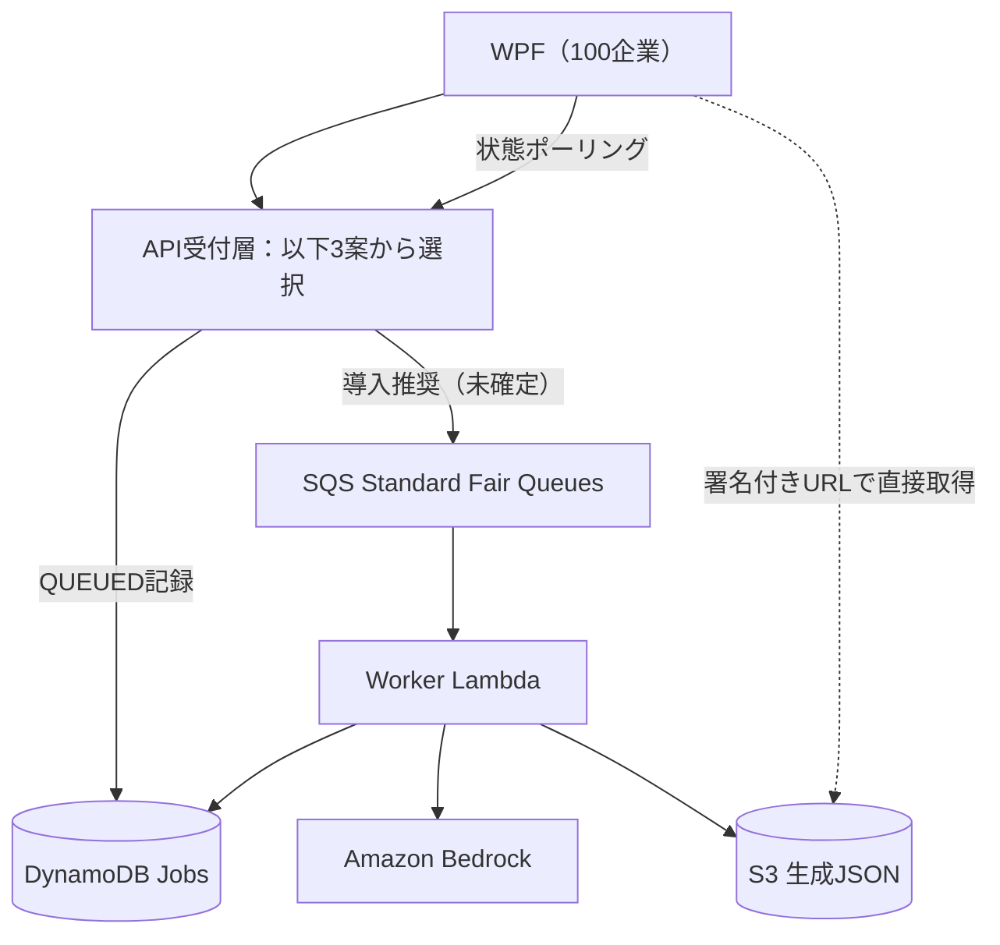

# 2026-10-19 非同期BedrockシステムのAPI方式比較・利用量・料金試算

> **過去の比較資料。** [現在の検討状況](../current/検討状況.md)／[入口比較の履歴](../比較検討/2026-10-25_REST-APIとWeb-Functionsの構成比較.md)を参照。今回は不透明トークンを前提とし、料金・性能は未実測です。

> **設計比較のための机上試算。AWSへのデプロイ、性能負荷試験、実測料金はまだない。** 料金は仮の単価・処理時間・稼働時間で計算した参考値。Python/FastAPIの既存資産や移植工数は比較条件から除外する。

## 1. 今日の結論

- **APIの第一候補：API Gateway Regional REST API + AWS WAFの直接関連付け + Event Functions（通常Lambda）。**
- **非同期方式は維持：** APIはジョブ受付後`202 + jobId`を返し、WPFが`GET /jobs/{jobId}`でポーリング。ジョブ状態・企業別請求使用量はDynamoDB、JSON成果物はS3へ永続保存。
- **SQS Standard Fair Queuesは導入推奨・正式採用は未確定。** Workerの同時実行数制御・滞留監視・企業間公平性を改善する候補。
- Web Functionsは多重HTTP並列処理と課金体系に利点があるが、WAF必須ならCloudFront＋オリジン保護が必要。今回のトラフィックではメリットを実測で立証できていない。
- 月100万ジョブはボタン押下型の業務機能として非現実的と判断し、**月1万・10万・20万ジョブ**で試算する。

## 2. 共通の処理構成と入口3案

> 図は**SQS追加後の候補構成**。従来のrev4 SVG/draw.ioはAPI Lambda→Worker Lambdaを直接非同期Invokeする採用履歴であり、候補図への置き換えはまだ行っていない。

| 比較 | A: REST API + 通常Lambda | B: HTTP API + 通常Lambda | C: Lambda Web Functions |
| --- | --- | --- | --- |
| HTTP公開 | API Gateway REST API | API Gateway HTTP API | Web Functions標準HTTPS |
| WAF必須時 | **REST APIステージへ直接関連付け** | CloudFront + WAF | CloudFront + WAF |
| WAF迂回対策 | REST API自体をWAFで守る | HTTP APIの直接公開URLの保護を追加設計 | IAM認証エンドポイント + CloudFront OAC等 |
| 同時要求 | 基本1要求/実行環境、環境数を増やす | 同左 | 複数要求/環境、環境数も増える |
| API管理機能 | APIキー/使用量プラン等あり | RESTの一部機能なし | Gateway管理機能を内蔵しない |
| 主な課金 | Gateway要求 + Lambda要求/実行時間 | 同左（Gateway要求単価が安い） | 要求 + CPU実働時間 + 環境メモリ存続時間 |
| 長時間HTTP/ストリーミング | 統合方式に依存 | 制限あり | 得意だが今回は使わない |
| SQS/Worker/S3/DynamoDB | どちらも基本共通 | 同左 | 同左 |
| 今回の判断 | **第一候補** | 料金面は有力だがCloudFront追加 | 利点はあるが今回は不採用 |

**Web Functionsのメリット：** 同じ実行環境で多数のHTTP要求を処理、DynamoDB等I/O待ちの活用、HTTPサーバーとしての開発容易性、長時間HTTPやストリーミング、CPU稼働時間ベースの課金。
**デメリット：** REST API管理機能は使えずJWT/認可/制限を別途設計、WAFにはCloudFront、実行環境メモリ課金は常に最安ではない、複数企業のリクエスト間でグローバル変数等を共有しない実装が必須、新方式で運用実績が少ない。2026-10-19時点の対応言語はNode.jsだが今回は移植コストを無視する。

## 3. 100社・営業日・ボタン押下型の利用量モデル

**前提：** 100社が均等に利用、月20営業日、平日8時間/日、社員のボタン押下で1件ずつ生成。1社10人が利用するとした換算も併記。

| 項目 | 月1万ジョブ | 月10万ジョブ | 月20万ジョブ |
| --- | ---: | ---: | ---: |
| 1企業・月間 | 100件 | 1,000件 | 2,000件 |
| **1企業・1営業日** | **5件** | **50件** | **100件** |
| 1企業10人利用時・1人1日 | 0.5件 | 5件 | 10件 |
| 100社合計・1営業日 | 500件 | 5,000件 | 10,000件 |
| 全社平均・1時間あたりジョブ | 62.5件 | 625件 | 1,250件 |

1ジョブは手動登録API 1回と、生成平均120秒の間に5秒間隔でポーリング24回を行うと仮定 → **25 API要求/ジョブ**。JWT再認証、エラー再送、S3直取得はこのAPI要求数に含めない。

| 負荷指標 | 月1万 | 月10万 | 月20万 |
| --- | ---: | ---: | ---: |
| API要求/月 | 25万 | 250万 | 500万 |
| 営業時間中の平均RPS | 0.43 | 4.34 | 8.68 |
| **ピーク5倍と仮定したRPS** | **2.17** | **21.70** | **43.40** |

式：`RPS = 月間ジョブ数 × 25 ÷ (20日 × 8時間 × 3600秒)`。ピーク5倍は設計上の仮定であって実測ではない。

## 4. 月額コスト：同じ業務量で3案を比較

**計算前提**：us-east-1（バージニア北部）の概算USD単価、無料枠・段階単価・税は除外。**AWSサービス全体の料金ではなくAPI受付の比較**。Bedrockの推論料金、SQS、Worker Lambda、DynamoDB、S3、WAF、CloudFrontの転送/証明書/ログ等は基本比較に含めない。

- REST API: `$3.50 / 100万HTTP API要求`
- HTTP API: `$1.00 / 100万HTTP API要求`
- Event Functions: `256MB, Arm64, 120ms/要求`。料金を`$0.20 / 100万要求 + $0.0000133334 / GB秒`と仮置き。→ **約$0.60/100万要求**。
- Web Functions: `$0.30 / 100万要求 + CPU実働時間12ms/要求 × $0.0000276944 / vCPU秒 × 1vCPU相当 + 0.5GB × 160環境時間/月 × $0.0000036667 / GB秒`。→ **約$0.632/100万要求 + $1.056/月（環境メモリ）**。
- CloudFront HTTPS要求料金参考：**$0.01/1万要求**と仮置き。WAF付きプラン、リージョン、通信量で変動するため確定単価ではない。

| API受付費用（USD/月、概算） | 1万ジョブ | 10万ジョブ | 20万ジョブ |
| --- | ---: | ---: | ---: |
| **REST API + Event Lambda** | **$1.03** | **$10.25** | **$20.50** |
| HTTP API + Event Lambda | $0.40 | $4.00 | $8.00 |
| Web Functions（環境稼働160時間という仮定） | $1.21 | $2.64 | $4.22 |
| CloudFrontリクエスト分のみ（参考追加費用） | +$0.25 | +$2.50 | +$5.00 |
| HTTP API + Lambda + CloudFront要求分 | $0.65 | $6.50 | $13.00 |
| Web Functions + CloudFront要求分 | $1.46 | $5.14 | $9.22 |

例：月10万ジョブ → API要求250万。REST API要求$8.75 + 通常Lambda要求・実行時間$1.50 = **約$10.25**。

**重要な解釈：** CloudFrontのWAFとREST API直接WAFの基本料金・ルール料金等は表に含まれない。Web Functionsの環境稼働時間は単一環境160時間相当（全環境合計時間）と仮置きしただけであり、実際の起動/停止挙動を示すものではない。したがって3案の実請求額や価格順位は確定しない。

## 5. 受付の並列処理・性能の机上評価

通常Lambdaは実行環境を増やして同時要求を受ける。Web Functionsは同一環境でも複数要求を並列処理可能。**Web Functionsが1環境で実効20並列を処理すると仮定した場合**：

| 同時HTTPリクエスト | 通常Lambda必要環境数（単純モデル） | Web Functions必要環境数（単純モデル） |
| --- | ---: | ---: |
| 100 | 100 | 5 |
| 500 | 500 | 25 |
| 1,000 | 1,000 | 50 |

これは算術上の必要環境数の例であり、AWSのスケール所要時間やp95レイテンシ、エラー率を予測する根拠にはならない。**以前のp95仮想表（例: 180ms/150msなど）はあくまで架空の例で、設計判断の根拠には採用しない。**

将来k6等で検証する際の暫定合格目標（実測ではない）：`GET /jobs/{jobId}` p95 300ms以下、`POST /jobs` p95 500ms以下、5xx 0.1%未満、顧客間認可違反ゼロ。100/500/1,000の一斉アクセスは通常の月間平均RPSより厳しいストレステストであり、需要の実績予測ではない。

## 6. Bedrock側の並列数（重要）

平均生成時間120秒、営業日160時間/月と仮定する。リトライやBedrock側スロットリングなしで**キュー待機ゼロ**を狙う場合の平均必要並列数：

| 規模 | 平均生成依頼/秒 | 営業時間の平均同時生成 | ピーク5倍相当 |
| --- | ---: | ---: | ---: |
| 1万ジョブ | 0.017 | 約2件 | 約10件 |
| 10万ジョブ | 0.174 | 約21件 | 約104件 |
| 20万ジョブ | 0.347 | 約42件 | 約208件 |

式：`必要同時実行 ≈ ジョブ到着率(件/秒) × 平均生成所要時間(秒)`。ここでいうピーク5倍の「必要数」はピーク持続時に滞留させず処理を始めるための理論値で、実際にはSQSで待機させられる。BedrockのRPM・TPMクォータ、モデル別制限、p95生成時間などにより実運用の最大値は別途設計。

### SQSと企業単位の公平性

- 直接非同期Invokeでも並列実行は可能。**SQSは並列対応そのものではなく、流量の平準化・待機行列・再試行を改善する手段**。
- SQS Standard Fair Queuesは`MessageGroupId=customerId`で大量投入企業を識別し、他社の待ち時間が著しく悪化するのを緩和する。FIFOではなく、企業別の確定割当や専用処理保証ではない。
- LambdaのSQSイベントソースの最大同時実行数でWorkerを制御。ジョブ実行時間やモデル/リージョン別のトークン割当を測定して調整する。
- 再配信による重複請求防止の冪等性、SQS送信漏れの回復、DLQ、可視性タイムアウト、ジョブ滞留アラームが必要。

## 7. 採否・再検討事項

**第一候補：Regional REST API + WAF直接関連付け + API Lambda (Event Functions)。** WAFが必須なBtoBサービスで構成を単純にし、CloudFront経由のみ通す追加対策を避ける利点を優先する。API Gatewayのリクエスト料金差は試算上月数ドル〜数十ドルと小さい。これだけでWeb Functionsが性能面で劣ると判断してはいけない。

- Web Functionsの再検討条件：状態照会APIの著しい増大、実測でCPU/メモリ/遅延の優位、HTTPストリーム採用、CloudFront利用状況の変化。
- SQSの正式採用：Bedrockの使用モデルの実クォータと生成時間、ジョブ開始待ちの目標、企業別の公平性要件を確認して決定。
- 先に決めるべき業務要件：1社あたり受付上限、二重クリック時の冪等性、実トークンの使用量記録、生成後のS3保存に失敗した場合の請求ポリシー。

## 公式情報
- [AWS Lambda Web Functions](https://docs.aws.amazon.com/lambda/latest/dg/web-functions.html)
- [AWS Lambda料金](https://aws.amazon.com/lambda/pricing/)
- [API Gateway料金](https://aws.amazon.com/api-gateway/pricing/)
- [REST APIとHTTP APIの機能比較](https://docs.aws.amazon.com/apigateway/latest/developerguide/http-api-vs-rest.html)
- [SQS Fair Queues](https://docs.aws.amazon.com/AWSSimpleQueueService/latest/SQSDeveloperGuide/sqs-fair-queues.html)

[ADR-0008: Web Functions比較](../adr/0008_Web-Functions比較.md) / [ADR-0009: SQS公平キュー](../adr/0009_SQS公平キュー導入検討.md) / [構成設計](../archive/旧設計/構成設計.md)
