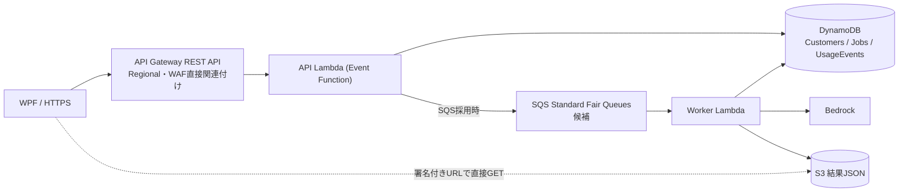
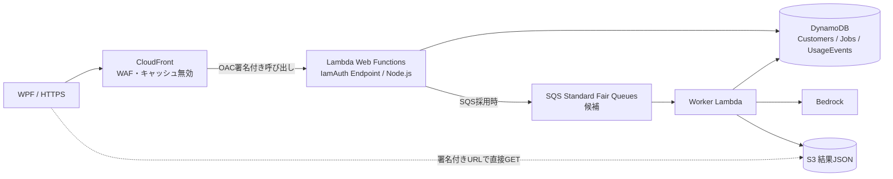

# REST APIとLambda Web Functionsの採用比較（2026-10-20）

> **過去の比較資料。** [現在の検討状況](../current/検討状況.md)／[最新の入口比較](../current/入口方式比較.md)を参照。今回は不透明トークンを前提とし、料金・性能は未実測です。

> **設計判断資料・暫定版**。AWS公式仕様と、実測前の仮定に基づく机上比較。Lambda Web Functionsの料金・処理性能はPoC未実施のため未確定。既存の第一候補「Regional REST API＋通常Lambda」は維持し、Web Functionsを有力な代替候補として検証する。既存のADR-0008をこの資料で補足する。

## 1. 比較対象と共通前提

- 100社、1社50件/営業日、月20営業日 → **月100,000ジョブ**。
- Bedrockによる生成120秒、WPFが10秒おきに状態確認 → 1ジョブ12 GET。
- 比較用の保守的な認証前提：1ジョブ1回 `POST /auth`、1回 `POST /jobs`、12回 `GET /jobs/{jobId}`。
- API/WAF/CloudFrontの対象：**100,000 × 14 = 1,400,000 HTTP要求/月**。JWTを再利用する実装ではauthは減る。
- 20営業日×8時間=160時間/月の営業時間中に均等到着した場合、平均約**2.43 RPS**、ピーク5倍の例で**約12.15 RPS**。実際の分布・ピークは未計測。
- JSON生成結果は平均30KBと仮定してS3に保存。WPFは署名付きURLから取得するため、S3 GETはAPI受付リクエストに含めない。
- **120秒はWorker側の生成時間**。受付の通常Lambda/Web Functionsの実行時間として計上しない。
- SQS Standard Fair Queues導入は推奨・未決定。SQS/Worker/Bedrock/DynamoDB/S3の費用は両案に共通であり、この表から除外する。

## 2. 採用したときの構成

### A: API Gateway Regional REST API + AWS WAF + 通常Lambda

- API Gatewayのリクエスト管理、ステージ、WAF直接関連付けが使える。JWTによる企業認証・ジョブ所有者照合は引き続き必要。
- **向いている例**：企業向けの短いREST API、明確なAPI管理ポリシー、少数エンドポイント、運用担当を増やせない小規模バックエンド。
- **メリット**：WAF連携が直接的、ログ・トレースの責務が明確、標準的な構成、通常Lambdaの実績。
- **デメリット**：API Gateway REST APIの要求単価、イベントごとのLambda起動、同一環境で原則1同時リクエスト。HTTPストリーミング等で統合方式の制約がある。

### B: CloudFront + AWS WAF + OAC + Lambda Web Functions

- CloudFrontからのオリジンリクエストをOACで署名し、Web Functionsの`IamAuth`と、対象CloudFront distributionに限定した`lambda:InvokeWebFunctionEndpoint`リソースポリシーで**オリジン直アクセスを制限**する。
- JWTの`Authorization`ヘッダーはオリジンへ引き継ぎ、Web Functions側でJWT検証と顧客所有者チェックを実装する。Authorizationの転送・キャッシュポリシーを明示設定。**認証・状態APIのCloudFrontキャッシュは無効**。
- **向いている例**：Express/Hono/Fastify製Node.js API、I/O待ちが長いDB参照API、多数の並列HTTP要求、SSRやWebアプリ、ストリーミング/SSE、グローバル配信。
- **メリット**：同一実行環境で複数要求を処理、CPUのI/O待ち時間をCPU実働課金から除き得る、Webサーバーの開発体験、レスポンスストリーミング、直接HTTPSエンドポイント。
- **デメリット**：WAFにはCloudFrontが必要、OAC/IAM/キャッシュ・ヘッダー転送・ログが追加論点、CPU実働とメモリ環境時間の実測が必要、Node.jsのみ対応（2026-10-20時点）、リクエスト間でグローバル可変状態を共有すると顧客データ混在の危険。
- `maxConcurrencyPerEnvironment`は上限値（既定64）で、実際の同時処理能力はLambdaが動的調整する。`maxEnvironments`・`rateLimit`も設定可能。**「1環境20並列」などを実測値として扱わない**。

## 3. セキュリティ・運用の比較

| 論点 | REST API + Event Lambda | CloudFront + Web Functions |
| --- | --- | --- |
| WAFの場所 | REST APIステージにRegional WAF | CloudFront配信にWAF（CloudFront scope） |
| WAFの迂回防止 | APIステージ自体がWAF保護下 | Web Function Endpointを`IamAuth`、OAC署名、CloudFront SourceArn限定 |
| JWT | Lambda等で署名・有効期限・企業ID/所有者を検証 | Node.jsアプリのリクエストスコープ内で同じ検証 |
| 認証応答・ステータスのキャッシュ | API Gatewayステージキャッシュ無効 | CloudFrontキャッシュ無効、Authorization転送を確認 |
| リクエスト上限 | API Gatewayのスロットリング等 | Endpoint `rateLimit`、WAFレート制限等 |
| 企業別の負荷公平性 | アプリ/SQS等で対応 | 同左。Web Functionsの同時処理は企業間公平性の保証ではない |
| 監視 | Gatewayアクセスログ＋Lambda/CloudWatch | CloudFrontログ＋Web Functions/CloudWatch |
| ロールバック | API Lambdaバージョン/APIステージ等 | Web Function revision/endpoint比率・CloudFront設定 |
| 実装制約 | Lambdaハンドラー、既存言語選択肢が広い | Node.js HTTPサーバー、並列処理のリクエストスコープ分離 |
| コスト予測 | 回数・メモリ割当・実行時間から比較的容易 | 回数・CPU実働・メモリ実使用と累計環境時間の仮定に依存 |

**どちらでも必須**：JWT検証、企業IDとjobIdの所有者検証、冪等性、WAF、監査、Secrets管理、SQS導入時の重複配信・再実行対策、利用量・請求記録の顧客分離。WAFは認証ではない。

## 4. 前回の料金シミュレーション（記録用、未検証）

東京リージョンの単価を仮置きした**前回会話時点の試算値をそのまま記録**。AWS Pricing Calculatorの出力ではなく、最新単価・無料枠・転送料金まで検算済みという意味ではない。Web FunctionsのCPU・メモリ・環境時間と、通常Lambdaの平均120msも**仮定**。

| 構成 | API受付+WAF等の月額参考値 |
| --- | ---: |
| REST API + Event Lambda + WAF | **$18.63** |
| CloudFront + WAF + Web Functions（楽観） | **$14.63** |
| CloudFront + WAF + Web Functions（標準） | **$16.92** |
| CloudFront + WAF + Web Functions（悲観） | **$28.04** |

### Web Functionsの3ケースの仮定

| 変数 | 楽観 | 標準 | 悲観 |
| --- | ---: | ---: | ---: |
| 1リクエストCPU実働 | 5ms | 15ms | 40ms |
| 1環境の平均メモリ使用量（課金の近似） | 300MB | 500MB | 1GB |
| 全環境の累計稼働時間 | 100時間/月 | 300時間/月 | 800時間/月 |
| Web Functions単体（前回試算） | $1.11 | $3.40 | $14.52 |
| CloudFront要求分（仮置き） | $1.68 | $1.68 | $1.68 |
| WAF基本（仮置き） | $11.84 | $11.84 | $11.84 |
| 総額 | **$14.63** | **$16.92** | **$28.04** |

通常Lambda側の仮定：256MB、Arm64、平均120ms/API、140万API/月。REST API要求料金$5.95、Lambda$0.84、WAF$11.84として$18.63。

**解釈上の注意**：
- Web Functionsの「累計環境時間」はカレンダーの営業時間と同じではない。複数環境の稼働時間の合計であり、ゼロスケールやアイドル削除、ピークによって変化する。
- 前回のWeb Functionsメモリ課金は「平均使用GB×環境秒」の近似であり、実際の請求メトリクス・課金丸め・単価は計測・料金資料に基づき確認する。
- Web FunctionsのCPU料金には起動時CPU消費等も影響し得るため、「要求あたり5/15/40ms」は仮の平均化。
- CloudFrontの転送量、WAFログ、API/CloudFront応答サイズ、認証ヘッダー、カスタムドメイン、DynamoDB/S3/Worker/SQS/Bedrockは比較表から除外。両案で共通でない項目は別途加算。
- AWS WAFのルール・マネージドルールグループの実際の課金数やCloudFront定額プラン適用可否、無料枠の条件をCalculatorで再確認。価格の小差を断定しない。

### 料金よりも運用を優先する条件

標準ケース差額は前回モデルでは約**$1.71/月**。Web Functionsが確実に安いといえる根拠ではなく、この程度ならシンプルなREST APIを優先しやすい。CloudFrontを既に利用している、将来HTTPストリーミングや大量同時接続が必要、PoCで費用・遅延の明確な改善が再現できるならWeb Functionsの採用価値が高まる。

## 5. PoC/採用判断の記録欄

| 検証 | 目標例（実測値ではない） | 実測欄 |
| --- | --- | --- |
| オリジン直アクセス | 署名なし直アクセス403、CloudFront経由成功 | 未実施 |
| テナント分離 | 他社jobIdは権限エラー、並行100社で漏えいゼロ | 未実施 |
| GET状態APIのp95 | 300ms以下 | 未実施 |
| POSTジョブ作成のp95 | 500ms以下 | 未実施 |
| エラー率 | 5xx 0.1%未満 | 未実施 |
| 通常/5倍ピークの負荷 | RPS 2.43/12.15を基準に、より厳しいバーストも試験 | 未実施 |
| Web Functions CPU | `EnvironmentCPUTime`（Sum） | 未実施 |
| Web Functions環境稼働 | `EnvironmentActiveTime`等（実際の計測仕様を確認） | 未実施 |
| Web Functionsメモリ | `EnvironmentMaxMemoryUsage`（Maximum、平均メモリの代替としない） | 未実施 |
| 同時HTTP処理 | `EnvironmentConcurrentRequests`（Maximum） | 未実施 |
| 計算単価・無料枠 | 当該リージョンのCalculatorを保存し比較 | 未実施 |
| 障害時の切り分け | リクエストIDでWAF→受付→SQS→Workerを追跡 | 未実施 |

**採用条件案**：WAFバイパス防止・テナント分離・障害解析の条件を両方式とも満たした後、月額差が運用複雑性を上回るか、p95とリトライ率に実測メリットがあるかで判断する。採用前にADR-0008のステータスを更新する。

## 6. 残すべき設計上の決定事項

1. API入口の正式な採用方式（REST API / Web Functions）。
2. JWT発行頻度・TTL、顧客ID/ジョブ所有者の照合箇所。
3. REST APIではWAF直接関連付け、Web FunctionsではOAC/IamAuth/SourceArn制限の具体的なIaC定義。
4. CloudFrontで全APIパスをキャッシュ無効にすること、Authorizationヘッダー・Query・Cookieの転送方針、WAFの誤検知対応。
5. デプロイ/ロールバックと障害時の相関ID・ログ保持期間。
6. RPSピーク・ジョブ滞留許容時間、SQS Fair Queues採否とWorker同時実行制限。
7. 実際の料金見積書の生成日、リージョン、通貨、価格表バージョン、無料枠、CloudFrontプラン適用。
8. ステータスポーリング間隔、バックオフ、再試行、認証再発行による追加API呼び出し。
9. Web Functionsの対応言語・イベントループブロック・グローバル状態からの企業データ漏えい防止。

## AWS公式資料

- [Lambda Web Functions概要](https://docs.aws.amazon.com/lambda/latest/dg/web-functions.html)
- [Web Functionsのスケーリング](https://docs.aws.amazon.com/lambda/latest/dg/web-functions-scaling.html)
- [Web Functionsのメトリクス](https://docs.aws.amazon.com/lambda/latest/dg/web-functions-monitoring-metrics.html)
- [Web Functionsのベストプラクティス](https://docs.aws.amazon.com/lambda/latest/dg/web-functions-best-practices.html)
- [CloudFrontでWeb Functionsのオリジンを保護](https://docs.aws.amazon.com/AmazonCloudFront/latest/DeveloperGuide/private-content-restricting-access-to-lambda-web.html)
- [API Gateway REST APIにWAFを適用](https://docs.aws.amazon.com/apigateway/latest/developerguide/apigateway-control-access-aws-waf.html)
- [Lambda料金](https://aws.amazon.com/lambda/pricing/)
- [API Gateway料金](https://aws.amazon.com/api-gateway/pricing/)
- [CloudFront料金](https://aws.amazon.com/cloudfront/pricing/)
- [WAF料金](https://aws.amazon.com/waf/pricing/)

[2026-10-19の旧比較](2026-10-19_非同期Bedrock基盤とAPI方式の比較.md) / [ADR-0008](../adr/0008_Web-Functions比較.md) / [AWS料金見積もり](2026-10-20_AWS料金見積もり試算.md)
