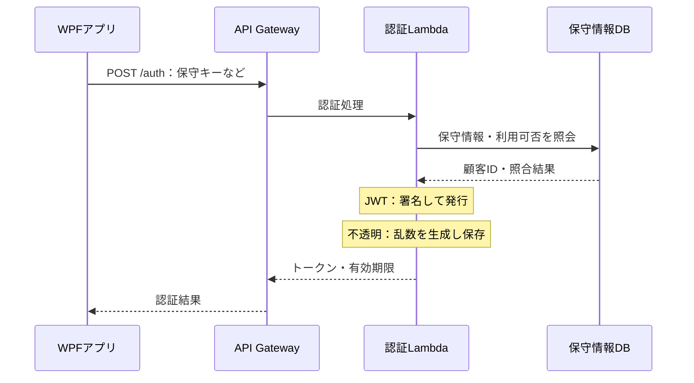
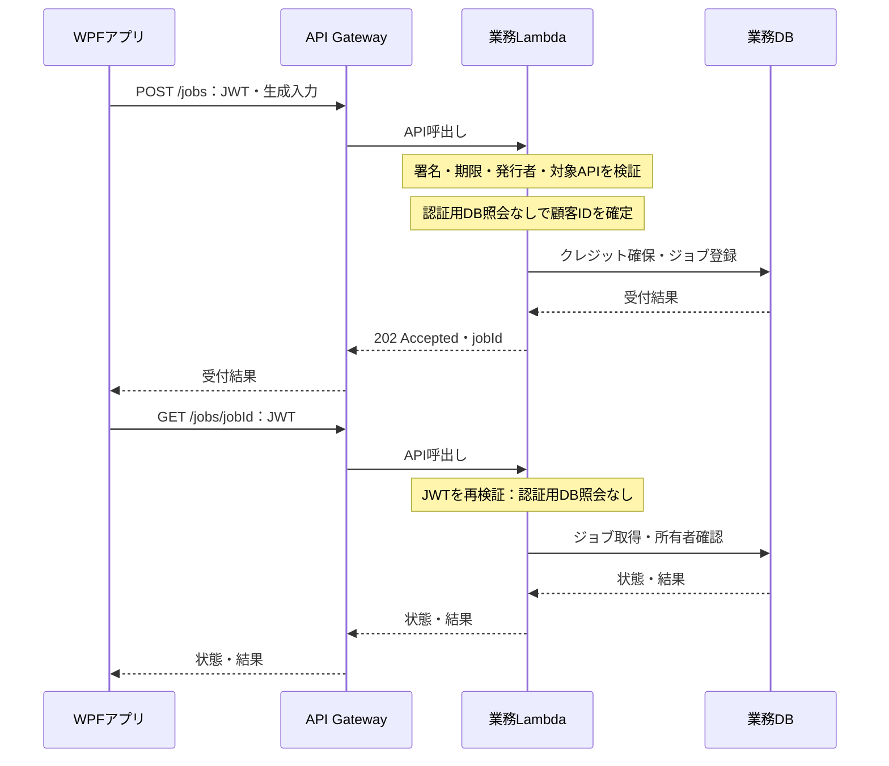
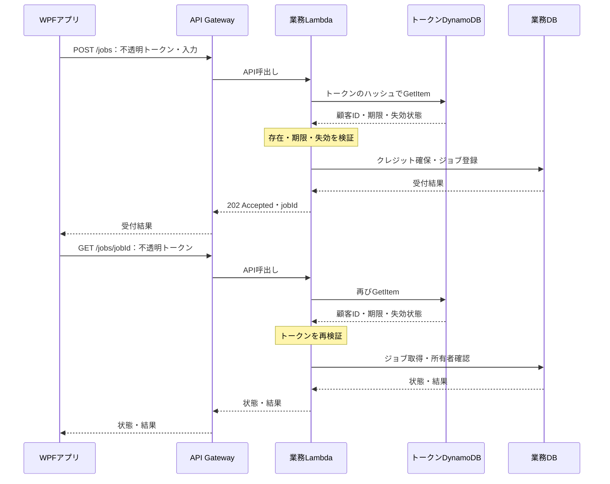
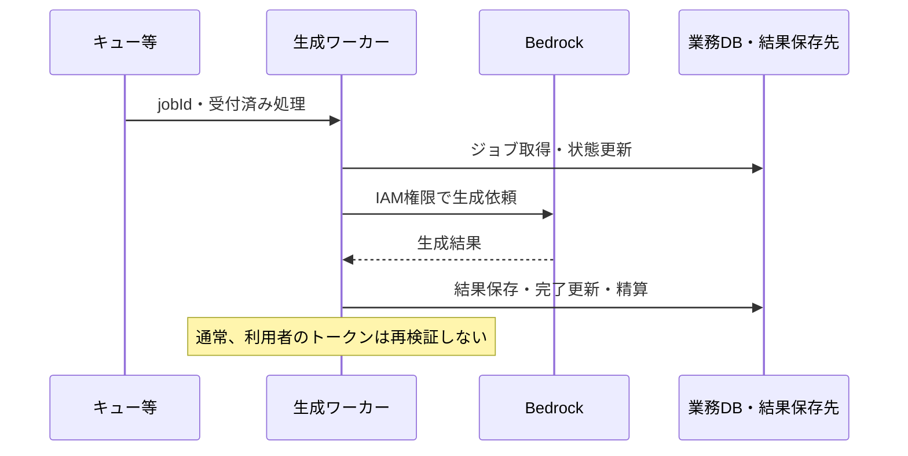

# AWS生成API：JWTと不透明トークンの設計比較

> **過去の比較資料。** [現在の検討状況](../current/検討状況.md)／[最新の入口比較](../current/入口方式比較.md)を参照。今回は不透明トークンを前提とし、料金・性能は未実測です。

作成日：2026年10月21日／検討資料

## 1. 判断の要点

**現時点の要件ではJWTを第一候補とする。不透明トークンへの変更は、トークン単位の即時失効など、サーバー側でセッションを管理する具体的な要件がある場合に選ぶ。**

これは本資料の設計上の提案であり、実装の確定事項ではない。

- `/auth`でDBを使うことは、JWTをやめる理由にならない。JWTの利点は、発行後の各APIで認証用DB照会を省けることにある。
- クレジット残量の確認は業務上の処理。JWTの検証とは別で、どちらの方式でも必要になる。
- 不透明トークンでは原則として各保護APIでトークン保存先に照会する。ただしキャッシュで省略する構成は可能。
- JWTも署名・期限などの検証は必要。「JWTなら検証不要」ではなく「認証用のセッションDB照会が通常不要」。
- DynamoDBの追加費用は発生するが、小さいアイテムの読取単価は低い。費用だけで不透明トークンを否定するのも適切ではない。
- 即時失効の必要性、署名鍵管理とセッション管理のどちらを運用するか、API Gatewayの種類と既存実装を含めて決める。

## 2. 今回のシステムと前提

| 項目 | 本資料の前提 |
|---|---|
| 利用元 | WPFデスクトップアプリ |
| 初回認証 | 利用者が保有する保守キーなどを、保守ID・顧客情報と照合 |
| 外部API | `POST /auth`、`POST /jobs`、`GET /jobs/{jobId}` |
| 生成 | AWS側でBedrockを呼び出す非同期処理 |
| 結果取得 | WPFがjobIdで状態・結果をポーリング |
| 利用量 | 独自クレジットをDBで管理し、生成受付時に残量を確認・確保する案 |
| 比較対象 | 自社発行の署名付きJWTと、自社発行のランダムな不透明トークン |

保守情報の既存DBがDynamoDBか別のDBかは未確定。本資料では不透明トークンの保存先をDynamoDBと仮定する。クレジット・ジョブの保存先も論理的に区別して表示し、同じテーブルにするかは確定しない。

キュー、生成ワーカーの実行基盤、結果の保存先、トークン有効期間、クレジットの確保・精算方式は実装時に確定する。図は比較用の構成であり、現在のAWS環境を実測・調査したものではない。

## 3. 3つの識別情報の役割

| 情報 | 目的 | 提示する場面 |
|---|---|---|
| 保守キー | 最初に利用者・契約を確認する認証情報 | `/auth` |
| アクセストークン | 認証済みのアクセス元を確認する | `/jobs`などの保護API |
| jobId | 特定の生成処理を指定する | 状態・結果の取得 |

jobId自体を閲覧権限として扱わない。認証で確定した顧客IDとジョブ所有者を照合する。クレジット残量はトークンに持たせず、DBを正とする。

## 4. 初回認証：両方式で保守情報のDB照合が必要

不透明トークンの場合、上図の発行処理に加えて、トークンハッシュ・顧客ID・有効期限・失効状態などをトークンDBへ保存する。JWTは、ステートレスなアクセストークンとして使うなら発行ごとのセッション保存を必要としない。監査ログやリフレッシュトークンを保存する場合のDB処理は別途必要。

保守キーをURLのクエリに入れず、HTTPSのPOST本文で受け取る案とする。保守キー・トークンをアクセスログに出力しない。

## 5. JWT：認証検証はLambda内で完結できる

以下は業務Lambdaの共通ミドルウェアでJWTを検証する比較案。署名検証用の鍵を安全に取得・キャッシュ済みであることを前提とする。

**Lambda内で完結するのは認証の検証部分。クレジットやジョブの処理までDB不要になるわけではない。**

クライアントが本文に指定した顧客IDは認証根拠にしない。署名検証済みJWTから得た顧客IDを使う。

### 検証場所の選択肢

| 検証場所 | 認証用DB照会 | 注意点 |
|---|---|---|
| 業務Lambdaの共通ミドルウェア | 通常なし | 対象APIすべてに共通処理を適用する |
| Lambda Authorizer | 通常なし | 別Lambdaの呼出し・実行料金を評価する |
| HTTP APIの標準JWT Authorizer | 通常なし | 発行者・公開鍵・対応アルゴリズム等の要件を満たす必要がある |

API Gatewayの標準JWT AuthorizerはHTTP API向けの機能。独自JWTを発行するだけで自動的に利用できるわけではない。AWSの仕様に合うissuer、公開鍵の取得経路などを準備する。[1]

「DB照会なし」は「ネットワークアクセスが一切ない」という意味ではない。初回・鍵更新時の公開鍵取得や、採用構成に応じたSecrets Manager等からの取得があり得る。KMSで発行時に署名する構成も別途評価する。

## 6. 不透明トークン：認証のために保存先を参照する

以下は業務Lambda内の共通処理で検証する案。Lambda Authorizerに切り出す場合も、キャッシュがなければトークン照会は発生する。

各保護APIに検証が必要だが、同じコードを各ハンドラーに複製する必要はない。共通ミドルウェアまたはAuthorizerに集約する。

### トークン保存項目の例

| 項目 | 用途 |
|---|---|
| tokenHash：主キー | 提示トークンをハッシュ化して直接GetItemする |
| customerId | 認証済み顧客を特定する |
| expiresAt | Lambdaが毎回、有効期限を判定する |
| revokedAtまたはstatus | 明示的な失効を判定する |
| createdAt | 発行日時を記録する |

暗号学的に安全な乱数で、例として256ビットのトークンを生成する。平文トークンは発行時にクライアントへ渡し、保存先にはSHA-256等によるハッシュを保持する。保守キーから単純に派生させない。[5]

DynamoDB TTLは清掃用。期限切れアイテムが数日残る場合があるため、「レコードが存在するから有効」と判定しない。LambdaでexpiresAtを検証する。[4]

## 7. APIごとのDB処理の比較

| API・処理 | JWTの認証用DB処理 | 不透明の認証用DB処理 | 両方式に共通する業務DB処理 |
|---|---|---|---|
| POST /auth | 通常セッション保存なし | トークンレコードの書込み | 保守情報の照合 |
| POST /jobs | 通常なし | トークン照会 | クレジット確保・ジョブ登録・重複受付制御 |
| GET /jobs/{jobId} | 通常なし | ポーリングごとにトークン照会 | ジョブ取得・所有者確認 |
| 生成ワーカー | クライアントJWTの再検証は通常不要 | クライアントトークン照会は通常不要 | 状態更新・結果保存・精算等 |
| トークンの個別失効 | 即時反映には失効リスト等が必要 | レコード更新または削除 | 必要に応じた監査記録 |

表は標準的な比較。JWTに失効リストや毎回の契約状態照会を加えれば、そのDB処理は追加される。不透明トークンでもキャッシュヒット時には照会を省ける。

同じDynamoDBテーブルにトークンと残量を置いても、別アイテムなら読取はそれぞれ消費する。BatchGetItemでネットワーク往復をまとめても、読取ユニットが無料になるわけではない。1アイテムにまとめる設計も可能だが、複数セッション、アイテムサイズ、更新競合などの制約を評価する。

## 8. 非同期ワーカーはAWSの権限で動く

キュー等を使用するのは比較用の案。ワーカーはIAMロールでAWSサービスを利用する。受付後に利用者トークンが期限切れになっても、受付済みジョブを取り消す必要は通常ない。契約停止時に実行待ちジョブも止めるなら、別途ワーカー側の業務ルールとして定義する。

## 9. クレジット処理：方式にかかわらず必要な設計

### 残量の読取りだけでは超過利用を防げない

残量が1のとき、2つのリクエストが同時に「残量1」を読み、両方とも生成開始すると超過する。強い整合性の読取りを使っても、読取りと減算が別ならこの競合は防げない。

固定量を消費するなら、条件付きUpdateItemで「残量が必要量以上」の条件と減算を一体化する。複数アイテムにまたがるジョブ登録・予約記録の整合性にはトランザクション等を検討する。[7]

可変量を消費するなら、受付時に上限分を予約して完了時に精算するなど、超過を防ぐ方式を定める。最終消費量が予約を超える場合の扱いも必要。

| タイミング | 提案する処理 |
|---|---|
| 生成受付 | 残量条件を確認し、消費予定分を確保 |
| 受付の再送 | 冪等性キーで既存jobIdを返し、二重確保を防ぐ |
| 完了 | 確保分の消費確定・必要に応じた差額精算 |
| 失敗 | 返却ルールに従って一度だけ戻す |
| ポーリング | 状態・結果の取得。原則として新規消費しない |

受付後のキュー投入失敗、ワーカー再実行、返却処理の再試行も考慮する。返却自体も冪等にする。この業務ロジックはJWTライブラリにも不透明トークンにも任せられない。

## 10. DynamoDBの追加料金

### 試算条件と確認した単価

2026年10月21日にAWS公式の東京リージョン料金データを取得して確認。[2][8]

| 項目 | 前提 |
|---|---|
| リージョン | 東京：ap-northeast-1 |
| モード・テーブルクラス | オンデマンド・Standard |
| 読取り | 100万RRUあたり0.1425米ドル |
| 書込み | 100万WRUあたり0.715米ドル |
| トークンのサイズ | 読取り4KB以下、発行時書込み1KB以下 |
| 円換算 | 説明用の固定仮定：1米ドル＝150円。実勢為替ではない |

税、無料枠、割引、ストレージ、GSI、バックアップ、グローバルテーブル、Lambda、Gateway、ログ、通信等は除外。以下は**不透明トークンによって追加される認証DB処理のみ**で、システム全体の見積りではない。

通常の読取りは4KB単位で、強い整合性なら1回1RRU、結果整合性なら1回0.5RRU。トランザクション読取りは1回2RRU。通常の書込みは1KB単位で1WRU、トランザクション書込みは2WRU。[2]

### トークン照会だけの追加費用

| 月間のトークン照会回数 | 強い整合性：米ドル | 強い整合性：円 | 結果整合性：円 |
|---:|---:|---:|---:|
| 10万回 | 0.01425 | 約2.14円 | 約1.07円 |
| 100万回 | 0.1425 | 約21.38円 | 約10.69円 |
| 1,000万回 | 1.425 | 約213.75円 | 約106.88円 |
| 1億回 | 14.25 | 約2,137.50円 | 約1,068.75円 |

**アクセス増で費用は増える。ただし上記条件では読取単価が低く、100万回単位でも数十円程度である。料金差だけを理由に不透明トークンを不採用とする根拠は弱い。**

### ポーリングを含めた具体例

1ジョブにつき受付1回、結果確認10回なら、保護APIへのアクセスは合計11回。キャッシュなしの不透明トークンでは、その都度認証DBを読む。

| 条件 | 回数・費用 |
|---|---:|
| 月間ジョブ数 | 10万件 |
| 1ジョブの保護API呼出し | 11回 |
| 追加トークン読取り | 月110万回 |
| 強い整合性の追加読取料金 | 0.15675米ドル＝約23.51円 |
| トークン発行が月10万回の場合の追加書込料金 | 0.0715米ドル＝約10.73円 |
| 上記の読取＋発行書込 | 約34.24円／月 |

発行は通常ジョブ単位とは限らない。セッション内で複数ジョブを処理すれば発行回数は減る。毎リクエストでlastUsedAtを更新すれば追加の書込料金がかかるため、必要性を検討する。

### 再計算方法

1. 月間の保護API呼出し回数を数える。生成受付とポーリングの両方を含める。
2. キャッシュを使うなら、実測または仮定したキャッシュミス率を掛ける。
3. 読取りアイテムサイズと整合性からRRUを算出する。
4. RRUを100万で割り、0.1425米ドルを掛ける。
5. トークン発行・失効・利用日時更新の書込分を別に加える。

料金以外にもネットワーク往復、DBの障害・スロットリング時の認証失敗、再試行、監視が増える。遅延の固定値は示せないため、実環境でp50・p95等を測定する。Lambda Authorizerを別途使う場合は、その呼出し・実行料金も加算する。両方式を同じ検証配置で比較することが重要。

## 11. キャッシュと即時失効の関係

| 構成 | 認証DB照会 | 失効反映 |
|---|---|---|
| 不透明・キャッシュなし・強い整合性 | 毎回 | 同一リージョンの主テーブルで、失効書込完了後の新しい読取りに反映 |
| 不透明・結果整合性 | 毎回 | 直前の失効が一時的に見えない場合がある |
| 不透明・検証結果キャッシュあり | キャッシュミス時 | 通常はキャッシュ期限まで古い許可が残り得る |
| JWT・失効リストなし | 通常なし | 発行済みトークンは原則として有効期限まで利用可能 |
| JWT・失効リストを毎回照会 | 毎回 | DB整合性やキャッシュ設計に依存 |

不透明なら無条件に即時失効できるわけではない。すでに認証が完了した実行中リクエストまで取り消すものでもない。主キーをtokenHashにして直接GetItemし、厳密な失効反映が必要ならConsistentRead=trueを検討する。GSIは強い整合性の読取りに対応しない。[3]

API GatewayのLambda Authorizerは検証結果をキャッシュできる。[6] キャッシュ期間はトークン残存期間との関係も設計し、期限を過ぎた認証結果が使われないようにする。ルートごとの権限差もキャッシュキー・返却内容に反映する。

クレジット残量の判定を認証結果と一緒にキャッシュしない。残量は消費・予約処理の時点でDBにより制御する。

## 12. 実装と運用の比較

| 観点 | JWT | 不透明トークン |
|---|---|---|
| 認証の主要処理 | 標準ライブラリで署名・検証 | 標準乱数・ハッシュ＋DB検索＋期限・失効判定 |
| 運用対象 | 鍵、ローテーション、許可アルゴリズム、クレーム検証 | セッション保存、失効、TTL、整合性、必要に応じたキャッシュ |
| トークンDB障害 | 基本検証はトークンDBに依存しない | DB照会失敗時は原則拒否し、サービス障害として扱う |
| 個別セッション停止 | 追加の仕組みが必要 | レコードで直接制御しやすい |
| トークン内容 | 署名付きJWTの内容は通常読める。秘密情報を含めない | クライアントから意味を読み取れない |
| 漏えい時 | Bearerとして扱うなら盗用可能 | 同じく盗用可能 |
| 全体のDB依存 | 業務DBへの依存は残る | 業務DBに加え、認証保存先への依存がある |

JWTはデコードするだけでは検証にならない。署名、有効期限、許可アルゴリズム、issuer、audience、必要なクレームを検証する。ライブラリの採用だけで設定や運用方針まで自動的に決まるわけではない。[9]

JWTを採用するなら短い有効期間を候補とし、期限切れ時の再認証または更新方式を決める。保守キーによる再認証で足りるなら、リフレッシュトークンを必ず導入する必要はない。長時間のポーリング中に期限切れになった場合も、再認証後に同じ顧客として結果取得を継続できるようにする。

どちらの方式もHTTPS、ログへのトークン非出力、WPFでの保管方針が必要。WPFにはJWTの署名秘密鍵を配布しない。

## 13. 本当に不透明トークンが必要か

| 採用理由の候補 | 評価 |
|---|---|
| authでDBを使っているから | 決め手にならない。JWTの利点はauth後の検証にある |
| クレジット残量を毎回見るから | 決め手にならない。業務DBアクセスと認証用照会は別 |
| トークンごとに即座に停止したい | 不透明を選ぶ有力な理由 |
| 利用端末・セッション一覧や強制ログアウトが必要 | 不透明が自然な選択になり得る |
| クライアントへ顧客情報等を含めたくない | 不透明の利点。ただしJWTの情報を最小化する方法もある |
| 鍵管理よりDBのセッション管理に運用を統一したい | チームの既存基盤次第で合理的 |
| ライブラリで検証を共通化し、認証照会を省きたい | JWTを選ぶ理由 |

### 現時点での提案

**JWTを第一候補とし、不透明トークンへの変更を必須とはしない。**

JWTの検証で顧客IDを確定し、クレジット残量は生成受付時にDBで確保する。結果確認ではJWT検証後、ジョブ所有者を確認する。こうすれば認証のための追加GetItemを省ける。

一方、セッションの個別停止や強制ログアウトが本番要件なら、不透明トークンの利点は明確になる。その場合、DynamoDBの照会料金は比較的小さく収まる可能性が高く、料金だけを理由に避ける必要はない。

契約停止を即反映したいだけなら、JWT検証後の業務処理で顧客の利用停止状態を確認する案もある。ただし生成受付だけで止めればよいのか、結果取得まで止めるのかで必要な照会範囲が変わる。トークン単位の失効とは別の要件として扱う。

## 14. 本番設計で確定する事項

1. 即時停止の対象：顧客全体か、特定トークン・端末か。反映の許容時間はどれくらいか。
2. APIの種類と検証場所：HTTP API／REST API、業務Lambda内／Lambda Authorizer／標準JWT Authorizer。
3. 有効期間と再認証：更新の要否、期限切れ中のポーリングの扱い。
4. 鍵管理またはセッション管理：担当、ローテーション・失効手順、障害時の挙動。
5. クレジット：確保量、精算、失敗時返却、再送・重複実行の制御。
6. 規模：月間ジョブ数、平均ポーリング回数、ピーク同時アクセス。
7. 実測：API応答時間、DynamoDB消費量、Authorizer・Lambda・ログを含む料金。

## 15. 採用理由の記載例

### JWTを採用する場合

> 認証済み顧客の識別とクレジット管理を分離し、アクセストークンの検証にはJWTを採用する。各APIは署名・有効期限等を検証して顧客IDを確定し、生成受付時にDBでクレジット残量を確認・確保する。トークン単位の即時失効を必須としない前提で、認証用セッション照会を省き、標準ライブラリにより検証を共通化する。

### 不透明トークンを採用する場合

> セッション単位の停止とサーバー側での認証状態管理を要件とするため、不透明トークンを採用する。各保護APIはトークン保存先を参照し、有効期限・失効状態を検証する。追加照会の料金・遅延を許容し、必要な失効反映時間に応じて読取整合性とキャッシュ方針を定める。

## 16. 参考資料

AWSの製品仕様・料金は以下の一次資料による。本資料の構成、推奨、月間回数は今回の検討用に作成した案・試算。

1. [API Gateway HTTP API：JWT Authorizer](https://docs.aws.amazon.com/apigateway/latest/developerguide/http-api-jwt-authorizer.html)
2. [DynamoDB料金](https://aws.amazon.com/dynamodb/pricing/)
3. [DynamoDBの読取整合性](https://docs.aws.amazon.com/amazondynamodb/latest/developerguide/HowItWorks.ReadConsistency.html)
4. [DynamoDB TTL](https://docs.aws.amazon.com/amazondynamodb/latest/developerguide/TTL.html)
5. [OWASP Session Management Cheat Sheet](https://cheatsheetseries.owasp.org/cheatsheets/Session_Management_Cheat_Sheet.html)
6. [API Gateway HTTP API：Lambda Authorizer](https://docs.aws.amazon.com/apigateway/latest/developerguide/http-api-lambda-authorizer.html)
7. [DynamoDBの条件式・条件付き更新](https://docs.aws.amazon.com/amazondynamodb/latest/developerguide/Expressions.ConditionExpressions.html)
8. [AWS公式料金データ：東京DynamoDB](https://pricing.us-east-1.amazonaws.com/offers/v1.0/aws/AmazonDynamoDB/current/ap-northeast-1/index.json) — APN1-ReadRequestUnits／APN1-WriteRequestUnitsを確認。currentの内容は更新される。
9. [RFC 8725：JWT Best Current Practices](https://www.rfc-editor.org/rfc/rfc8725.html)

図はMermaid形式。GitHubなどMermaid対応のMarkdownビューアで表示できる。非対応ビューアではコードとして表示される。
